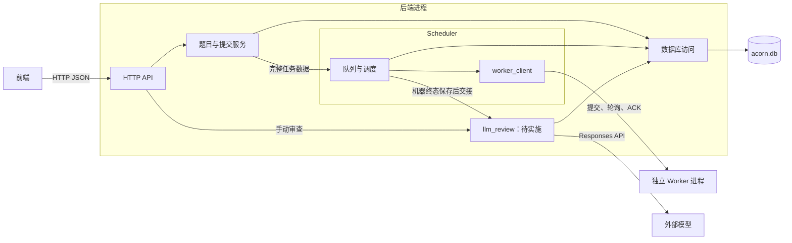

# 后端与 Scheduler 设计

状态：已确认，作为首版实现依据。

本文同步[LLM 代码审查设计](08-llm-code-review-design.md)的后端增量合同，llm_review、结构版本 3、审查 HTTP 字段与路由及相关配置和生命周期均已批准、待实施；当前程序仍为下述 P06–P10 与健康观测实现。LLM 的具体策略和实施验收以第 08 篇为依据，文档维护边界见[索引](README.md)。

实施进度：P06–P10 已完成配置、日志、SQLite 业务访问、开发用户预置、Scheduler、HTTP API，以及启动排队装入、旧在途中断、正常停机与故障退出。源码样例、真实单／双 Worker 联调和独立程序操作验收已完成，实际范围见[开发计划实施记录](04-development-plan.md#7-实施记录)。

## 1. 目标与范围

后端是单个 Rust 进程，内含 HTTP API、Scheduler 和数据库访问模块。前端通过 HTTP JSON 查询题目、提交单文件源码并轮询结果；Scheduler 通过 unary gRPC 向独立 Worker 推送任务、轮询状态和确认结果。

LLM 增量在同一进程增加与 Scheduler 平行的 llm_review 模块，机器判题后按固定题目版本自动触发，或由页面手动启动、重跑。审查只保存最近一次意见，不改变机器判题状态、verdict 或终态详情；请求沿用配置测试用户和既有访问范围，不新增管理员角色校验。

首版服务于 C 与 Python 3 判题闭环。题目、测试数据及一个测试用户由部署端本地预置；后端从配置读取该用户的 `user_id`，所有新提交归属于此用户。当前不启用登录、会话、角色鉴权或用户管理接口，请求不能覆盖提交归属。

前后端完全分离，后端仅提供 API，不托管前端静态文件，也不实现 CORS 中间件。HTTP 访问边界和浏览器跨域响应由部署端通过防火墙、反向代理及路由配置安排。

浏览器页面、Monaco 编辑、本地草稿和提交交互见[前端 GUI 设计](05-frontend-design.md)，实施见[前端开发计划](06-frontend-development-plan.md)。核心 GUI 与提交历史使用现有 API；F08 已按[健康观测设计](07-health-observation-design.md)完成 H01–H03 的 Worker 状态 RPC、共享采集、只读 HTTP 快照、入口监督及停机接线，页面及过期警告留在 H04。

执行规则以 [Worker 设计](01-worker-design.md)为准，存储结构以[数据库设计](02-database-design.md)和[建表 SQL](../sql/001-initial-schema.sql)为准。Scheduler 只有一个活动实例，与 API 一同启动和退出。

## 2. 技术选型与进程结构

| 用途 | 技术 |
| --- | --- |
| 实现语言 | Rust |
| HTTP | [Axum](https://docs.rs/axum/latest/axum/)，请求和响应使用 Serde / serde_json |
| 异步执行 | 一个 Tokio runtime，运行 HTTP、Scheduler、gRPC 和数据库异步调用 |
| Worker 客户端 | [Tonic](https://docs.rs/tonic/latest/tonic/) / Prost，依据 `acorn.worker.v1` 协议生成 |
| HTTP 中间件 | Tower 的 `ServiceBuilder` 组合中间件，tower-http 的 `TraceLayer` 记录请求日志 |
| 数据库 | SQLite，使用 [SQLx](https://docs.rs/sqlx/latest/sqlx/) 的 `runtime-tokio`、`sqlite` 特性，直接维护 SQL |
| LLM 客户端（待实施） | 复用 reqwest 异步客户端，Responses API 合同见[第 08 篇第 2 节](08-llm-code-review-design.md#2-api-兼容性核对) |
| 配置 | TOML，启动时读取并验证 |
| 日志 | tracing / tracing-subscriber，英文单行文本输出到 stderr |

具体依赖版本在实施时统一选择和锁定。随 SQLite 驱动构建的 SQLite 必须满足初始 SQL 对 STRICT 表和 JSON 函数的要求。



API 与 Scheduler 通过进程内调用和消息交接任务。Worker 客户端复用配置地址对应的 gRPC channel；连接复用不改变短 RPC、轮询取结果的业务模型。

## 3. 模块职责

模块先按后端程序内的 Rust module 组织，共同拥有一个进程生命周期。

| 模块 | 职责 |
| --- | --- |
| `http` | 路由、HTTP 请求与响应结构、请求大小限制、状态码和错误响应转换 |
| `problems` | 查询已发布题目的最新版本、题面和语言限额 |
| `submissions` | 创建幂等、固定版本、校验请求、保存源码、将任务交给 Scheduler、查询历史与结果 |
| `scheduler` | 有界内存队列、Worker 轮转选择、分派、轮询、终态保存和 ACK 编排 |
| `llm_review`（待实施） | 自动及手动接纳、独立有界队列与并发、模型调用、输出校验、最新审查保存及停止边界；分工见[第 08 篇第 3 节](08-llm-code-review-design.md#3-后端结构与责任边界) |
| `scheduler::worker_client` | Scheduler 子模块，封装判题三个 RPC 和只读状态 RPC、调用 deadline、Proto 与后端类型转换、传输错误分类；状态查询使用独立健康预算 |
| `database` | SQLx 共享连接池、参数绑定、短事务、条件状态更新和查询 |
| `health` | 本地接纳快照、共享有界探测、最近结果缓存及单调时钟过期投影；不参与业务决策 |
| `config` / `logging` | 启动配置校验和统一日志初始化 |
| 程序入口 | 组装共享句柄、完成启动检查、监督后台任务、处理退出 |

HTTP 请求与响应结构也称 DTO（Data Transfer Object，数据传输对象），例如创建请求的 `problem_id`、`language_id`、`source`，以及创建响应的 `submission_id`、`state`。它们定义对外 JSON 形状，在边界与 Worker Proto、数据库行分别转换。后端使用少量明确的数据类型表示任务和结果。

HTTP 层通过 `ServiceBuilder` 组合公共中间件，`TraceLayer` 统一记录方法、路径、状态码和耗时；请求体上限使用 Axum 的 `DefaultBodyLimit`。JSON 提取、路径与查询参数解析和路由拒绝均转换为第 5.4 节的错误结构。Worker 选择、任务去重和重新排队由 Scheduler 控制，gRPC deadline 由客户端设置。

完整任务包含 Submission ID、固定题目版本、语言、源码字节、有序用例和限额。源码从 HTTP 字符串按 UTF-8 编码，不调整换行、不裁剪内容；入库字节与发送给 Worker 的字节一致。

LLM 增量在创建及启动装入 JudgingTask 时携带固定版本的 review_mode，仅供后端判断自动门槛，不加入 Worker 请求或 Proto。llm_review 的队列只携带提交、审查身份及必要元数据，执行时独立读取源码、固定公开题面及 verdict。

业务 HTTP 查询读取数据库中的业务状态和结果。前端轮询不触发 Worker RPC；Worker 的阶段和逐点进度不写库，首版 HTTP 也不提供这些临时信息。

[`Health::start`](../crates/backend/src/health.rs) 接受健康配置、共享数据库和 Scheduler 句柄，从 Scheduler 取得现有客户端的廉价克隆；返回缓存句柄和由入口监督的任务。`Health::snapshot()` 只读缓存，`local_snapshot()` 读取创建服务停止标记及 Scheduler 短锁和信号量。`Health::stop()` 中断当前轮次或间隔，任务取消并等待本轮异步检查结束后返回；H03 已在入口启动唯一采集任务，并向 HTTP 共享创建服务、Scheduler 和 Health 句柄；受控及真实 Worker 测试夹具采用同一组装契约。采集周期、错误码和展示规则统一遵守[健康观测设计第 4 节](07-health-observation-design.md#4-后端观测来源与采集)。

## 4. 数据库访问与预置数据

API 与 Scheduler 共享一个 SQLx `SqlitePool`，首版固定 `max_connections = 1`，数据库访问依次使用该连接。SQLx 异步调用直接运行在后端已有的 Tokio runtime 内；SQLite 的阻塞调用由 SQLx 内部后台线程处理，见[运行时支持](https://docs.rs/sqlx/latest/sqlx/#runtime-support)和[SQLite 连接说明](https://docs.rs/sqlx/latest/sqlx/sqlite/struct.SqliteConnection.html)。

llm_review 复用该单连接池和 Tokio runtime。读取审查输入后先归还连接，再请求模型；模型网络等待不占用数据库连接、事务或 Scheduler 待接纳名额。

`Database::probe_read()` 复用该连接池和 `Database::observe` 的只读错误边界，执行 `SELECT id FROM users LIMIT 1` 的可选行查询，空表也成功。采集预算覆盖连接池等待及 SQL；超时不承诺底层 SQLite 同时停止，仍受既有有限 busy timeout 约束。普通读取错误只降低该次观测，实际返回的严重存储错误仍通知既有故障退出流程。

一个数据库操作使用一个连接，完成一次查询或一个短事务后归还；占用连接和事务均不能跨越 gRPC、模型 HTTP 调用或等待内存队列交接。创建提交仍使用 `BEGIN IMMEDIATE`；LLM 的结构和审查写入增量遵守[数据库设计](02-database-design.md)。连接显式启用 `foreign_keys` 并配置有限 busy timeout。使用参数绑定的普通 SQL 查询和类型映射。

服务使用已初始化的 `acorn.db`，启动时检查结构版本及配置引用，不自动修改已有结构或执行升级。

部署预置的测试用户必须存在，题目按数据库设计在事务内发布，包含至少一个用例和允许语言的正值预算。测试用户的密码哈希字段保留，当前后端不执行密码验证或生成登录凭据。

后端仍验证语言、用例数量、数据大小和限额：源码按 UTF-8 编码后的长度计量；输入、期望输出及总载荷按原始字节计量。HTTP 请求体、gRPC 消息和原始任务载荷各有独立上限。

内存限额从 SQLite `memory_kib`、配置 `request.max_run_memory_kib` 到 RPC `RunLimits.memory_kib` 统一使用 KiB，不进行字节除法。当前应用只接受结构版本 2，LLM 的 L01 将应用版本检查与完整初始 SQL 一同切换为 3；版本 2 → 3 由部署端使用单独交付的 SQL 离线升级，见[升级合同](08-llm-code-review-design.md#53-数据库升级职责)。后端与 Worker 需使用同一版 KiB 协议，LLM 增量不修改该协议；实际资源统计和结果字节字段的单位保持原契约。

同一版本的测试数据在一次任务装配中按 `case_index` 读取。正常新提交由 API 将内存中的完整任务直接交给 Scheduler，Scheduler 不再次读源码或题库。启动装入排队任务时才由 Scheduler 读取其固定版本数据。

P06 的 [`Database`](../crates/backend/src/database/mod.rs) 提供题目列表与版本查询、创建幂等查询、提交详情与筛选历史、完整固定版本任务装配，以及三个非终态条件更新、终态保存和旧在途中断写入。`create_submission` 在短事务内查重、固定版本并装配 `JudgingTask`，提交并释放连接后返回；待接纳名额由 [`CreationService`](../crates/backend/src/submissions/creation.rs) 预留，数据库层不等待队列。已有同键同内容记录保留原版本；仅 queued 记录返回可交接任务。`queued_tasks` 按顺序读取，并在超过配置容量时明确报错；P09 入口先调用旧在途中断与排队读取，Scheduler 在启动分派循环前装入全部任务及其名额。

终态先由 [`TerminalOutcome`](../crates/backend/src/submissions.rs) 按已知用例数和原始字节预算校验结果形状，再执行单条条件 UPDATE，同时原子提交状态、独立 verdict、JSON 详情和终态时间。P07 的 Worker 客户端校验完整响应的 Job ID、运行状态、阶段及进度与终态消息对应关系。数据库错误保留 SQLx 原始原因，业务查重与校验错误使用独立类型；P09 在数据库操作边界区分普通只读、关键写入与严重存储故障，通过共享通知保留首个致命错误并交给入口监督，通知不依赖 HTTP 等待者的生命周期。

配置示例见 [backend.example.toml](../config/backend.example.toml)。`scheduler.workers` 使用 Tonic endpoint URI；数据库路径相对于进程工作目录。HTTP 体积按源码最坏 JSON 转义开销预留，gRPC 门限按原始任务／结果另加协议空间校验，Base64 JSON 长度不复用二进制消息门限。入口完成配置、结构版本、预置用户检查和启动任务处理后，启动 Scheduler、共享健康采集及 HTTP 服务，不要求 Worker 启动时即可连接；新任务的实际接纳和失联仍按第 7 节处理。

## 5. HTTP 接口

接口使用 HTTP JSON、HTTP 头中的幂等键及 UTF-8 源码。

### 5.1 路由与查询

| 方法与路径 | 行为 |
| --- | --- |
| `GET /api/v1/problems` | 返回已发布题目列表，只展示最新版本 |
| `GET /api/v1/problems/{id}` | 返回最新版本的题号、版本号、标题、题面和可提交语言及限额 |
| `GET /api/v1/problems/{id}/versions/{version_no}` | 返回指定已发布版本的同类信息；GUI 结果页按提交固定版本查询，答题页仍取最新版本 |
| `POST /api/v1/submissions` | 创建提交，或取得同键的已有提交 |
| `POST /api/v1/submissions/{id}/review`（待实施） | 手动启动或重跑最近一次 LLM 审查，不重新执行 Worker |
| `GET /api/v1/submissions/{id}` | 返回提交身份、固定版本、语言、业务状态、判题结论、终态详情与时间戳 |
| `GET /api/v1/submissions` | 返回配置测试用户的提交历史，可按题号、机器状态和 verdict 筛选；LLM 增量新增 review_status 筛选 |
| `GET /api/v1/health` | 读取本地接纳、Scheduler 及共享数据库与 Worker 观测缓存，返回 `200` 和 `Cache-Control: no-store`；字段见[健康契约](07-health-observation-design.md#5-http-契约与可见范围) |

健康 GET 不执行 SQL 或 Worker RPC；`failed`、`stale`、`full` 和 `stopping` 均作为响应中的组件状态，组装失败沿用 `500 InternalError`。返回后端 UTC 组装时间及各项实际完成时间，不包含内部地址、数据库路径或原始异常。

列表使用 `limit`、`offset`，默认页长和最大页长由配置提供。题目按题号排序，历史按 `created_at_ms DESC, id DESC` 排序；列表不附带源码、题面正文或终态诊断。题目查询不返回测试输入和答案。

两个列表的顶层 JSON 均为 `{"items":[...],"limit":20,"offset":0}`，`limit` 是生效的页长，`offset` 默认 0，不额外计算总条数。题目列表项包含 `problem_id`、`version_no`、`title`；题目详情增加 `statement` 和 `languages`，每个语言项包含 `language_id`、`cpu_time_ms`、`wall_time_ms`、`memory_kib`。提交历史项采用第 5.3 节的身份、状态、结论和时间戳字段，省略 `terminal_details`。请求字段、分页及筛选参数不接受未规定字段。

LLM 增量在最新及显式版本的题目详情新增 review_mode，提交历史项新增 review_status，不携带 review 详情。历史 review_status 允许 DISABLED、PENDING、DOUBTFUL、PASS、FAILED，省略表示全部；与 problem_id、state、verdict 按 AND 组合后排序和分页，非法值返回 InvalidRequest。提交详情的审查字段见第 5.3 节。

`statement` 是 Markdown 源文，后端按字符串返回，不预渲染 HTML。GUI 按[题面展示规则](05-frontend-design.md#32-答题页面)解析并禁用内嵌 HTML；公开样例写在题面中，不由测试用例接口提供。

题目列表和默认详情使用最新版本；显式版本接口可查询仍保留的已发布版本，题号与版本不匹配或不存在时返回 `404`。它不改变创建提交的版本选择，新提交仍只接受题号并选取最新版本。提交中的版本号来自创建时的固定记录，结果展示和失败用例定位不得改用题目的最新版本。

### 5.2 创建提交

```http
POST /api/v1/submissions
Content-Type: application/json
Idempotency-Key: 7b5f28d3-51a4-463c-98a4-0a11815d8d46
```

```json
{
  "problem_id": 1,
  "language_id": "c",
  "source": "int main(void) { return 0; }\n"
}
```

`Idempotency-Key` 必填，格式为随机 UUID。请求只接受上述业务字段；用户、题目版本、测试数据、限额和执行参数由服务端确定。

新提交返回 `202 Accepted`，同键同内容返回 `200 OK`，均包含 `submission_id`、`state`，并通过 `Location` 指向提交查询地址。响应只确认业务提交已保存并交给本地队列，不等待 Worker 空闲或判题结束。

同键内容比较使用题号、语言及 UTF-8 编码后的源码字节；冲突返回 `409 IdempotencyConflict`。重复请求不重新选版本、不创建新 ID、不重新执行已经分派或结束的任务。客户端断开或丢失响应不撤销提交。

### 5.3 提交详情与判题结果

提交查询使用数据库的 `queued`、`dispatching`、`running`、`finished`、`failed` 状态，`verdict` 独立返回。终态详情作为类型化对象返回，字节字段使用 Base64；不向前端返回双重编码的 JSON 字符串。

`GET /api/v1/submissions/{id}` 返回以下字段。这些是 HTTP 响应字段：`submission_id` 对应数据库的 `submissions.id`，`terminal_details` 对应解析后的 `terminal_details_json`，不新增同名数据库列。

| 字段 | 内容 |
| --- | --- |
| `submission_id` | UUID 字符串 |
| `problem_id`、`version_no`、`language_id` | 创建时固定的执行对象 |
| `state` | 持久化业务状态 |
| `verdict` | 判题结论，未取得判题结论时为 `null` |
| `terminal_details` | 终态详情对象；运行中和 AC 时为 `null` |
| `created_at_ms`、`terminal_at_ms` | UTC Unix 毫秒；终态时间尚无时为 `null` |
| `review_status`（待实施） | 独立审查状态，DISABLED / PENDING / DOUBTFUL / PASS / FAILED |
| `review`（待实施） | 可空对象，返回审查 ID、触发来源、时间、模型、有效意见或稳定错误；具体合同见[第 08 篇第 8.1 节](08-llm-code-review-design.md#81-接口) |

运行中 `verdict` 和终态详情为空；AC 仅有结论；CE 带编译诊断和截断标记；WA、RE、TLE、MLE、OLE 只带首个失败用例；执行失败带 `code` 和有界 `diagnostic`。缺失的用例和统计保持缺失，不构造占位数据。

CE 的 `terminal_details` 使用 `compile_diagnostic_base64`、`compile_diagnostic_truncated`。用例失败使用 `failed_case` 对象，含 `case_index`、`stdout_base64`、`stderr_base64`、两个截断标记，以及可选的 `resources`、`exit_code` 或 `signal`。资源字段保持 Worker 的微秒和字节单位；未提供的字段省略，退出码和信号至多存在一种。

查询到判题失败仍返回 `200 OK`，由业务状态和结果描述失败。执行失败详情中的 `code` 属于任务结果，不是 HTTP 错误码。

review 独立于 terminal_details，机器 AC 仍要求 terminal_details 为 null。审查 DOUBTFUL 或 FAILED 同样作为 GET 的正常业务数据返回 200，不把审查失败当作机器执行失败。prompt_version、raw_output_json、endpoint、密钥、完整 API 正文和思考链不进入前端 DTO。

### 5.4 HTTP 错误规约

错误结构采用 `{"error":{"code":"QueueFull","message":"The submission queue is full."}}`。`code` 稳定供前端判断，`message` 为英文，具体措辞可以改进。HTTP 错误只描述当前 HTTP 操作未能完成。

HTTP `error.code` 如下，标注 LLM 的新增项待实施；增加错误码时须先更新此表：

| `error.code` | HTTP 状态码 | 条件 |
| --- | --- | --- |
| `InvalidRequest` | `400` | JSON、路径或查询参数格式错误，必填值缺失、源码为空、出现未允许字段或分页与筛选值无效 |
| `InvalidIdempotencyKey` | `400` | 创建请求缺失 `Idempotency-Key`，或键不符合 UUID 格式 |
| `UnsupportedMediaType` | `415` | POST 请求未使用 JSON Content-Type |
| `RequestTooLarge` | `413` | HTTP 请求体超过上限 |
| `SourceTooLarge` | `413` | 源码按 UTF-8 编码后超过字节上限 |
| `UnsupportedLanguage` | `422` | 请求的语言不是首版支持的 C 或 Python |
| `LanguageNotAllowed` | `422` | 题目最新版本未允许请求语言 |
| `ProblemNotFound` | `404` | 题目不存在或尚无已发布版本 |
| `ProblemVersionNotFound` | `404` | 指定题目下不存在该已发布版本 |
| `SubmissionNotFound` | `404` | 提交不存在 |
| `IdempotencyConflict` | `409` | 同一用户的同一幂等键携带不同题目、语言或源码 |
| `QueueFull` | `503` | 当前没有待接纳名额 |
| `JudgingNotFinished`（LLM） | `409` | 手动审查的机器 state 不是 finished |
| `ReviewChanged`（LLM） | `409` | 手动接纳时最新审查 ID 与 expected_review_id 不同，需先取得最新快照 |
| `ReviewUnavailable`（LLM） | `503` | 审查服务未启用或不可接纳 |
| `ReviewQueueFull`（LLM） | `503` | 独立审查队列没有待执行名额 |
| `BackendStopping` | `503` | 后端已停止接纳新提交；LLM 增量也用于停止后的手动审查请求 |
| `RouteNotFound` | `404` | API 路径不存在 |
| `MethodNotAllowed` | `405` | 路径存在但不支持该 HTTP 方法 |
| `InternalError` | `500` | 数据库访问、预置任务数据或当前操作发生内部错误 |

已有排队提交因没有名额而无法再次交接时，`QueueFull` 的 `error` 对象额外携带 `submission_id`，指向原提交；其他错误省略该字段。内部 SQL、宿主路径和原始传输异常只写日志，不直接用作 `error.code` 或 `message`。框架及中间件的错误响应也遵守本节。

数据库操作失败是否同时触发后端退出，按[第 8.3 节](#83-数据库及后台故障)区分普通只读失败、关键写入失败与严重存储故障。

### 5.5 手动审查（待实施）

POST review 的 JSON 必须携带最近一次 GET 取得的 expected_review_id，尚无审查时为 null。仅机器 state=finished 可启动，包括 CE、零通过及题目禁用自动审查的情况；不满足自动门槛不限制手动触发。

按[第 08 篇第 8.1 节](08-llm-code-review-design.md#81-接口)处理服务状态、PENDING 合并、预期 ID 和队列名额：已有 PENDING 返回 200 并复用同次审查，新接纳返回 202，包含 submission_id、review_status 和 review，Location 指向提交详情。新一轮覆盖上次审查，机器结果保持不变。GET 只读快照；自动触发直接走进程内交接。

llm_review 在短接纳操作开始时登记其生命周期，复用创建服务的组织方式；HTTP 处理器只等待结果。客户端超时、取消、关页或断连不取消已登记的事务处理、提交后交接或按停止及错误合同收尾；入队后的审查独立运行，正常停机等待这些短操作结束。

## 6. 提交创建与进程内交接

1. 校验 HTTP 请求、幂等键和源码大小，用配置中的测试用户确定归属。
2. 先查 `(user_id, create_request_key)`。已有记录按既定内容比较规则返回；只有仍为 `queued` 且未在内存中的记录需要重新交接。
3. 新建前原子预留一个待接纳名额，满时返回 `503`，不创建 Submission。预留只在内存中记录，不是数据库记录或 Worker 执行资源。
4. 在 `BEGIN IMMEDIATE` 短事务中再次查重，处理同时到来的同键请求。确实为新提交时，选取最新版本，装配并验证测试数据和限额，生成 UUID，插入 `queued` 记录和源码；竞争中发现已有记录时返回原记录并释放多余预留。
5. 数据库提交成功后，用已预留的名额将完整任务交给 Scheduler，再完成创建响应。回滚或校验失败释放预留。

创建服务拥有事务与入队这一短操作的生命周期，HTTP 处理器只等待它的结果。客户端断开后，已经开始的创建操作仍完成事务处理和提交后的入队；响应无人接收不撤销已保存的 Submission。正常停机等待这些操作结束，不把交接是否完成绑定到 HTTP 连接存续时间。

进程可能在数据库提交后、入队前崩溃；该提交仍为 `queued`，下次启动装入队列。数据库与内存交接不具有跨介质原子性，首版以启动装入和同键重传覆盖这一边界。

重复投递按 Submission ID 合并。终态记录的重复创建响应不占排队名额，即使队列已满也可以返回原提交。已有 `queued` 记录因队列满而无法再次交接时，返回带原 Submission ID 的 `503`，保留该排队记录。

## 7. Scheduler

### 7.1 内存状态与分派策略

P07 的实现位于 [`scheduler`](../crates/backend/src/scheduler/mod.rs)，短同步锁保护 FIFO 与按 ID 去重的本地记录；Worker 缓存由单个调度循环持有，各任务的 RPC 跟踪在独立 Tokio 任务中执行并回送完成事件，见 [`tracking`](../crates/backend/src/scheduler/tracking.rs)。数据库访问和网络等待均在锁外执行。

Scheduler 保存 FIFO 待接纳队列、按 Submission ID 去重的记录、当前提交到 Worker 地址的映射，以及各 Worker 的可用状态缓存。Worker 地址来自配置，上述调度状态不落库。

队列上限包含创建中的预留、排队任务和等待 `SubmitJob` 接纳确认的任务。Worker 明确接纳后归还该名额；明确忙而退回队列时继续占用原名额，避免重入队时挤占已经释放的空间。

实现使用 `Arc<tokio::sync::Semaphore>`，初始许可数等于待接纳上限。创建前通过 `try_acquire_owned()` 取得许可，无许可时立即返回 QueueFull；`OwnedSemaphorePermit` 随创建操作、排队任务和等待接纳的任务转移。明确接纳、本地失败、事务回滚或重复投递合并时释放相应许可，忙时重新排队继续持有。信号量作为唯一名额计数，启动装入的每条 queued 记录也持有一个许可，见 [Tokio 信号量](https://docs.rs/tokio/latest/tokio/sync/struct.Semaphore.html)。

每个 Worker 缓存以下本地状态：

| 状态 | 含义与变化 |
| --- | --- |
| 可尝试 | 当前无本地在途分派，且再次尝试时间已到；启动时各地址为此状态 |
| 本地占用 | 已为一个任务选定该地址，缓存其 Job ID；本次分派或跟踪结束后清除 |
| 暂缓尝试 | 收到忙、结果区满、停机拒绝，或提交、查询通信失败后，缓存下一次允许尝试时间；配置间隔到达后转为可尝试 |

在可尝试的 Worker 中按轮转顺序选择，选中后先标记本地占用。不同 Submission 可在不同 Worker 同时执行；同一 Worker 只有一个本地在途分派，同一 Job 的阶段和用例始终由 Worker 串行执行。

明确因忙、结果区满或停机而未接纳的任务退回队首，目标 Worker 转为暂缓尝试。重新入队后立即触发选择：有其他可尝试 Worker 就直接分派，不等待刚刚拒绝的节点。新任务入队、在途完成和再次尝试时间到达也触发选择；这些操作只检查内存，不轮询数据库任务队列。

缓存根据现有提交、查询和 ACK 调用结果更新，不为分派增加前置状态探测；F08 的独立健康观测不更新该缓存。终态已保存且一次 ACK 调用已结束时，节点重新可尝试；明确非法请求保存失败后也释放本地占用。提交或查询失败而结束本地跟踪时，节点进入暂缓尝试。这一间隔只约束该地址接收后续新任务，不延后当前失败终态，也不重新执行旧任务。

可尝试表示可以向该节点发起提交，不能证明远端确实空闲；旧任务可能还在执行，结果区也可能已满。最终以 `SubmitJob` 的接纳或拒绝为准，缓存不提供实时状态保证。

### 7.2 分派与轮询

| 事件 | 持久化与动作 |
| --- | --- |
| 选择任务和 Worker | 条件更新 `queued → dispatching`，提交事务后记录内存路由，再调用 `SubmitJob` |
| 条件更新影响 0 行 | 丢弃过期内存任务，归还待接纳名额和本地占用，不发送 RPC |
| 接纳成功或已存在同 ID | 条件更新 `dispatching → running`，对同地址、同 ID 调用 `GetJob` |
| 明确忙、结果区满或停机且未接纳 | 条件更新回 `queued`，清除本次路由，将任务放回队首，暂缓该节点并立即尝试其他候选 Worker |
| 明确非法请求 | 保存 `failed`，记录 Worker 拒绝原因，归还待接纳名额并释放本地占用 |
| 提交超时或断连，接纳情况不明 | 只做一次有界 `GetJob`；有记录则继续跟踪，终态则保存；不存在或无法确认则保存失败 |
| 正常轮询失败或记录不存在 | 立即保存失败，结束本次跟踪，不向其他 Worker 重交该任务 |
| `GetJob` 返回运行状态 | 按配置间隔继续查询，阶段和进度不落库 |
| `GetJob` 返回终态 | 校验结果，持久化终态，提交成功后调用 ACK |

gRPC deadline 覆盖单次提交、查询或 ACK；不启用应用层自动重发提交或对冲调用。只对明确未接纳的任务重新分派；状态不明或已执行任务不自动重试。

首版一个 Submission ID 就是一个 Job ID。`SubmitJob` 返回重复记录时，继续查询该记录，不生成第二个 ID。所有 RPC 响应须与所查询 ID 对应。

后端保存的通信与协议失败代码为 `WorkerUnavailable`（通信故障或无法确认）、`WorkerJobNotFound`（查询明确无记录）和 `InvalidWorkerResponse`（身份、状态、阶段、进度或终态形状违反协议）。明确非法请求保存 Worker 的 `InvalidJob`／`UnsupportedLanguage` 原因；Worker 自身返回的合法失败终态保留其代码。诊断按配置限制 UTF-8 字节。无效响应保存失败，不视为已经通过校验的远端终态，不发送 ACK。

### 7.3 保存结果与 ACK

在后端校验 Worker 终态的基本协议形状：状态与消息对应、结论有效、AC/CE 没有失败用例、用例级错误有且仅有首个失败用例且序号在本任务范围内、输出不超限。未知统计保持缺失，不重新运行程序或重新比较输出。

`finished` 与 `failed` 的写入使用 `WHERE state IN ('dispatching','running')`，在同一事务中保存状态、独立 verdict、详情和终态时间。终态时间是后端保存时刻。

LLM 增量按固定版本 review_mode 与已校验机器结果判断门槛，在上述首次终态写入中同时保存审查初态。独立名额预留、未生效时释放、提交后交接及交接失败处理遵守[第 08 篇第 7.1 节](08-llm-code-review-design.md#71-自动交接)。重复终态、ACK 失败、同键重传和后端重启不重复自动触发。审查的外部网络等待不进入判题跟踪或 ACK 流程。

事务提交并归还数据库连接后立即调用 `AcknowledgeResult`，不等待审查交接、交接失败的状态写入或模型请求。ACK 失败仅记录警告，不回滚数据库、不重判；首版不建立自动 ACK 重试循环或持久确认队列。Worker 已返回终态且本次 ACK 调用已结束后，释放本地在途记录和路由，再继续自动审查交接；ACK 失败不跳过该交接。审查交接及收尾写入不再持有 Scheduler 对该 Worker 的本地占用。

迟到结果不能覆盖已保存失败；如果在本次仍有路由的处理流程中拿到旧终态，可丢弃内容并 ACK。任务跟踪结束后，不额外扫描旧 Worker 查找迟到结果。

## 8. 启动、停机与故障

### 8.1 启动

1. 加载并校验 TOML，初始化日志；检查至少一个且不重复的 Worker 地址、正值门限和配置测试用户。
2. 打开已初始化的数据库，检查结构版本，启用外键和数据库连接配置。
3. 将 `dispatching` 和 `running` 记录保存为 `failed / SchedulerInterrupted`，已有终态不变。
4. 检查现有 `queued` 数量不超过待接纳上限，按 `created_at_ms, id` 装入完整任务；超限报错退出，由部署端调整上限。
5. 创建 Worker 客户端句柄，启动 Scheduler、共享健康采集和 HTTP 服务；全部启动检查成功后才接纳 HTTP 提交。健康缓存初始可为 `unknown`，无需等待首轮探测成功。

LLM 增量在接纳请求前将遗留 PENDING 保存为 FAILED/ReviewInterrupted，保留原 ID 和请求元数据、补完成时间，不补投模型请求；启动并监督审查模块，与现有判题启动处理共同由入口编排。

排队任务继续调度；在途旧任务不恢复、不重交、不补发 ACK。没有 Worker 可立即接纳时，排队任务留在内存等待候选地址下次可用。

### 8.2 正常停机

收到退出信号后，停止接纳新提交和启动新分派。已经开始的创建流程完成数据库与本地交接；尚未分派的任务保留 `queued`，下次启动再装入。

创建服务在启动短操作时登记接纳边界。已登记的操作即使尚在写事务前的幂等查询，也允许在停止新接纳后继续尝试预留名额并交接；队列容量限制仍然生效。等待期间 HTTP 查询继续可用，新创建请求返回 `503 BackendStopping`。

等待已经分派的任务完成正常跟踪、结果保存和一次有 deadline 的 ACK 调用，再关闭 HTTP，通知健康采集停止并等待其结束，最后关闭 SQLx 连接池和日志。等待业务收尾期间，健康采集及健康 HTTP 查询继续可用。明确未接纳而退回队列的任务不再分派。停止后端不向 Worker 发送远程取消请求。

LLM 增量收到停止信号即关闭手动和自动审查接纳，取消未完成审查并按本次 ID 保存 FAILED/ReviewInterrupted；停止前已开始的短接纳操作允许收尾。停止后到达且满足自动门槛的机器终态，在保存机器结果的同一事务中直接写入 FAILED/ReviewInterrupted，不再入审查队列。关闭 HTTP 和数据库前等待本地审查收尾，不等待远端模型执行完成；详细停止边界见[第 08 篇第 7.3 节](08-llm-code-review-design.md#73-启动停机与异常)。

被强制终止时，下次启动仍按第 8.1 节处理，不承诺这一次等待完成。

### 8.3 数据库及后台故障

连接配置有限 `busy_timeout_ms`，对 SQLite 支持的锁竞争先有限等待。运行期普通只读操作失败时，记录英文错误，当前 HTTP 操作返回 `500 InternalError`，后端继续运行。此规则覆盖题目、提交历史和结果查询，以及创建写事务开始前的幂等查询；例如查询锁等待耗尽或连接池等待超时。这类失败可能随锁释放或负载回落而恢复，单次失败不作为进程退出依据。健康读取探测的普通失败只更新缓存，健康 HTTP 读取该缓存仍返回 `200`。

关键写入包括创建提交的写事务开始、执行和提交，业务状态转换、终态保存，以及启动时旧在途记录的中断写入。上述操作发生数据库错误，经过适用的有限锁等待仍无法完成时，记录英文错误并触发故障退出；未成功保存的结果不 ACK，也不能声称已将任务保存为失败。预期的查重与业务校验错误正常返回，不触发进程退出。

LLM 增量的审查接纳、完成和中断写入同属关键数据库写入；审查调度任务意外结束按入口监督规则故障退出。普通外部 API 失败只结束本次审查，不触发后端退出；下次启动按审查中断规则处理遗留 PENDING。

明确的磁盘满、I/O 故障和数据库损坏等严重存储故障，无论发生在读取还是写入时，均触发故障退出，不适用普通只读失败的继续运行规则。

有限等待是 SQLite 的连接机制，不是重新执行判题。其行为及与其他错误的区别见 [busy timeout](https://www.sqlite.org/c3ref/busy_timeout.html)与[结果码说明](https://www.sqlite.org/rescode.html)。

Scheduler 后台任务意外退出交给程序入口记录错误并触发故障退出，避免 HTTP 继续接纳而没有实际调度。SQLx 操作错误按上述操作类型和故障性质处理，不将所有 SQLx 错误统一视为致命故障。健康采集任务本身异常结束时，入口记录错误而继续判题服务，不自动重建任务，已有观测随后按单调年龄投影为 `stale`；严重数据库故障仍遵守既有退出规则。

故障退出时立即停止接纳新提交和启动新分派，同时通知健康采集停止；等待已开始的短创建操作完成事务处理及收尾后，结束其余本地任务跟踪，等待健康采集结束后退出后端，不等待其他 Worker 完成判题。未成功保存的结果不 ACK，Worker 侧仍可能继续执行并受其本地限额约束。该路径与第 8.2 节正常停机的完整在途等待区分。

故障退出不进入通用自动重试或修复循环。部署修复并重启后按第 8.1 节处理已有记录。此策略定义首版错误边界，后续改变恢复要求时单独设计。

## 9. 配置与日志

后端启动时读取一份 TOML，修改后通过重启生效。配置至少包含：

| 类别 | 配置内容 |
| --- | --- |
| HTTP | 监听地址、请求体上限、列表默认及最大页长 |
| 数据库 | `acorn.db` 路径、有限 `busy_timeout_ms` |
| 测试用户 | 已预置的 `user_id` |
| Scheduler | 待接纳上限、Worker 地址列表、轮询间隔、拒绝后再次尝试间隔 |
| gRPC | 提交、查询和 ACK deadline，发送与接收消息上限 |
| 健康观测 | `[health]` 的 `interval_ms` 和 `timeout_ms`，缺省分别为 5_000 和 1_000；均为正值，派生过期阈值 `2 * (interval_ms + timeout_ms)` 必须不溢出 |
| LLM 审查（待实施） | 可缺省的 `[llm_review]`，缺省不启用；endpoint、密钥、模型、思考强度、独立并发与队列名额、HTTP/token/字节预算见[第 08 篇第 9 节](08-llm-code-review-design.md#9-后端配置预算与错误) |
| 任务校验 | 源码、用例数、单个输入和答案、合计字节、运行时间及内存的允许上限 |
| 结果与日志 | 有界诊断及输出约定、日志级别 |

API 上限与部署的 Worker 规约对齐，Base64 结果和 JSON 请求开销单独计量。配置不从 Worker 动态发现，不协商能力，不自动放宽限额。

日志统一为英文、可读的单行文本，记录提交 ID、题号、语言、Worker 地址、操作和错误原因。创建、分派、终态保存和停机记录为 info；明确拒绝和 ACK 失败为 warn；数据库与后台故障为 error；重复请求和普通轮询为 debug。日志不输出完整源码、测试数据或无界程序输出。

LLM 配置同样只由后端 TOML 读取，正式程序不加载开发用 .env。审查日志字段和保密边界遵守第 08 篇第 9、11 节；未启用时手动请求返回 ReviewUnavailable，满足自动门槛的审查保存 FAILED/ReviewUnavailable，停机时优先使用 ReviewInterrupted。

LLM 的完整落库详情固定上限为 32 KiB，按序列化后的 UTF-8 字节计量；错误 message 使用后端固定英文说明，最多 512 UTF-8 字节，不新增配置项。完整意见或诊断对象仍各自受 16 KiB 上限约束，组装规则见[第 08 篇第 5.2 节](08-llm-code-review-design.md#52-最近一次详情)。响应读取超过 max_response_bytes（默认 1 MiB）或组装详情超出总预算时，本次审查保存 FAILED/ReviewInvalidOutput；该错误属于审查结果，不是新增 HTTP 错误码。

## 10. 最小验证范围

测试覆盖以下主要且可重复的流程；失败路径用可控的返回值验证既定行为，不刻意构造小概率、难以复现的时序窗口或故障组合。只为实际发现的问题补充回归测试。

- C 和 Python 各完成一次从 HTTP 创建、进程内排队、gRPC 执行到结果查询的真实闭环；AC、CE 和首个失败用例的返回遵守既有契约。
- 同键重传只有一个 Submission，冲突明确报错，题目更新后原提交仍固定原版本。
- 默认题目查询返回最新版本，显式版本接口可查旧版本；新提交仍不接受指定旧版本。
- 队列满时新请求不创建记录；重复已知提交能返回；明确忙后任务退回队首，有其他候选 Worker 时立即分派；跨 Worker 同时执行不同提交不改变单 Job 串行规则。
- 提交响应不明只查询一次；失联后保存失败且不重交；数据库终态提交早于 ACK，ACK 失败不改变终态。
- 后端重启继续装入 `queued`，将旧在途记录保存失败，不联系旧 Worker；启动排队超限和关键数据库故障按约定退出。
- 正常停机完成在途处理，排队记录留至下次启动。

LLM 新增合同按[第 08 篇 L01–L06](08-llm-code-review-design.md#10-实施顺序与有限验收)独立验证；上述已完成的判题检查不作为审查功能已交付或已验收的证据。
