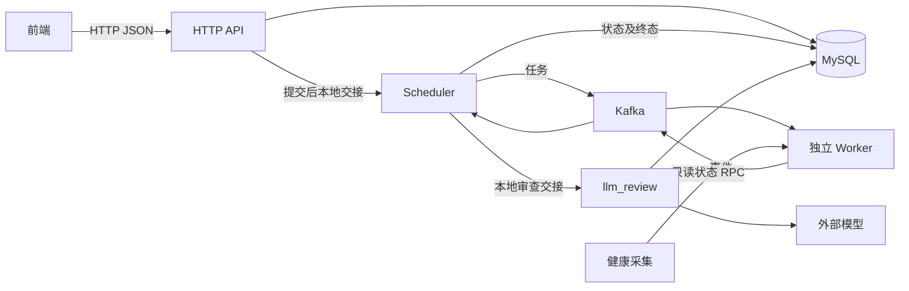

# 后端与 Scheduler 设计

本文定义 HTTP、Scheduler、共享数据库、健康采集及服务生命周期的职责和合同。自动及手动 LLM 审查的策略、独立队列、最新意见及页面合同见[LLM 代码审查设计](08-llm-code-review-design.md)。

MySQL 的连接、配置、事务和故障合同以[迁移设计](09-mysql-migration-design.md)为依据；迁移实际过程和检查结果见[实施记录](d02-execution/09-mysql-migration-execution.md)。

## 1. 目标与范围

后端是单个 Rust 进程，内含 HTTP API、Scheduler 和数据库访问模块。前端通过 HTTP JSON 查询题目、提交单文件源码并轮询结果；Scheduler 通过 Kafka 发布任务和消费 Worker 事件；gRPC 仅用于只读状态观测。

LLM 增量在同一进程增加与 Scheduler 平行的 llm_review 模块，机器判题后按固定题目版本自动触发，或由页面手动启动、重跑。审查只保存最近一次意见，不改变机器判题状态、verdict 或终态详情；请求沿用配置测试用户和既有访问范围，不新增管理员角色校验。

首版服务于 C 与 Python 3 判题闭环。题目、测试数据及一个测试用户由部署端本地预置；后端从配置读取该用户的 `user_id`，所有新提交归属于此用户。当前不启用登录、会话、角色鉴权或用户管理接口，请求不能覆盖提交归属。

前后端完全分离，后端仅提供 API，不托管前端静态文件，也不实现 CORS 中间件。HTTP 访问边界和浏览器跨域响应由部署端通过防火墙、反向代理及路由配置安排。

浏览器页面、Monaco 编辑、本地草稿和提交交互见[前端 GUI 设计](05-frontend-design.md)，实施见[前端开发计划](06-frontend-development-plan.md)。健康观测通过数据库读取、Kafka metadata、Worker 状态 RPC、后端共享采集及只读 HTTP 快照提供页面数据；入口监督、停机、健康页面和过期警告遵守[健康观测设计](07-health-observation-design.md)。

执行规则以 [Worker 设计](01-worker-design.md)为准，存储结构以[数据库设计](02-database-design.md)和[建表 SQL](../sql/001-initial-schema.sql)为准。Scheduler 只有一个活动实例，与 API 一同启动和退出。

## 2. 技术选型与进程结构

| 用途          | 技术                                                                                                                                                   |
| ------------- | ------------------------------------------------------------------------------------------------------------------------------------------------------ |
| 实现语言      | Rust                                                                                                                                                   |
| HTTP          | [Axum](https://docs.rs/axum/latest/axum/)，请求和响应使用 Serde / serde_json                                                                           |
| 异步执行      | 一个 Tokio runtime，运行 HTTP、Kafka 服务、状态 gRPC 和数据库异步调用                                                                                  |
| Worker 客户端 | [Tonic](https://docs.rs/tonic/latest/tonic/) / Prost，依据 `acorn.worker.v1` 协议生成                                                                  |
| HTTP 中间件   | Tower 的 `ServiceBuilder` 组合中间件，tower-http 的 `TraceLayer` 记录请求日志                                                                          |
| 数据库        | MySQL 8.4／InnoDB，使用 [SQLx 0.9.0](https://docs.rs/sqlx/0.9.0/sqlx/) 的 `runtime-tokio`、`mysql`、`mysql-rsa` 特性，直接维护 SQL                     |
| LLM 客户端    | 复用 reqwest 0.13.5 异步客户端，固定 json_schema、无重试和重定向，Responses API 合同见[第 08 篇第 2 节](08-llm-code-review-design.md#2-api-兼容性核对) |
| 配置          | TOML，启动时读取并验证                                                                                                                                 |
| 日志          | tracing / tracing-subscriber，英文单行文本输出到 stderr                                                                                                |

依赖版本由 Cargo.lock 锁定。数据库初始化会话及应用连接设置 utf8mb4_0900_bin 和严格模式，保留外键、CHECK 和原始字节存储；后端连接显式禁用 MySQL SSL。



API 与 Scheduler 通过进程内调用交接任务；Kafka 负责跨进程任务分配和事件传递。配置地址对应的 gRPC channel 仅供健康采集，不驱动分配或判定机器失败。

## 3. 模块职责

模块先按后端程序内的 Rust module 组织，共同拥有一个进程生命周期。

| 模块                       | 职责                                                                                                                                                                                         |
| -------------------------- | -------------------------------------------------------------------------------------------------------------------------------------------------------------------------------------------- |
| `http`                     | 路由、HTTP 请求与响应结构、请求大小限制、状态码和错误响应转换                                                                                                                                |
| `problems`                 | 查询已发布题目的最新版本、题面和语言限额                                                                                                                                                     |
| `submissions`              | 创建幂等、固定版本、校验请求、保存源码、将任务交给 Scheduler、查询历史与结果                                                                                                                 |
| `scheduler`                | 有界本地队列及许可、Kafka 任务发布、事件持久化和审查交接                                                                                                                                     |
| `llm_review`               | 自动及手动接纳、独立有界队列与并发、模型调用、输出校验、最新审查保存及停止边界；监督手动短操作并在停机时等待收尾；分工见[第 08 篇第 3 节](08-llm-code-review-design.md#3-后端结构与责任边界) |
| `scheduler::worker_client` | 只读 Worker 状态客户端、健康 deadline、消息预算和快照校验，不选择执行节点                                                                                                                    |
| `database`                 | SQLx 共享连接池、参数绑定、短事务、条件状态更新和查询                                                                                                                                        |
| `health`                   | 本地接纳快照、共享有界探测、最近结果缓存及单调时钟过期投影；不参与业务决策                                                                                                                   |
| `config` / `logging`       | 启动配置校验和统一日志初始化                                                                                                                                                                 |
| 程序入口                   | 组装共享句柄、完成启动检查、监督后台任务、处理退出                                                                                                                                           |

HTTP 请求与响应结构也称 DTO（Data Transfer Object，数据传输对象），例如创建请求的 `problem_id`、`language_id`、`source`，以及创建响应的 `submission_id`、`state`。它们定义对外 JSON 形状，在边界与 Worker Proto、数据库行分别转换。后端使用少量明确的数据类型表示任务和结果。

HTTP 层通过 `ServiceBuilder` 组合公共中间件，`TraceLayer` 统一记录方法、路径、状态码和耗时；请求体上限使用 Axum 的 `DefaultBodyLimit`。JSON 提取、路径与查询参数解析和路由拒绝均转换为第 5.4 节的错误结构。任务去重、发布重试和事件处理由 Scheduler 控制；状态 RPC 使用健康采集预算。

完整任务包含 Submission ID、固定题目版本、语言、源码字节、有序用例和限额。源码从 HTTP 字符串按 UTF-8 编码，不调整换行、不裁剪内容；入库字节与发送给 Worker 的字节一致。

LLM 增量在创建及启动装入 JudgingTask 时携带固定版本的 review_mode，仅供后端判断自动门槛，不加入 Worker 请求或 Proto。llm_review 的队列只携带提交、审查身份及必要元数据，执行时独立读取源码、固定公开题面及 verdict。

业务 HTTP 查询读取数据库中的业务状态和结果。前端轮询不触发 Worker RPC；Worker 的阶段和逐点进度不写库，首版 HTTP 也不提供这些临时信息。

[`Health::start`](../crates/backend/src/health.rs) 接受健康配置、共享数据库和 Scheduler 句柄，从 Scheduler 取得现有客户端的廉价克隆；返回缓存句柄和由入口监督的任务。`Health::snapshot()` 只读缓存，`local_snapshot()` 读取创建服务停止标记及 Scheduler 短锁和信号量。`Health::stop()` 中断当前轮次或间隔，任务取消并等待本轮异步检查结束后返回；入口启动唯一采集任务，并向 HTTP 共享创建服务、Scheduler 和 Health 句柄；受控及真实 Worker 测试夹具采用同一组装契约。采集周期、错误码和展示规则统一遵守[健康观测设计第 4 节](07-health-observation-design.md#4-后端观测来源与采集)。

## 4. 数据库访问与预置数据

API、Scheduler、llm_review 与健康采集共享一个 SQLx `MySqlPool`，`database.max_connections` 默认 4。`database.acquire_timeout_ms` 限制整个连接取得过程，`lock_wait_timeout_secs` 分别设置会话 InnoDB 与元数据锁等待；查询时间不计为 acquire 阶段。SQLx MySQL 异步调用直接运行在已有 Tokio runtime 内，连接和等待范围见[迁移配置合同](09-mysql-migration-design.md#31-配置密码与连接池)。

llm_review 复用该共享池和 Tokio runtime。读取审查输入后先归还连接，再请求模型；模型网络等待不占用数据库连接、事务或 Scheduler 待接纳名额。

`Database::probe_read()` 复用该连接池和 `Database::observe` 的只读错误边界，执行 `SELECT id FROM users LIMIT 1` 的可选行查询，空表也成功。采集预算覆盖连接池等待及 SQL，超时表示在预算内没有取得读取结果，不承诺服务端在同一时刻结束工作。普通读取错误只降低该次观测，实际返回的严重存储错误仍通知既有故障退出流程。

一个数据库操作使用一个连接，完成一次查询或一个短事务后归还；占用连接和事务均不能跨越 gRPC、模型 HTTP 调用或等待内存队列交接。应用每条新连接设置 READ COMMITTED、严格 SQL 模式及有限锁等待，SQL 使用参数绑定。同键 INSERT 竞争先回滚再按用户和幂等键读取一次；手动审查在事务内锁定提交行，具体顺序见[迁移事务合同](09-mysql-migration-design.md#5-运行期提交和审查事务)。

服务连接 TOML 指定的端点、库名及用户，以进程环境变量 MYSQL_PASSWORD 提供密码，不自动加载 .env。启动只读取 schema_version 中 id=1 的版本 4，并检查配置用户存在；缺少密码、缺少版本行、版本不符或用户不存在均拒绝启动，已建立的池在检查失败后关闭。应用不建库、建表或自动升级。

部署预置的测试用户必须存在，题目按数据库设计在事务内发布，包含至少一个用例和允许语言的正值预算。测试用户的密码哈希字段保留，当前后端不执行密码验证或生成登录凭据。

后端仍验证语言、用例数量、数据大小和限额：源码按 UTF-8 编码后的长度计量；输入、期望输出及总载荷按原始字节计量。HTTP 请求体、Kafka 消息和原始任务载荷各有独立上限。

内存限额从 MySQL `memory_kib`、配置 `request.max_run_memory_kib` 到 RPC `RunLimits.memory_kib` 统一使用 KiB，不进行字节除法。初始化结构为版本 4，采用空库全新部署。后端与 Worker 使用同一版 KiB 协议；实际资源统计和结果字节字段的单位保持原契约。

同一版本的测试数据在一次任务装配中按 `case_index` 读取。正常新提交由 API 将内存中的完整任务直接交给 Scheduler，Scheduler 不再次读源码或题库。启动装入排队任务时才由 Scheduler 读取其固定版本数据。

[`Database`](../crates/backend/src/database/mod.rs) 提供题目、提交查询、固定版本任务装配、条件状态更新及终态保存。create_submission 在短事务中查重和装配，提交并归还连接后交给 CreationService；judging_recovery 只装配 queued，仅读取 dispatching/running 的 ID，并校验 queued 与 dispatching 的合计容量。Scheduler::restore 在启动发布和事件消费前恢复这些任务的许可及去重记录。

终态先由 [`TerminalOutcome`](../crates/backend/src/submissions.rs) 按已知用例数和原始字节预算校验结果形状，再执行单条条件 UPDATE，同时原子提交状态、独立 verdict、JSON 详情和终态时间。Worker 客户端校验完整响应的 Job ID、运行状态、阶段及进度与终态消息对应关系。数据库错误保留 SQLx 原始原因，业务查重与校验错误使用独立类型；数据库操作边界区分普通只读、关键写入与严重存储故障，通过共享通知保留首个致命错误并交给入口监督，通知不依赖 HTTP 等待者的生命周期。

配置示例见 [backend.example.toml](../config/backend.example.toml)。`scheduler.workers` 使用 Tonic endpoint URI；MySQL endpoint 使用 host:port，IPv6 为 [address]:port，配置和日志不包含数据库密码。HTTP 体积按源码最坏 JSON 转义开销预留，Kafka 门限按原始任务／结果另加协议空间校验，Base64 JSON 长度不复用二进制消息门限。入口完成配置、结构版本、预置用户检查和启动任务处理后，启动 Scheduler、共享健康采集及 HTTP 服务，不要求 Worker 启动时即可连接；任务发布和事件错误按第 7 节处理。

## 5. HTTP 接口

接口使用 HTTP JSON、HTTP 头中的幂等键及 UTF-8 源码。

### 5.1 路由与查询

| 方法与路径                                        | 行为                                                                                                                                                                     |
| ------------------------------------------------- | ------------------------------------------------------------------------------------------------------------------------------------------------------------------------ |
| `GET /api/v1/problems`                            | 返回已发布题目列表，只展示最新版本                                                                                                                                       |
| `GET /api/v1/problems/{id}`                       | 返回最新版本的题号、版本号、标题、题面和可提交语言及限额                                                                                                                 |
| `GET /api/v1/problems/{id}/versions/{version_no}` | 返回指定已发布版本的同类信息；GUI 结果页按提交固定版本查询，答题页仍取最新版本                                                                                           |
| `POST /api/v1/submissions`                        | 创建提交，或取得同键的已有提交                                                                                                                                           |
| `POST /api/v1/submissions/{id}/review`            | 手动启动或重跑最近一次 LLM 审查，不重新执行 Worker                                                                                                                       |
| `GET /api/v1/submissions/{id}`                    | 返回提交身份、固定版本、语言、业务状态、判题结论、终态详情与时间戳                                                                                                       |
| `GET /api/v1/submissions`                         | 返回配置测试用户的提交历史，可按题号、机器状态和 verdict 筛选；LLM 增量新增 review_status 筛选                                                                           |
| `GET /api/v1/health`                              | 读取本地接纳、Scheduler 及共享数据库与 Worker 观测缓存，返回 `200` 和 `Cache-Control: no-store`；字段见[健康契约](07-health-observation-design.md#5-http-契约与可见范围) |

健康 GET 不执行 SQL 或 Worker RPC；`failed`、`stale`、`full` 和 `stopping` 均作为响应中的组件状态，组装失败沿用 `500 InternalError`。返回后端 UTC 组装时间及各项实际完成时间，不包含内部地址、数据库路径或原始异常。

列表使用 `limit`、`offset`，默认页长和最大页长由配置提供。题目按题号排序，历史按 `created_at_ms DESC, id DESC` 排序；列表不附带源码、题面正文或终态诊断。题目查询不返回测试输入和答案。

两个列表的顶层 JSON 均为 `{"items":[...],"limit":20,"offset":0}`，`limit` 是生效的页长，`offset` 默认 0，不额外计算总条数。题目列表项包含 `problem_id`、`version_no`、`title`；题目详情增加 `statement` 和 `languages`，每个语言项包含 `language_id`、`cpu_time_ms`、`wall_time_ms`、`memory_kib`。提交历史项采用第 5.3 节的身份、状态、结论和时间戳字段，省略 `terminal_details`。请求字段、分页及筛选参数不接受未规定字段。

LLM 增量在最新及显式版本的题目详情新增 review_mode，提交历史项新增 review_status，不携带 review 详情。历史 review_status 允许 DISABLED、PENDING、DOUBTFUL、PASS、FAILED，省略表示全部；与 problem_id、state、verdict 按 AND 组合后排序和分页，非法值返回 InvalidRequest。提交详情的审查字段见第 5.3 节。

`statement` 是 Markdown 源文，后端按字符串返回，不预渲染 HTML。GUI 按[题面展示规则](05-frontend-design.md#32-答题页面)解析并禁用内嵌 HTML；公开样例写在题面中，不由测试用例接口提供。

题目列表和默认详情使用最新版本；显式版本接口可查询仍保留的已发布版本，题号与版本不匹配或不存在时返回 `404`。它不改变创建提交的版本选择，新提交仍只接受题号并选取最新版本。提交中的版本号来自创建时的固定记录，结果展示和失败用例定位不得改用题目的最新版本。

### 5.2 创建提交

```http
POST /api/v1/submissions
Content-Type: application/json
Idempotency-Key: 7b5f28d3-51a4-463c-98a4-0a11815d8d46
```

```json
{
  "problem_id": 1,
  "language_id": "c",
  "source": "int main(void) { return 0; }\n"
}
```

`Idempotency-Key` 必填，格式为随机 UUID。请求只接受上述业务字段；用户、题目版本、测试数据、限额和执行参数由服务端确定。

新提交返回 `202 Accepted`，同键同内容返回 `200 OK`，均包含 `submission_id`、`state`，并通过 `Location` 指向提交查询地址。响应只确认业务提交已保存并交给本地队列，不等待 Worker 空闲或判题结束。

同键内容比较使用题号、语言及 UTF-8 编码后的源码字节；冲突返回 `409 IdempotencyConflict`。重复请求不重新选版本、不创建新 ID、不重新执行已经分派或结束的任务。客户端断开或丢失响应不撤销提交。

### 5.3 提交详情与判题结果

提交查询使用数据库的 `queued`、`dispatching`、`running`、`finished`、`failed` 状态，`verdict` 独立返回。终态详情作为类型化对象返回，字节字段使用 Base64；不向前端返回双重编码的 JSON 字符串。

`GET /api/v1/submissions/{id}` 返回以下字段。这些是 HTTP 响应字段：`submission_id` 对应数据库的 `submissions.id`，`terminal_details` 对应解析后的 `terminal_details_json`，不新增同名数据库列。

| 字段                                      | 内容                                                                                                                                                               |
| ----------------------------------------- | ------------------------------------------------------------------------------------------------------------------------------------------------------------------ |
| `submission_id`                           | UUID 字符串                                                                                                                                                        |
| `problem_id`、`version_no`、`language_id` | 创建时固定的执行对象                                                                                                                                               |
| `state`                                   | 持久化业务状态                                                                                                                                                     |
| `verdict`                                 | 判题结论，未取得判题结论时为 `null`                                                                                                                                |
| `terminal_details`                        | 终态详情对象；运行中和 AC 时为 `null`                                                                                                                              |
| `created_at_ms`、`terminal_at_ms`         | UTC Unix 毫秒；终态时间尚无时为 `null`                                                                                                                             |
| `review_status`                           | 独立审查状态，DISABLED / PENDING / DOUBTFUL / PASS / FAILED                                                                                                        |
| `review`                                  | 可空对象，固定返回 review_id、trigger、requested_at_ms、completed_at_ms、model、result、error；具体合同见[第 08 篇第 8.1 节](08-llm-code-review-design.md#81-接口) |

运行中 `verdict` 和终态详情为空；AC 仅有结论；CE 带编译诊断和截断标记；WA、RE、TLE、MLE、OLE 只带首个失败用例；执行失败带 `code` 和有界 `diagnostic`。缺失的用例和统计保持缺失，不构造占位数据。

CE 的 `terminal_details` 使用 `compile_diagnostic_base64`、`compile_diagnostic_truncated`。用例失败使用 `failed_case` 对象，含 `case_index`、`stdout_base64`、`stderr_base64`、两个截断标记，以及可选的 `resources`、`exit_code` 或 `signal`。资源字段保持 Worker 的微秒和字节单位；未提供的字段省略，退出码和信号至多存在一种。

查询到判题失败仍返回 `200 OK`，由业务状态和结果描述失败。执行失败详情中的 `code` 属于任务结果，不是 HTTP 错误码。

review 独立于 terminal_details，机器 AC 仍要求 terminal_details 为 null。审查 DOUBTFUL 或 FAILED 同样作为 GET 的正常业务数据返回 200，不把审查失败当作机器执行失败。prompt_version、raw_output_json、endpoint、密钥、完整 API 正文和思考链不进入前端 DTO。

### 5.4 HTTP 错误规约

错误结构采用 `{"error":{"code":"QueueFull","message":"The submission queue is full."}}`。`code` 稳定供前端判断，`message` 为英文，具体措辞可以改进。HTTP 错误只描述当前 HTTP 操作未能完成。

HTTP `error.code` 如下，LLM 新增项已由 L04 接入；增加错误码时须先更新此表：

| `error.code`                | HTTP 状态码 | 条件                                                                                 |
| --------------------------- | ----------- | ------------------------------------------------------------------------------------ |
| `InvalidRequest`            | `400`       | JSON、路径或查询参数格式错误，必填值缺失、源码为空、出现未允许字段或分页与筛选值无效 |
| `InvalidIdempotencyKey`     | `400`       | 创建请求缺失 `Idempotency-Key`，或键不符合 UUID 格式                                 |
| `UnsupportedMediaType`      | `415`       | POST 请求未使用 JSON Content-Type                                                    |
| `RequestTooLarge`           | `413`       | HTTP 请求体超过上限                                                                  |
| `SourceTooLarge`            | `413`       | 源码按 UTF-8 编码后超过字节上限                                                      |
| `UnsupportedLanguage`       | `422`       | 请求的语言不是首版支持的 C 或 Python                                                 |
| `LanguageNotAllowed`        | `422`       | 题目最新版本未允许请求语言                                                           |
| `ProblemNotFound`           | `404`       | 题目不存在或尚无已发布版本                                                           |
| `ProblemVersionNotFound`    | `404`       | 指定题目下不存在该已发布版本                                                         |
| `SubmissionNotFound`        | `404`       | 提交不存在                                                                           |
| `IdempotencyConflict`       | `409`       | 同一用户的同一幂等键携带不同题目、语言或源码                                         |
| `WorkersUnavailable`        | `503`       | 新建前没有可用的新鲜正成员数；此次不创建记录，同键已有记录沿用原规则                 |
| `QueueFull`                 | `503`       | 当前没有待接纳名额                                                                   |
| `JudgingNotFinished`（LLM） | `409`       | 手动审查的机器 state 不是 finished                                                   |
| `ReviewChanged`（LLM）      | `409`       | 手动接纳时最新审查 ID 与 expected_review_id 不同，需先取得最新快照                   |
| `ReviewUnavailable`（LLM）  | `503`       | 审查服务未启用或不可接纳                                                             |
| `ReviewQueueFull`（LLM）    | `503`       | 独立审查队列没有待执行名额                                                           |
| `BackendStopping`           | `503`       | 后端已停止接纳新提交；LLM 增量也用于停止后的手动审查请求                             |
| `RouteNotFound`             | `404`       | API 路径不存在                                                                       |
| `MethodNotAllowed`          | `405`       | 路径存在但不支持该 HTTP 方法                                                         |
| `InternalError`             | `500`       | 数据库访问、预置任务数据或当前操作发生内部错误                                       |

已有排队提交因没有名额而无法再次交接时，`QueueFull` 的 `error` 对象额外携带 `submission_id`，指向原提交；其他错误省略该字段。内部 SQL、宿主路径和原始传输异常只写日志，不直接用作 `error.code` 或 `message`。框架及中间件的错误响应也遵守本节。

数据库操作失败是否同时触发后端退出，按[第 8.3 节](#83-数据库及后台故障)区分普通只读失败、关键写入失败与严重存储故障。

### 5.5 手动审查

POST review 的 JSON 必须携带最近一次 GET 取得的 review.review_id 作为 expected_review_id，尚无审查时显式写 null。省略、非 UUID、错误类型或未知字段返回 InvalidRequest。仅机器 state=finished 可启动，包括 CE、零通过及题目禁用自动审查的情况；不满足自动门槛不限制手动触发。

按[第 08 篇第 8.1 节](08-llm-code-review-design.md#81-接口)处理服务状态、PENDING 合并、预期 ID 和队列名额：已有 PENDING 返回 200 并复用同次审查，新接纳返回 202，包含 submission_id、review_status 和 review，Location 指向提交详情。新一轮覆盖上次审查，机器结果保持不变。GET 只读快照；自动触发直接走进程内交接。

llm_review 在短接纳操作开始时登记其生命周期，复用创建服务的独立持有原则；队列任务监督短操作，HTTP 处理器通过一次性结果通道等待。客户端超时、取消、关页或断连不取消已登记的事务处理、提交后交接或按停止及错误合同收尾；入队后的审查独立运行，正常停机等待这些短操作结束。活动去重按审查 ID，前一轮已落库而本地执行尚未清理时不误合并新一轮。

## 6. 提交创建与进程内交接

1. 校验 HTTP 请求、幂等键和源码大小，用配置中的测试用户确定归属。
2. 先查 `(user_id, create_request_key)`。已有记录按既定内容比较规则返回；只有仍为 `queued` 且未在内存中的记录需要重新交接。
3. 新建前只读独立 Worker 组成员缓存；新鲜零成员或 unknown（尚无样本、查询失败、过期）返回 `503 WorkersUnavailable`，不创建 Submission。成员为正时原子预留一个待接纳名额，满时返回 `503 QueueFull`。已有同键记录的返回或 queued 重新交接不受成员限制。预留只在内存中记录，不是数据库记录或 Worker 执行资源。
4. 在 READ COMMITTED 短事务中再次查重。确实为新提交时，选取最新版本，装配并验证测试数据和限额，生成 UUID，插入 `queued` 记录和源码；仅当 INSERT 返回 1062 时回滚并在新短事务读取同一用户和幂等键，共用已有记录的内容比较和固定版本装配。同内容返回原记录并释放多余预留，不同内容返回冲突；键不存在时仍报告原存储错误，不再次 INSERT。
5. 数据库提交成功后，用已预留的名额将完整任务交给 Scheduler，再完成创建响应。回滚或校验失败释放预留。

创建服务拥有事务与入队这一短操作的生命周期，HTTP 处理器只等待它的结果。客户端断开后，已经开始的创建操作仍完成事务处理和提交后的入队；响应无人接收不撤销已保存的 Submission。正常停机等待这些操作结束，不把交接是否完成绑定到 HTTP 连接存续时间。

进程可能在数据库提交后、入队前崩溃；该提交仍为 `queued`，下次启动装入队列。数据库与内存交接不具有跨介质原子性，首版以启动装入和同键重传覆盖这一边界。

重复投递按 Submission ID 合并。终态记录的重复创建响应不占排队名额，即使队列已满也可以返回原提交。已有 `queued` 记录因队列满而无法再次交接时，返回带原 Submission ID 的 `503`，保留该排队记录。

## 7. Scheduler

### 7.1 内存状态与分派策略

[`scheduler`](../crates/backend/src/scheduler/mod.rs) 的短同步锁保护 FIFO、ID 所有权和停止标记；数据库及 Kafka 等待均在锁外。一个 Semaphore 是待接纳名额的唯一计数来源，创建操作通过 try_acquire_owned 预留，提交后随固定版本任务交接给本地记录。

queued、dispatching 各占一个许可，running 只保留 ID 等待终态。首次合法运行或终态提交成功后归还许可，重复事件不重复释放；终态及审查交接后清除 ID。回滚或重复合并释放多余预留，Kafka 发布重试继续持有原许可。

配置的 Worker 地址只用于状态观测，Scheduler 不维护节点空闲、路由、冷却或逐任务轮询缓存。

### 7.2 任务发布与事件

Publisher 从本地队列取完整任务，发送前读取一次业务状态；确认仍 queued 后编码发送，不持有数据库连接。临时失败及发送结果不明保留原任务重试，合法运行或终态到达后停止后续重发；broker 确认后才条件写 dispatching，不回退已推进的状态。

EventConsumer 串行校验和处理事件。首次 RUNNING 从 queued/dispatching 推进；运行快照不作为持久进度。身份可信但形状无效的事件保存 InvalidWorkerResponse；无法解码、身份无效或引用不存在时，记录 topic/partition/offset，保留位点并结束服务。条件更新保留首个有效终态，消息重投可能重复执行但不创建新的 Submission。

### 7.3 保存结果与位点

机器终态和自动审查初态同事务保存，条件要求仍处于 queued、dispatching 或 running。首次生效才预留和交接本次审查，数据库提交后归还许可和连接。自动策略及失败收尾见[审查交接](08-llm-code-review-design.md#71-自动交接)。

随后以 safe CommitMode::Async 尝试本条事件 offset+1 入队，再完成已保存审查的本地 handoff；入队同步失败也不能丢弃该交接，先收尾再报告消费错误。入队成功不表示 broker 已保存位点，不逐条等待回执或读回，不等待模型调用。重复终态保留原机器结果和审查 ID，不再次交接。

### 7.4 Kafka 发布与事件处理入口

[`scheduler::kafka`](../crates/backend/src/scheduler/kafka.rs) 提供 Publisher、EventConsumer 和 EventProcessor。发布和消费分别运行，Scheduler::start 在恢复所有权后监督两项服务，调用方也可分别提供停止信号并监督返回错误；正式入口编排见[Kafka 生命周期设计](10-kafka-judging-design.md#91-后端启动与停止)。

Publisher 从同一个有界本地队列取得任务，发送期间 ID 与许可继续由 Scheduler 持有。首次发送前只读取业务状态，网络等待不持有数据库连接；临时交接失败保留同一编码任务，按既有重试间隔继续。投递确认后仅以 queued 为条件写 dispatching；合法运行或终态落库后不再安排本地重发，已在途的发送仍完成一次。无法继续的客户端或配置错误通过发布服务返回。

EventConsumer 按事件组串行读取。Database::judging_context 仅查询当前状态及固定版本的语言、用例数和 review_mode；[`validation`](../crates/backend/src/scheduler/validation.rs) 验证事件状态、阶段、进度及终态的对应关系。首次运行写库后归还许可，后续合法运行快照不再写状态；可信身份下的无效响应保存 InvalidWorkerResponse，无法解码或无法关联身份的消息保留位点并结束消费服务。

首次终态通过 Scheduler::persist_terminal 共用审查准备和条件持久化，之后以 SDK safe 的 CommitMode::Async 提交事件位点请求，不读回、不逐条等待 broker 回执。请求入队成功或同步失败后均完成已保存审查的本地交接并清除 ID；同步失败在交接后向调用方报告，当前消费服务结束，不跨过本条继续处理。数据库保存失败时不发起位点提交，重复终态不准备或交接第二次审查。

请求入队成功后可以继续处理后续事件，不能据此宣称 broker 已保存位点。接受消费进度落后、提交失败发现延迟及重放；后续成功提交的较大位点可覆盖此前已处理记录，尾部失败不保证自动补交。重启仍从 broker 已保存位点恢复，沿用幂等状态更新及旧 PENDING 审查中断规则，不自动重新审查。配置已移除 commit_timeout_ms，既有部署文件必须删除该字段；其余修复与验收按[修复计划](10-kafka-judging-design.md#12-safe-接口修复计划)推进。

## 8. 启动、停机与故障

### 8.1 启动

1. 加载并校验 TOML，初始化日志，读取进程 MYSQL_PASSWORD，连接 MySQL 并检查结构版本 4 和配置用户。
2. 中断遗留 PENDING 审查，保持原机器终态；通过 judging_recovery 装入 queued 任务及 dispatching/running 等待 ID，校验合计待接纳容量。
3. 恢复本地许可及去重状态，创建审查服务、Kafka Publisher 和 EventConsumer，启动状态健康采集及 HTTP。状态缓存初始可为 unknown。

仅 queued 重交；dispatching、running 等待 Kafka 后续事件，不写 SchedulerInterrupted，不联系 Worker 取消或恢复执行。事件消费组从 broker 已保存的位点继续，重复事件不覆盖终态或自动重审。

### 8.2 正常停机

收到 Ctrl-C 或 SIGTERM 后，停止新创建接纳和任务发布，立即关闭审查接纳并取消本地未完成审查。已登记的创建短操作继续完成事务及本地交接；尚未发送的任务保持 queued，下一次启动装入。收尾期间 HTTP 查询继续可用，新建返回 503 BackendStopping。

已登记创建交接结束后，停止领取新事件，给已开始的发送、事件持久化／审查交接及消费者释放等待一个共同 kafka.shutdown_timeout_ms 预算。SDK 消费者通过 RAII 在阻塞线程释放；预算耗尽报告未完成，不能取消已开始的析构或保证进程完全退出时间。位点仅尝试异步入队，不承诺退出前保存全部位点。

等待审查取消和消息服务收尾后关闭 HTTP，停止并等待健康采集，最后关闭数据库。后端不等待全库 running 清零，也不远程取消 Worker；独立 Worker 可以继续执行并发布事件。审查的短操作和取消规则见[第 08 篇第 7.3 节](08-llm-code-review-design.md#73-启动停机与异常)。

### 8.3 数据库及后台故障

连接取得与行锁／元数据锁分别配置有限等待。运行期普通只读操作失败时，记录英文错误，当前 HTTP 操作返回 `500 InternalError`，后端继续运行。此规则覆盖题目、提交历史和结果查询，以及创建写事务开始前的幂等查询；例如池等待、普通网络断连和服务端查询错误。这类失败可能随锁释放或负载回落而恢复，单次失败不作为进程退出依据。健康读取探测的普通失败只更新缓存，健康 HTTP 读取该缓存仍返回 `200`。

关键写入包括创建提交的写事务开始、执行和提交，业务状态转换、终态保存，以及审查中断写入。上述操作发生数据库错误，经过适用的有限锁等待仍无法完成时，记录英文错误并触发故障退出；未成功保存的事件不提交位点，也不能声称已将任务保存为失败。预期的查重与业务校验错误正常返回，不触发进程退出。

提交 INSERT 的 1062 在故障观察边界内完成限定的竞争读取；只有确实找到同一用户和幂等键的记录，才按内容比较转为业务结果。回滚、新事务读取和提交错误继续按关键写入报告；COMMIT 返回错误时不能据此断言写入未生效或已成功回滚。

LLM 增量的审查接纳、完成和中断写入同属关键数据库写入；审查调度任务意外结束按入口监督规则故障退出。普通外部 API 失败只结束本次审查，不触发后端退出；下次启动按审查中断规则处理遗留 PENDING。

明确的磁盘满、I/O 故障和数据库损坏等严重存储故障，无论发生在读取还是写入时，均触发故障退出，不适用普通只读失败的继续运行规则。

MySQL 错误按驱动提供的数值编号分类；普通网络 I/O 不代表服务端磁盘损坏。初始严重存储映射为 1114、1712、1810、1811、1812、1817，锁等待 1205、死锁 1213 和 COMMIT 结果不明按关键写入处理，不自动重试。事务结束及具体故障验收以[迁移错误合同](09-mysql-migration-design.md#6-错误与健康观测)为准。

Scheduler 后台任务意外退出交给程序入口记录错误并触发故障退出，避免 HTTP 继续接纳而没有实际调度。SQLx 操作错误按上述操作类型和故障性质处理，不将所有 SQLx 错误统一视为致命故障。健康采集任务本身异常结束时，入口记录错误而继续判题服务，不自动重建任务，已有观测随后按单调年龄投影为 `stale`；严重数据库故障仍遵守既有退出规则。

故障退出时立即停止接纳新提交和启动新发布，停止审查及健康采集；等待已登记创建短操作后，通过同一 Kafka 停止流程有限收尾，保留首个错误和次要失败日志，再结束 HTTP、审查、健康和数据库。未成功保存的事件不提交位点，不等待远程 Worker 判题完成；下次启动按第 8.1 节恢复。

故障退出不进入通用自动重试或修复循环。部署修复并重启后按第 8.1 节处理已有记录。此策略定义首版错误边界，后续改变恢复要求时单独设计。

## 9. 配置与日志

后端启动时读取一份 TOML，修改后通过重启生效。配置至少包含：

| 类别         | 配置内容                                                                                                                                                                           |
| ------------ | ---------------------------------------------------------------------------------------------------------------------------------------------------------------------------------- |
| HTTP         | 监听地址、请求体上限、列表默认及最大页长                                                                                                                                           |
| 数据库       | 端点、库名、用户名、连接池上限、连接取得与锁等待预算；密码从进程 MYSQL_PASSWORD 读取                                                                                               |
| 测试用户     | 已预置的 `user_id`                                                                                                                                                                 |
| Scheduler    | 待接纳上限、状态观测地址列表、Kafka 发布重试间隔                                                                                                                                   |
| gRPC         | 只读状态 RPC 的发送与接收消息上限，deadline 使用健康预算                                                                                                                           |
| 健康观测     | `[health]` 的 `interval_ms` 和 `timeout_ms`，缺省分别为 5_000 和 1_000；均为正值，派生过期阈值 `2 * (interval_ms + timeout_ms)` 必须不溢出                                         |
| LLM 审查配置 | 可缺省的 `[llm_review]`，缺省不启用；endpoint、密钥、模型、思考强度、独立并发与队列名额、HTTP/token/字节预算见[第 08 篇第 9 节](08-llm-code-review-design.md#9-后端配置预算与错误) |
| 任务校验     | 源码、用例数、单个输入和答案、合计字节、运行时间及内存的允许上限                                                                                                                   |
| 结果与日志   | 有界诊断及输出约定、日志级别                                                                                                                                                       |

API 上限与部署的 Worker 规约对齐，Base64 结果和 JSON 请求开销单独计量。配置不从 Worker 动态发现，不协商能力，不自动放宽限额。

日志统一为英文、可读的单行文本，记录提交 ID、topic/partition/offset、操作和错误原因。创建、分派、终态保存和停机记录为 info；临时消息错误为 warn；数据库与后台故障为 error；重复请求和状态观测为 debug。日志不输出完整源码、测试数据或无界程序输出。

LLM 配置已由 L02 接入后端 TOML 读取和启用校验，正式程序不加载开发用 .env。客户端构造不发启动探测；L03 已在入口创建和监督审查服务，enabled=true 时按题目固定版本策略自动审查，题目默认 DISABLED。配置 Debug 隐藏密钥和 endpoint，TOML 解析错误只报告字节位置，不回显配置原文。审查日志字段和保密边界遵守第 08 篇第 9、11 节；满足自动门槛但服务未启用时保存 FAILED/ReviewUnavailable，停机时优先使用 ReviewInterrupted；L04 的手动请求通过同一服务检查可用及停止边界。

LLM 的完整落库详情固定上限为 32 KiB，按序列化后的 UTF-8 字节计量；错误 message 使用后端固定英文说明，最多 512 UTF-8 字节，不新增配置项。完整意见或诊断对象仍各自受 16 KiB 上限约束，组装规则见[第 08 篇第 5.2 节](08-llm-code-review-design.md#52-最近一次详情)。响应读取超过 max_response_bytes（默认 1 MiB）或组装详情超出总预算时，本次审查保存 FAILED/ReviewInvalidOutput；该错误属于审查结果，不是新增 HTTP 错误码。

## 10. 最小验证范围

测试覆盖以下主要且可重复的流程；失败路径用可控的返回值验证既定行为，不刻意构造小概率、难以复现的时序窗口或故障组合。只为实际发现的问题补充回归测试。

- C 和 Python 各完成一次从 HTTP 创建、进程内排队、Kafka 执行到结果查询的真实闭环；AC、CE 和首个失败用例的返回遵守既有契约。
- 同键重传只有一个 Submission，冲突明确报错，题目更新后原提交仍固定原版本。
- 默认题目查询返回最新版本，显式版本接口可查旧版本；新提交仍不接受指定旧版本。
- 队列满时新请求不创建记录；重复已知提交能返回；运行或终态持久化后释放待接纳许可；跨 Worker 同时执行不同提交不改变单 Job 串行规则。
- 发布结果不明保留任务重试；事件先持久化再提交位点，位点入队失败仍完成已保存审查的交接。
- 后端重启装入 queued，恢复 dispatching/running 等待；消费离线期间事件，不中断 Worker。启动容量超限及关键数据库故障按约定退出。
- 正常停机有限收尾当前消息和本地短操作，queued 留至下次启动，不等待远程判题。

LLM 合同按[第 08 篇 L01–L06](08-llm-code-review-design.md#10-实施顺序与有限验收)独立验证。实际结果见[基础判题实施记录](d02-execution/04-development-execution.md#7-实施记录)、[健康观测实施记录](d02-execution/06-frontend-development-execution.md#58-f08h01worker-状态-rpc)和[审查实施记录](d02-execution/08-llm-code-review-execution.md#12-实施记录)。
