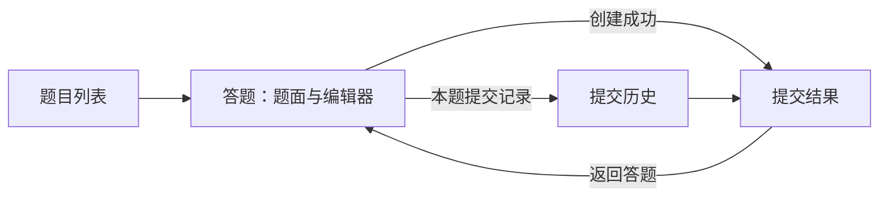

# 前端 GUI 设计

状态：F01–F07 首版 GUI 已完成，包含中文浅色页面、HTTP 客户端、题目浏览、C/Python 编辑、本地草稿、主动提交、结果详情、固定版本题面、状态轮询，以及提交历史筛选、分页和详情往返。首版桌面浏览器联调已完成，实际新增与复用记录、验收对应关系及未测范围见[前端开发计划](06-frontend-development-plan.md#57-f07首版浏览器联调与操作说明)；F08 健康观测设计已确认，H01 Worker 状态 RPC 和 H02 后端共享采集模块已实现，程序入口、HTTP 和页面待接入。

## 1. 目标与范围

交付普通用户可直接使用的浏览器 GUI：浏览预置题目，选择 C 或 Python 3，编辑单文件源码，提交后查看持久化结果，并从历史记录重新打开结果。浏览器本地保留按题目、语言区分的草稿。

后端职责和 HTTP 契约以[后端与 Scheduler 设计](03-backend-design.md#5-http-接口)为准，数据含义以[数据库设计](02-database-design.md)为准。后端已支持核心页面和提交历史；前端不等待健康接口即可开始开发。

### 1.1 优先级与边界

| 优先级 | 范围 | 交付要求 |
| --- | --- | --- |
| 必需 | 题目列表、答题页面、提交结果页面 | 完成浏览、编辑、创建和查询的真实闭环 |
| 首版配套 | 提交历史、本地草稿、分页、错误提示、直接访问结果链接 | 与核心页面一并交付 |
| 后续低优先级 | 后端健康观测 | 独立任务，先明确后端契约，不阻塞首版 |

首版跳过登录、注册、账号状态、角色和用户管理。所有提交继续归属于后端配置的测试用户；历史列表代表该配置用户的提交，不能据浏览器或本地草稿区分用户。部署的 HTTP 访问边界仍由后端设计规定的反向代理、防火墙等安排。

结果页的“返回答题”打开最新题面和已有草稿，不提供历史源码回填；当前提交详情 API 没有源码字段。

## 2. 技术选型

| 用途 | 方案 | 功能范围 |
| --- | --- | --- |
| 应用 | Vue 3 + TypeScript，Composition API、SFC、`script setup` | 浏览器 SPA，不做 SSR |
| 开发与构建 | Vite、`@vitejs/plugin-vue`、`vue-tsc` | 开发服务、构建与独立类型检查 |
| 页面路由 | Vue Router，HTML5 history | 独立结果链接、刷新和浏览器前进后退 |
| UI 组件 | Element Plus，中文组件文案 | 复用表格、表单、按钮、标签、提示和分页控件；按需导入 |
| 代码编辑 | `monaco-editor`，本仓库内的 Vue 包装组件 | 单文件编辑、C/Python 语法高亮、行号、缩进、撤销与查找 |
| 题面 | `markdown-it` 解析器与本项目的题面 Vue 组件，禁用原始 HTML | Markdown 转 HTML 后展示；首版不增加公式或图表插件 |
| HTTP | 浏览器原生 `fetch`、`AbortController` | 共用请求函数处理 JSON、超时、取消和错误，无第三方 HTTP 请求库 |
| 状态 | Vue `ref` / `computed` 与少量 composable | 页面查询状态留在页面，草稿与轮询共用逻辑；暂不引入全局 store 或请求缓存框架 |
| 验证 | ESLint、Prettier、Vitest；浏览器主路径联调 | 测试实际契约和状态变化，不为每个展示组件单独写测试 |
| 浏览器日志 | `console.debug/info/warn/error` 的少量公共日志函数 | 请求错误、创建结果、状态变化、草稿保存失败和未捕获异常 |
| 包管理 | pnpm，提交 `pnpm-lock.yaml` | 单独的前端工程，不改变 Cargo workspace |

具体依赖版本和相容的 Node.js、pnpm 版本在 F01 建立工程时选择、记录并锁定，`package.json` 的 `packageManager` 固定 pnpm 版本。后续安装使用 `pnpm install --frozen-lockfile`，不混用其他包管理器的锁文件。

Monaco 由本地构建产物提供编辑器与 Web Worker，不依赖运行时 CDN；进入答题页时才加载。创建、模型切换、尺寸变化和销毁由包装组件统一处理。C 的 API 语言 ID 为 `c`，编辑器采用支持 C 高亮的 `cpp` 模式；Python 使用 `python`。

首版仅面向桌面浏览器，支持与验收范围为视口宽度不小于 1024 CSS px。移动端及更窄视口不纳入适配、测试或交付范围，无需检查手机竖屏效果。已有窄屏样式可以保留，不构成支持承诺或后续维护要求。界面和错误引导使用中文，协议状态、verdict 和诊断原文保留。

## 3. 页面与导航

顶部导航提供“题目”和“提交历史”。不放登录按钮或尚未实现的健康入口。根路径 `/` 跳转 `/problems`，未知页面显示前端 404。

| 路由 | 页面 | 主要内容 |
| --- | --- | --- |
| `/problems` | 题目列表 | 题号、标题、最新版本、上一页和下一页 |
| `/problems/:problemId` | 答题 | Markdown 题面、语言限额、Monaco、草稿状态、提交 |
| `/submissions` | 提交历史 | 题号、提交 ID、语言、固定版本、状态、结论、时间和筛选 |
| `/submissions/:submissionId` | 提交结果 | 固定执行对象、业务状态、终态详情和返回入口 |



### 3.1 题目列表

使用题号升序展示，点击标题进入答题页。列表只有后端返回的题号、标题和版本，不展示虚构的难度、标签、通过率或用户完成状态。首版不做搜索，避免将当前页筛选误作全库搜索。

分页遵循 `items`、`limit`、`offset`，不要求 `total`。上一页按生效 `limit` 回退，下一页在本页数量等于 `limit` 时可用；恰好整页可能进入一个空页，该页提供返回上一页。初次请求不指定 `limit`，采用后端默认值，后续沿用响应中的生效值，不提供任意页跳转或总页数。

`limit`、`offset` 写入 URL query，前进后退恢复位置。加载、空题库、空分页和请求失败分别展示；请求失败保留刷新入口，不能呈现为空题库。

### 3.2 答题页面

桌面端左侧为可独立滚动的题面，右侧为语言选择、编辑器、草稿提示和提交按钮。题目标题处显示题号和当前展示版本；语言变化同步显示该语言的单用例 CPU、墙钟和内存限额。内存显示 KiB 或换算为 MiB，并明确单位。

语言选项来自详情的 `languages`，仅映射首版已支持的 `c` 与 `python`，不假设每道题都允许两种语言。初次打开选择第一个允许语言；已有本题语言选择可在仍受允许时恢复。空草稿从空编辑器开始，切换语言保留各自内容，不自动翻译或覆盖。

`statement` 按 Markdown 源文解释，覆盖标题、段落、列表、链接和围栏代码块，样例输入输出来自题面本身。禁用原始 HTML，不执行脚本、内嵌页面或 Vue 模板，保留解析器的危险链接过滤；首版不接入会重新允许任意 HTML 的插件。源码、编译诊断和程序输出一律以文本展示。

`markdown-it` 是将 Markdown 字符串转换为 HTML 的解析库，本身不提供 Vue 页面组件或编辑器。本项目建立一个小型题面组件，接收 `statement`，调用解析器并展示生成的 HTML，同时负责段落、列表和代码块样式；不另引入完整 Markdown 编辑组件。用法见 [markdown-it 文档](https://github.com/markdown-it/markdown-it#usage)。

提交前检查语言已选择、源码字符串非空，并通过 `TextEncoder` 计量 UTF-8 字节。不 `trim` 源码、不自动格式化或改写换行后再发送；请求保存点击时的编辑器文本。前端源码上限由 `VITE_SOURCE_MAX_BYTES` 提供，初始与[后端配置示例](../config/backend.example.toml)的 65,536 字节对齐；构建配置须随部署上限调整，后端始终执行最终校验，HTTP JSON 大小限制仍可能单独拒绝请求。

新提交只发送 `problem_id`、`language_id` 和 `source`。服务端在创建时选取最新版本，编辑页展示版本不构成锁定；页面明确说明提交以创建时的最新版本为准。若题目在编辑期间发布新版，结果页显示实际固定版本，前端不承诺一定执行打开页面时的旧版本，也不增加提交指定旧版本的参数。

### 3.3 提交结果页面

先按提交 ID 查询详情，显示完整可复制的 ID、题号、固定版本、语言、创建时间和终态保存时间。UTC Unix 毫秒转换为浏览器本地时间，并标明时区。终态保存时间减创建时间只能表示包含排队和调度的总耗时，不能标注为程序运行耗时。

结果页按提交的 `(problem_id, version_no)` 请求既有显式版本接口，取得对应标题、题面和语言限额，可折叠展示题面。不能用最新题面替换历史版本；若版本信息查询失败，仍展示已经取得的提交结果和固定版本身份，并单独提示题面信息未加载。

例如某次提交按题目 v1 判题，后来题目发布 v2：这次提交记录仍显示 v1 及其题面，重新进入答题页则展示 v2。首版不提供所有历史版本的列表、切换或比较入口，只在提交记录中查看实际执行的版本。

| `state` | 展示 | 查询策略 |
| --- | --- | --- |
| `queued` | 排队中 | 继续轮询 |
| `dispatching` | 分派中 | 继续轮询 |
| `running` | 判题中 | 继续轮询，不推测当前阶段 |
| `finished` | 已完成，并展示 verdict | 停止轮询 |
| `failed` | 执行失败，展示失败代码和诊断 | 停止轮询，不伪造 verdict |

| 终态内容 | 展示规则 |
| --- | --- |
| AC | “通过”，没有逐点结果或总资源统计 |
| CE | 编译诊断与截断提示，不展示失败用例 |
| WA / RE / TLE / MLE / OLE | 中文结论和首个失败用例序号；stdout、stderr、截断标记，以及存在的资源、退出码或信号 |
| `failed` | `terminal_details.code` 和 `diagnostic`；与 HTTP 请求失败分开显示 |

用例序号从 1 开始，归属于提交的固定版本。后端没有返回测试输入、标准答案、总点数、通过点数、百分比或实时阶段，不增加这些区域或模拟进度条。`failed_case` 的资源属于该失败用例，不代表全题统计；缺失值显示“未提供”，显式 0 仍显示为 0。`cpu_time_us`、`wall_time_us` 可除以 1000 显示 ms，`peak_memory_bytes` 可除以 1,048,576 显示 MiB，不能与题目限额中的 KiB 混用。

Base64 字段先解码为字节，再用 UTF-8 文本解码展示；非法 UTF-8 使用替换字符，并注明输出按 UTF-8 展示。编译诊断和 stdout/stderr 使用可滚动、可复制的文本区域，服务端标记截断时明确显示“输出已截断”。不能直接把 Base64 当作可读文本，也不能将输出作为 HTML 注入。

页面提供“返回答题”和“本题提交记录”。后者进入按题号筛选的提交历史，不是题目版本历史。返回答题进入最新题目详情；草稿来自当前浏览器，不能称为该历史提交的源码。

### 3.4 提交历史

使用 `GET /api/v1/submissions`，按后端的 `created_at_ms DESC, id DESC` 顺序展示。允许按 `problem_id`、`state`、`verdict` 筛选，点击“查询”应用表单条件，筛选与分页写入 URL，应用或清除筛选将 offset 归零并保留生效页长；空筛选参数省略，不提交未规定字段。状态和 verdict 同时设置时采用后端的交集语义。

筛选、排序和分页均在后端执行，先筛选和排序，再取指定页；前端只传查询参数、展示返回顺序。当前 API 已分页，不能只筛选或排序当前页后将其当作全部记录的结果。排序固定为创建时间倒序，同时间按 ID 倒序，不提供未受后端支持的排序切换。

历史行展示题号和固定版本，不为每行另查题目标题、终态详情或源码。分页规则与题目列表相同；列表支持手动刷新，不逐行轮询。点击记录进入结果页后再持续查询。新提交插入时 offset 分页可能重复或跳过记录，刷新回首页查看最新记录；首版不新增游标分页契约。

从历史行进入结果页时，结果 URL 携带本次历史的筛选和生效分页参数。“返回提交历史”按这些参数恢复原位置，结果页刷新或直接打开该链接后仍可返回；只读取既定的五个历史参数，不接受任意返回地址。独立结果 URL 没有历史参数时返回全部历史首页。“本题提交记录”始终只按题号进入首页。列表区分暂无记录、筛选无结果、空分页和查询失败；刷新失败保留最近成功列表并提示可能过期，手动重试，不自动查询。

## 4. 客户端状态与提交语义

### 4.1 HTTP 和错误处理

API 层维护与当前 HTTP JSON 一致的 TypeScript DTO，不复用 Worker Proto 作为浏览器契约。创建响应、列表、提交详情及各终态类型分别定义，保留 `null` 与省略字段的区别。业务错误、网络错误和响应解析失败由统一请求函数交给页面处理；不增加通用恢复框架。

请求超时初始设为 10 秒。超时或页面离开可取消浏览器等待，不能声称取消服务端创建或判题。页面查询参数变化时取消旧查询，旧响应不能覆盖新页面状态。查询 HTTP 错误与结果中的 `failed` 独立：前者说明这次查询失败，后者说明已保存的执行失败。

| 情况 | 用户提示与处理 |
| --- | --- |
| `InvalidRequest`、语言错误、源码或请求过大 | 就地说明错误，保留草稿；修正后发起新的主动提交 |
| `IdempotencyConflict` | 明确提示请求键与内容冲突，不自动换键掩盖错误 |
| `QueueFull`，没有 `submission_id` | 提示队列已满，保留原请求，用户可稍后手动重试 |
| `QueueFull`，带 `submission_id` | 提交已保存为 `queued`，但不在当前 Scheduler 内存中，重新交接时名额已满；保留原请求及键，提供结果链接和同键手动重试入口，不自动跳转结果页 |
| `BackendStopping` | 提示服务停止接纳，保留草稿和原请求；正常停机等待期间已有提交仍可查询 |
| 题目、版本或提交不存在 | 显示对应不存在状态，不跳转登录 |
| 网络错误、超时、其他 5xx 或无法解析创建响应 | 提示“尚未确认是否创建”，允许原请求同键重试，不自动创建第二条提交 |
| 其他 HTTP 错误或未知错误码 | 显示通用中文提示和可用的错误码，保留诊断上下文，不猜测业务状态 |

英文 `message` 作为辅助信息，前端主要按稳定 `error.code` 提供中文引导。代理返回非 JSON 的错误也应显示请求失败，不能报成业务终态。网络提示只描述当前操作，不能据一次请求成功就宣布 Worker 健康。

后端区分普通查询失败和致命故障：一次查询返回 `500 InternalError` 不代表后端已经退出，也不代表提交已失败；关键写入或严重存储故障则可能使后端退出，浏览器随后只能观察到请求失败或连接不可达。GUI 保留最近快照和手动重试入口，不从 HTTP 错误推断持久化终态，也不自动重交源码。

用户提示说明当前操作、影响和可采取的下一步。例如队列满时提示“当前排队任务较多，请稍后重试；代码草稿已保留”，创建响应不明时提示“尚未确认是否提交成功，请重试原提交或查看提交记录”。只有草稿确实保存成功时才称已保存；存储失败另行说明。表单错误在对应位置展示，查询失败提供页面内重试入口，临时操作反馈使用组件消息提示；不向用户直接展示 JavaScript 堆栈。

浏览器控制台保留排查信息，公共日志函数记录时间、操作、API 路径、HTTP 状态、错误码、已知提交 ID 和请求耗时；异常日志保留必要的原因与堆栈，不输出源码、请求正文、幂等键或程序输出。创建结果和业务状态变化记为 info，预期拒绝和本地存储失败记为 warn，网络、解析及未捕获异常记为 error，普通轮询记为 debug；非开发构建默认关闭 debug。

Vue 错误处理入口与浏览器的 `error`、`unhandledrejection` 记录未捕获异常；需要用户处理时显示可读提示，保留已有编辑内容和最近查询结果。同一异常由明确的处理入口记录，避免重复打印。首版日志只在浏览器控制台查看，不新增日志上报接口或服务。

### 4.2 创建请求与幂等键

1. 用户点击提交时冻结题号、语言、源码文本，生成随机 UUID `Idempotency-Key`。在受支持的安全上下文中使用浏览器 `crypto.randomUUID()`，本地联调使用 localhost，远程部署使用 HTTPS，见 [Web API 说明](https://developer.mozilla.org/en-US/docs/Web/API/Crypto/randomUUID)。
2. 当前创建请求未结束时禁用再次提交，避免双击生成多个键。请求快照与可继续编辑的草稿分开保存，修改草稿不能改变原请求。
3. `202` 新建和 `200` 同键返回均表示本次提交请求已完成，按 `submission_id` 导航至结果页；最终状态以详情查询为准。
4. 响应不明时，手动“重试原提交”复用完全相同的快照和键。只有用户明确发起另一份提交才生成新键；若上一份仍未确认，先说明可能已有记录。
5. 创建关键过程在后端独立完成，浏览器超时或关页不撤销它。普通 GET 查询不能替代尚未取得 ID 时的同键重传，也不会重新交接 queued 记录。

“待完成的提交请求”指用户已经点击提交，但创建结果尚不明确，或收到可重试拒绝后仍待重试的那一次请求。已知提交 ID 不代表交接完成。

内存状态保存本次请求的题号、语言、点击时源码和幂等键；同时在发送前将这份快照写入当前标签页的 `sessionStorage`，以便刷新后仍能恢复原请求。该存储在同一标签页刷新后保留，正常关闭标签页后结束，不承担长期草稿保存，见 [sessionStorage 说明](https://developer.mozilla.org/en-US/docs/Web/API/Window/sessionStorage)。

收到 `200` / `202` 成功响应、明确结束本次操作的业务拒绝，或用户确认放弃后，清除请求快照。`QueueFull`（无论是否带 ID）、`BackendStopping` 和创建结果不明时均保留快照，允许原键原内容手动重试。

重新打开答题页时如存在快照，提示“上次提交请求尚未完成”，提供手动“重试原提交”和“放弃原提交”入口；重试发送原内容和原键，不自动 POST，不使用后来修改的草稿替换。创建请求在途时禁用放弃操作。放弃前需确认，并提示原提交可能已创建、放弃后将失去原请求的重试入口；确认后清除内存和 `sessionStorage` 中的请求快照，保留草稿。放弃不撤销后端已创建的提交或判题。首版每个标签页只保留一份待完成的提交请求，完成或明确放弃后才开始另一份。

若会话存储不可用，提前说明本次请求不能在刷新后恢复；当前页面仍可提交并在内存保有原快照，刷新后不能声称安全重试。草稿和待完成的提交请求用途不同，不把最新草稿误当作先前请求快照。

### 4.3 结果轮询

结果页进入或刷新时立即 GET 当前快照。`queued`（排队中）、`dispatching`（分派中）、`running`（判题中）为非终态，均继续查询同一个提交详情接口。

查询顺序为“请求详情 → 收到并处理响应 → 若仍未结束，等待 1 秒 → 再请求详情”。这就是串行轮询：上一次请求完成后才安排下一次，同一结果页最多一个查询在途；不是固定每秒发起请求而让慢请求重叠。间隔是前端显示刷新频率，与后端到 Worker 的轮询间隔无关。

得到 `finished` 或 `failed` 后停止定时器；页面卸载或 ID 改变时清理定时器和在途请求。标签页隐藏时暂停定时轮询，重新可见时仅对尚未终态且未因查询失败暂停的提交立即查询。GET 失败时保留最后一次成功快照，标注状态可能过期并暂停轮询，等待用户点击重试；切换标签页不会解除查询失败后的暂停。首次查询失败则显示错误页和重试入口。

不根据等待时长自行写出 TLE、执行失败或中断，不从 `queued` 估算队列名次。刷新、前进后退和直接打开结果链接都从后端快照重建页面，不依赖此前的创建响应或本地计时。

后端重启后，尚未分派的 `queued` 会重新装入调度队列，GUI 继续按快照查询；旧 `dispatching/running` 会保存为 `failed`，失败代码为 `SchedulerInterrupted`，页面提示后端重启导致此次执行中断并停止轮询。已有终态保持不变，GUI 不将中断提交自动变成一次新的 POST。

### 4.4 本地草稿

草稿保存在 `localStorage`，键为 `acorn:draft:v1:<problem_id>:<language_id>`，值包含源码文本、最近展示的版本号和本地更新时间；另保存本题最后选择的语言。版本号用于提示题面变化，不改变提交的最新版本规则。

输入后以约 1000 ms 防抖保存，切换语言、题目和离开编辑页时补一次保存。重新进入优先恢复对应草稿；版本已变化时保留源码并提示复核新题面。每次版本变化提示一次即完成，提示后将草稿记录的版本号更新为当前展示版本并保存，无需用户确认；后续打开同一版本不再重复提示，保存失败仍按未保存处理。成功提交不清空草稿。“清空本语言草稿”需确认，只删除当前题目、当前语言内容。

答题页提供“保存草稿”按钮，并捕获 `Ctrl+S`（macOS 为 `Cmd+S`），阻止浏览器默认的保存网页操作，立即调用与自动保存相同的草稿保存函数，显示成功或失败反馈。快捷键在答题页激活时生效，离开时解除监听；与 Monaco 按键处理协调，避免同一次按键重复保存。它只保存当前题目和语言的本地草稿，不创建提交或调用后端。

草稿仅属于当前浏览器 origin，不同步到后端，不是源码历史或备份；清除浏览器数据后不可恢复。不做跨标签页自动合并。存储不可用或写入失败时显示未保存提示，编辑和提交继续可用，不能显示已保存。

## 5. 工程组织与访问方式

前端放在仓库的独立 `web/` 目录，建议结构如下。目录随对应任务创建。

```text
web/
  package.json
  pnpm-lock.yaml
  vite.config.ts
  .env.example
  README.md
  src/
    main.ts
    App.vue
    router.ts
    api/                  # HTTP DTO、请求函数、题目与提交接口
    pages/                # 题目列表、答题、历史、结果、404
    components/           # Monaco 包装、题面、结果详情、共用提示
    composables/          # 草稿、提交请求快照、结果轮询
    utils/                # 浏览器日志等少量公共函数
    styles/               # 浅色主题、布局与文本区域
```

API 层负责协议和错误，composable 负责明确的客户端生命周期，页面负责组合与布局。不另建 BFF、Node 服务端或浏览器直连 Worker 的路径。组件优先使用 Element Plus，只有 Monaco 和有明确复用需要的展示才包装；主题以浅色背景、清晰边界、足够的代码区高度和状态文字为主。颜色不能成为判题结论的唯一标识，表单具备标签、键盘焦点和可读错误提示。

开发时浏览器访问 Vite，由其将 `/api` 原样代理至后端，例如 `http://127.0.0.1:8080`；不剥离 `/api/v1`，也不要求后端新增 CORS。开发代理目标放在 Vite 的服务端配置，浏览器请求使用相对 `/api/v1`。配置方式见 [Vite server.proxy](https://vite.dev/config/server-options.html#server-proxy)。

部署时静态服务器提供前端构建产物，反向代理将同源 `/api/` 转发给 Axum，后端继续仅提供 API。HTML5 history 的页面路径回退到 `index.html`，但 `/api/` 和不存在的静态资源不能被回退成 HTML；结果链接直接访问与刷新必须可用。路由部署要求见 [Vue Router history 模式](https://router.vuejs.org/guide/essentials/history-mode.html)。

## 6. 后端依赖与健康观测

### 6.1 首版接口覆盖与缺口

| GUI 能力 | 当前支持 | 处理方式 |
| --- | --- | --- |
| 题目列表、最新题面与语言限额 | 已有题目 GET 接口 | 直接接入 |
| 历史提交对应题面 | 已有显式版本 GET 接口 | 结果页使用固定版本查询 |
| 创建、幂等重传、查询结果 | 已有提交 POST/GET 接口 | 按现有契约实现 |
| 分页和提交历史筛选 | 已有列表接口，无总条数 | 上一页/下一页及已支持筛选 |
| 本地草稿 | 无需后端接口 | 由浏览器保存 |
| 源码大小上限发现 | 当前无配置查询接口 | 前端构建配置对齐部署，后端最终校验 |
| 历史源码、实时阶段、逐点完整统计 | 当前不返回 | 不作为首版 GUI 能力，不因前端开发扩展协议 |
| 后端及 Worker 健康状态 | Worker 状态 RPC 和后端共享采集模块已有，浏览器暂无健康 HTTP 接口 | 按 H03 接入程序入口及 HTTP，H04 接入页面 |

首版不要求新增 HTTP 路由、修改 Proto 或数据库结构。题面格式和结果页显式版本查询的约定同步写入[后端设计](03-backend-design.md)。首版 GUI 已完成实现与浏览器验收，健康观测按 F08 独立实施。

### 6.2 后续健康功能

健康设计已确认，核心 GUI 交付后按 F08 实现。页面区分 HTTP 响应、数据库读取、新提交接纳、Scheduler 生命周期和 Worker 状态，直接展示指标及检查时间，不生成可接纳或整体健康结论。

现有 Scheduler 缓存只表示可以尝试分派，不证明远端在线或空闲。健康采集独立通过 Worker 状态 RPC 取得观测，前端只访问后端 HTTP，不直接调用 gRPC 或根据题目列表请求推断节点健康。

健康页面使用手动刷新，并在独立警告区提示后端返回的过期观测；外部告警、自动修复、重启和部署控制不属于该任务。

接口、观测来源、过期阈值、警告展示、实施步骤和有限验收统一见[健康观测设计与实施计划](07-health-observation-design.md)。该设计已确认，H01 Worker 状态 RPC 和 H02 后端共享采集模块已实现，程序入口、健康 HTTP 接口和页面尚未接入。

## 7. 首版验收

| 标识 | 主要要求 |
| --- | --- |
| UI-01 | 从题目列表进入真实示例题，Markdown 样例和语言限额可读；C/Python 可编辑提交并取得持久化结果 |
| UI-02 | `202` / `200` 均导航至同一查询模型；响应不明及带 ID 的 `QueueFull` 保留快照并手动同键同内容重试，带 ID 的 `QueueFull` 不自动跳转；重试只有一个 Submission，冲突不被隐藏 |
| UI-03 | 运行中仅展示业务状态，终态停止轮询；刷新可恢复，页面离开无残留定时查询；请求失败不伪造业务失败，切回标签页仍等待手动重试 |
| UI-04 | 正确展示 AC、CE、首个失败用例和执行失败；Base64、截断、未知统计、显式零值、单位和固定版本符合 HTTP 契约 |
| UI-05 | 历史按既有筛选和分页工作，无总条数依赖；空数据和错误可区分，记录可重新打开 |
| UI-06 | 草稿按题目/语言保存，切换和刷新后恢复，成功提交后保留；本地存储失败明确提示，待完成的提交请求独立保留 |
| UI-07 | 视口宽度不小于 1024 CSS px 的桌面答题布局可用；直接打开结果链接、前进后退、代理和静态资源均正常，无登录依赖 |
| UI-08 | 浏览器日志可定位请求和运行异常；用户收到可操作的中文提示，草稿、输出和幂等键不写入日志 |
| UI-09 | 答题页 Ctrl+S 立即保存本地草稿并阻止保存网页，成功/失败反馈准确，离页后解除快捷键监听 |

自动化与真实联调分工、任务完成条件和未测范围记录见[前端开发计划](06-frontend-development-plan.md#4-验证与交付记录)。健康功能不属于以上首版验收门槛。
