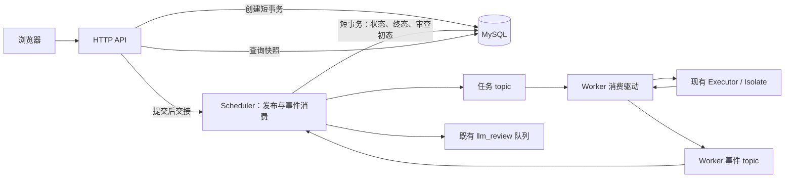

# Kafka 判题通信设计与实施计划

版本：v19。本文规定后端与 Worker 之间的 Kafka 任务投递、状态回传、接纳容量及部署方案。消息发布等待 broker 确认，消费位点使用 safe 异步提交且不逐条等待回执；配套修复按第 12 节推进。实施时同步受影响的现行设计、协议、调用方和配置说明；进度及检查结果见[实施记录](d02-execution/10-kafka-judging-execution.md#4-任务清单)。

## 1. 目标、依据与范围

### 1.1 技术基础

| 对象     | 复用的组件与合同                                                                                                                          |
| -------- | ----------------------------------------------------------------------------------------------------------------------------------------- |
| 数据库   | MySQL 8.4、InnoDB、结构版本 4；SQLx 0.9.0、READ COMMITTED 及现有共享连接池。见[MySQL 设计](09-mysql-migration-design.md#3-连接配置与启动) |
| 后端     | Tokio、HTTP、Scheduler 和[创建服务](../crates/backend/src/submissions/creation.rs)；保留配置用户归属、幂等键、固定题目版本及接纳上限      |
| Worker   | C/Python 执行器、Isolate、单执行位置及安全停止合同。见[Worker 设计](01-worker-design.md)                                                  |
| 健康观测 | 后台采集、缓存及只读 HTTP。见[健康观测设计](07-health-observation-design.md)                                                              |
| 自动审查 | 既有内存队列、模型客户端及持久化流程。见[审查设计](08-llm-code-review-design.md#7-接纳持久化与生命周期)                                   |

### 1.2 目标与范围边界

Kafka 仅承接后端与 Worker 的判题通信：完整任务、既有运行状态和机器终态。Worker 直接消费共享任务 topic，后端消费 Worker 事件 topic，以替换中央节点选择、忙时回队、逐 Job RPC 轮询和结果 ACK 缓存。

MySQL 业务状态、HTTP 提交与查询、执行器及资源限额沿用现有合同。自动审查由事件消费者交接；健康观测新增 Kafka 检查，消费组成员观测用于新建接纳。

## 2. 组件与替换边界



| 部件                 | 计划变更                                                                           | 保留的职责                                                         |
| -------------------- | ---------------------------------------------------------------------------------- | ------------------------------------------------------------------ |
| CreationService      | 保留事务提交后交接本地 Scheduler；202 不等待 Kafka 网络调用                        | 幂等内容比较、独立于 HTTP 连接的短操作生命周期、固定版本与输入校验 |
| Scheduler            | 用 Kafka 发布和事件消费替换节点轮转、地址路由、节点冷却及逐任务 RPC 轮询           | 本地有界待发队列、信号量名额、任务去重、状态推进和后台生命周期     |
| 数据库访问           | 复用现有表及查询，适配 Kafka 事件的条件状态更新                                    | MySQL 连接与会话、错误分类、结果类型、不可覆盖的机器终态           |
| WorkerService / Jobs | 将输入校验、单槽接纳及停止处理提取为共用运行入口；移除 RPC 查询记录、结果 ACK FIFO | 本机执行互斥、绝对期限、停止通道、BLOCKED 与安全释放               |
| gRPC                 | 移除 SubmitJob、GetJob、AcknowledgeResult；保留 GetWorkerStatus                    | 只读 Worker 观测；健康采集不参与分配                               |
| LLM                  | 自动审查由后端事件消费者交接                                                       | 独立容量、并发、单次 POST、手动重跑、最新意见及中断合同            |

任务发布与事件消费放在后端 `scheduler` 模块，数据库访问放在 `database` 下，共享消息由 `acorn-protocol` 生成。

## 3. 交付语义与业务状态

### 3.1 任务交接与消费确认

1. 创建事务保存 Submission，事务提交后交接本地 Scheduler，再返回 202。202 表示本地接纳完成，不表示 Kafka 已确认任务；交接窗口见第 5.3 节。
2. Worker 完成一次判题，等待 Kafka 确认终态消息后，才异步提交对应任务的消费位点。终态放入本地结果队列或发布运行快照都不允许提前提交任务位点。
3. 后端校验事件后异步提交事件位点；需要首次 running 或终态写入时，先提交 MySQL 并归还连接。后续合法运行快照无需新增数据库写入。

两端使用 SDK safe 的 CommitMode::Async，仅将指定分区的 offset+1 提交请求放入客户端队列；入队成功不表示 broker 已保存位点。生产路径不读回、不逐条等待提交结果，后续提交失败可能发现得更晚，消费组位点可以落后于已完成的业务处理。仅推进连续已处理的记录，不跨过尚未完成的记录。

首期使用普通消费者组、幂等生产者和手动位点，不启用 Kafka 事务；消息发布取得 broker 确认，MySQL 按自身事务提交，消费位点按上述规则异步推进，允许故障下重复传递。位点提交失败后，后续成功提交的较大位点可以覆盖此前已处理记录；尾部提交失败且没有后续事件时，位点可能保持落后，不承诺每次异步提交最终自动成功。业务幂等按第 3.2 节处理。交付边界见[Kafka 投递语义](https://kafka.apache.org/43/design/design/#message-delivery-semantics)。

### 3.2 重复执行与终态选择

已成功写入 Kafka 的消息按至少一次消费处理，前提是 broker 按部署的持久化策略保留消息，且保留期限覆盖实际积压和停机。尚未成功发送的数据库记录按第 5 节交接窗口处理。同一 Submission ID 继续作为 Job ID；消息重投不新建提交，不生成新的判题轮次。

发送结果不明后重发、终态发布后未提交任务位点、消费者失去分区等情况，都可能让同一源码再次执行；Kafka key、生产者幂等性和 Worker 的进程内去重不保证唯一执行。不同执行可能产生不同结果，MySQL 接受第一次通过校验并成功提交的机器终态，包括执行失败，之后的结果不覆盖它。HTTP 幂等键继续防止重复创建提交。

异步位点提交会扩大重复传递的窗口。后端重放已保存的事件时，不覆盖终态、不重复释放许可或触发同一次审查；Worker 重放任务时可能重新编译、执行源码，增加 CPU、内存和沙箱占用，并降低有效判题吞吐。接受该重复执行成本，不承诺每次执行得到相同结果。

### 3.3 状态定义

重启时按第 5.3–5.4 节恢复本地待发和接纳状态。

| 状态        | Kafka 模式下的含义                                              | 待接纳名额 |
| ----------- | --------------------------------------------------------------- | ---------- |
| queued      | 提交已保存，尚未取得并记录 Kafka 投递确认；可能处于发送中       | 占用       |
| dispatching | 已收到 Kafka 投递确认并保存该状态，等待 Worker 运行事件         | 占用       |
| running     | 后端已保存首次合法 RUNNING 事件；包括重投期间尚未取得终态的提交 | 不占用     |
| finished    | 已保存正常机器 verdict，含 AC、CE 和用例失败                    | 不占用     |
| failed      | 已保存执行、协议或确定的投递失败                                | 不占用     |

发布器取得 Kafka 确认后才允许 queued → dispatching；合法 RUNNING 允许 queued/dispatching → running；终态允许 queued/dispatching/running → finished/failed。事件可能早于投递确认的数据库更新，也可能直接到达终态，因此按当前状态条件更新，并停止后续本地重发。迟到确认、运行事件及重复终态均不回退或覆盖已有状态。

机器终态的内容、时间、源码及固定版本约束沿用[数据库设计](02-database-design.md#36-submissions)。

## 4. Topic 与消息合同

### 4.1 通道与消费者

| 通道                    | 生产者           | 消费者                     | 首期部署                                      |
| ----------------------- | ---------------- | -------------------------- | --------------------------------------------- |
| `acorn.judge.tasks.v1`  | Scheduler 发布器 | 所有 Worker 使用同一任务组 | 8 个分区，同组内可为最多 8 个 Worker 分配分区 |
| `acorn.judge.events.v1` | Worker           | Scheduler 事件消费组       | 1 个分区，事件串行写库                        |

两个 topic 的 key 均由待发送消息的 job_id 直接生成 UTF-8 字节，即现有 Submission ID；发送入口不接收另一份独立 key 参数，接收端按负载 job_id 关联任务并执行既有业务校验。任务不要求跨分区全局 FIFO；同一 Worker 一次只执行一个 Job。普通消费者组的分区归属可能造成耗时任务分布不均。

任务组内每个分区同一时刻由一个消费者持有，一个 Worker 可以持有多个分区。见[Kafka 消费设计](https://kafka.apache.org/43/design/design/)。

部署时预先创建 topic，客户端按第 8.1 节禁用自动创建，缺失时明确报错。两个 topic 均采用 delete 策略及 1 天保留期，即 retention.ms=86400000，实际保留还受容量配置影响。日志清理与业务状态的关系见第 5.7 节。参数含义见[官方 topic 配置](https://kafka.apache.org/43/configuration/topic-configs/)。

消费组名按部署环境固定，示例为 `acorn-judge-workers-v1` 与 `acorn-backend-judge-events-v1`。程序使用 `auto.offset.reset=error`；首次部署由部署端初始化新组位点，后续从已提交位点继续，不自动回到 earliest/latest。保留过期、位点丢失或 topic 被重建时明确报错，交部署端处理受影响记录。位点重置与首次初始化见[Kafka 管理说明](https://kafka.apache.org/43/operations/basic-kafka-operations/)。

### 4.2 Protobuf 负载

直接复用[现有协议](../proto/acorn/worker/v1/worker.proto)中的消息，通过现有 Cargo/Prost 流程生成。任务和事件分别由 topic 区分，消息主版本由 topic 后缀表达。

| topic  | Protobuf 消息    | 内容与用途                                                                                   |
| ------ | ---------------- | -------------------------------------------------------------------------------------------- |
| tasks  | SubmitJobRequest | 沿用 job_id、language_id、source、cases 和 run_limits，携带完整任务                          |
| events | GetJobReply      | 沿用 job_id、state、phase、completed_cases、total_cases 和终态 oneof，发送既有运行状态及终态 |

Worker 使用已有进度更新机制产生 GetJobReply 状态事件，Scheduler 沿用原[响应校验](../crates/backend/src/scheduler/validation.rs)及处理规则：

- RUNNING 接受 PREPARING、COMPILING、RUNNING_CASE、CHECKING，分别保留原语言、已完成用例数及终态缺失等校验；首次合法运行事件推进业务 running，后续运行事件继续等待终态，阶段和逐点进度不写库。
- FINISHED/FAILED 必须处于 DONE，保留原 result/failure、verdict、用例序号、输出及统计校验，首次合法终态落库后不可覆盖。
- 身份可确认但状态、阶段、进度或终态违反既有规则时，沿用 InvalidWorkerResponse 的失败处理；MQ 自身无法解码或身份不可信的错误另见第 8.3 节。

运行事件可以重复、交错或缺失中间阶段，业务不依赖收到全部阶段或连续进度；快照合并见第 6.1 节。

未收到新事件时继续等待，不生成 WorkerUnavailable；明确的通信及协议错误按第 8.3 节处理。

消息直接使用 Protobuf 二进制编码，接收边界校验字段、身份及预算。任务中的用例来自提交固定版本并保持顺序；Worker 从任务取得全部执行输入。后端按 job_id 读取提交及固定版本的语言、总用例数和 review_mode，供事件校验及自动审查使用。

## 5. MySQL 交接与接纳容量

### 5.1 沿用现有结构

沿用 MySQL 结构版本 4 的[现有表结构](../sql/001-initial-schema.sql)，状态条件更新由 submissions 表承担。

### 5.2 创建事务

创建服务继续独立持有短操作，不随 HTTP 断连取消，沿用现有接纳顺序：

1. 预检查请求，按用户及幂等键读取已有提交，比较题目、语言和原始源码；相同沿用原 ID，必要时继续 queued 交接，不同返回冲突。
2. 确实需要新建或重新交接 queued 记录时，先通过 Scheduler 信号量预留名额；无名额返回 QueueFull。
3. 在现有短事务中再次查重，仅新建时固定最新版本、装配校验任务并插入 queued；已有 queued 保留原固定版本。保留唯一键裁定及 1062 回滚后读取规则。
4. 提交并归还连接，将完整任务及预留名额交给 Scheduler 的有界本地队列。
5. 完成本地交接后返回原有 202、submission_id 和 Location。回滚、校验失败或重复合并释放多余预留。

### 5.3 任务发布与交接窗口

使用已有状态、内存队列和启动装入处理交接窗口：

1. Scheduler 从有界本地队列取得任务，在本地记录发送占用，以既有 Submission ID 去重；确认该提交仍允许发送，编码 SubmitJobRequest。此时数据库仍为 queued。
2. 不持有数据库连接或事务地向 Kafka 发送。临时错误或结果不明时保留本地待发送数据及许可，在发布服务中重试同一任务；若已收到合法运行或终态事件，则停止安排后续重发，已经在途的一次发送仍可能完成。配置或不可继续的错误明确报告并走受监督故障处理，不把缺少 Worker 事件当作发送失败证据。
3. broker 确认后，以 queued 为条件保存 dispatching。若运行或终态事件已经把记录推进，则不回退，不因此重新发送。
4. 若进程在确认前退出，或者 broker 已收到但确认／状态更新尚未完成，记录仍可能是 queued；下次启动及同键重传使用现有装配入口重交，允许因此重复执行。
5. 已保存 dispatching 的记录表示曾取得投递确认，running 表示曾取得合法运行事件；重启时恢复对它们的等待，不再次批量发布。Kafka 继续按消费位点处理未完成消息。

数据库提交、本地交接与 Kafka 发送为非原子操作，窗口通过本地重试、同键重传和启动装入处理，不新增 outbox 或常驻数据库补扫。

后端能关联具体提交，并确认任务遇到不可恢复的失败时，按第 3.3 节条件保存 failed 并收尾名额。一次多余重发失败、消息投递或观测超时均不足以证明任务不可继续。

### 5.4 运行与终态的名额收尾

沿用 Scheduler 的 Semaphore 和每条待接纳任务持有的许可，创建预留、本地排队及等待 Worker 接纳期间都占用名额。该上限不代表运行并发。

首次合法 RUNNING 将 queued/dispatching 条件更新为 running，数据库提交后释放对应本地许可。终态保存机器结果及自动审查初态，若任务还持有许可则释放；重复事件不重复释放或触发审查。许可在事务之外管理，仅在数据库提交成功后归还。

启动装入 queued 时恢复相应许可，同时为 dispatching 的 ID 恢复待接纳许可及本地去重记录，但不装配或重发其任务；running 不占待接纳许可。启动编排见第 9.1 节。

### 5.5 任务等待

queued/dispatching 在既有待接纳容量内排队，首次合法 RUNNING 后继续等待终态；Scheduler 按事件及明确错误推进业务状态，不设置后端任务超时计时器。Worker 继续执行现有 120 秒 Job 期限、阶段限额、停止及 BLOCKED 合同。消息发布及停机收尾使用第 8.1 节预算，健康采集沿用自身调用预算。

消费者失联时，Kafka 按组成员检测重新分配分区，其他 Worker 从已提交位点继续处理未确认任务；等待期间保留已有业务状态，消息受第 4.1 节的日志保留策略约束。

### 5.6 Worker 在线观测与接纳

后台查询 Worker 任务消费组的成员并缓存，后端自身不加入该组。已有 rdkafka Client 提供 [fetch_group_list](https://docs.rs/rdkafka/0.39.0/rdkafka/client/struct.Client.html#method.fetch_group_list)，Kafka 支持[查看活动组成员](https://kafka.apache.org/43/operations/basic-kafka-operations/)。按目标组协议及权限核对实际接口。

成员观测使用独立后台任务和专用缓存，管理采集预算、完成时间、最近错误及过期状态。同步查询放在阻塞工作线程，创建服务只读缓存。该任务与健康采集的生命周期、缓存及故障互不影响。

unknown 表示没有可用的新鲜成员数，包括启动尚无样本、查询失败或样本过期。新鲜零成员或 unknown 均在新提交入库前返回 503；有成员时按 Scheduler 信号量判断容量，允许繁忙 Worker 前积压。成员检测存在延迟，成员数不表示空闲执行位置数。

此观测仅用于新建接纳；已有任务继续处理，同幂等键沿用第 5.2 节规则。已有任务的状态与重投由事件处理及 Kafka 消费合同决定，健康 HTTP 和页面继续使用原健康采集。

### 5.7 消息保留边界

delete 策略按日志段清理过期数据，消费完成不会立即删除日志，未消费消息也可能过期；1 天保留期不是逐任务超时。Kafka 不生成逐任务过期事件，日志清理后的提交可能继续保持非终态，本期不自动标记失败或恢复。

## 6. Worker 消费与执行

输入约束复用[公共运行入口](../crates/worker/src/runtime.rs)的接纳校验，执行、停止和资源合同沿用[Worker 设计](01-worker-design.md#6-统一沙箱接口)。[Worker Kafka 服务](../crates/worker/src/kafka/service.rs)组合消费驱动、单槽执行通知及 FIFO 交接；旧 RPC 通过同一运行入口接纳。

### 6.1 接纳与结果交接

采用有界结果积压，按执行位置和预留结果容量控制新接纳：

1. 接收 Kafka 记录时，按第 8.2 节限制编码字节数并解码为 SubmitJobRequest，随后调用既有 Job ID、任务内容及资源上限校验。
2. 沿用 results.max_unacknowledged_results 约束本机待交接终态。开始一个任务前预留一个结果名额，保证完成后有位置保存终态；没有名额时暂停新接纳。执行仍为本机单槽，不在应用层另建未执行任务队列。
3. 进入既有执行入口后，以原进度回调更新同一活动 Job 的最新待发 GetJobReply 运行快照。首次 PREPARING 及后续进度均不阻塞执行；执行期限从进入执行入口计算。
4. 任务完成后，把有界终态及原任务 topic/partition/offset、分区归属交给 FIFO 发送队列。原执行位置安全可用且还有结果名额时，可以继续从 Kafka 接纳下一个任务；源码、用例和产物不随终态排队保留。
5. 发送器优先按 FIFO 交接终态。队列项记录“待发布终态”或“待提交任务位点请求”阶段；终态取得 broker 确认后转入后者，此后只重试对应任务 offset+1 请求的入队，不再发布该终态。提交请求不能跨过同分区尚未完成的记录；请求成功入队后释放条目及结果名额，不等待位点保存回执。已不能提交任务位点的条目按第 6.2–6.3 节处理。
6. 发布或请求入队同步返回的临时错误保留队列项当前阶段并重试，不通过重新执行源码重试交接；结果队列满后停止新接纳。不可继续的客户端故障明确退出，未保存位点供 Kafka 重投。请求入队后不再为本条记录保留确认队列项，也不能依赖它报告后续 broker 提交错误；停机按第 6.3 节收尾。

队列只驻留内存，交接完成后移除条目。Worker 退出时未完成交接的结果可能丢失，对应任务依赖未提交位点重投。

任务消费者采用 BaseConsumer，事件生产者采用 FutureProducer。执行、结果发送和消费驱动分开；结合 SDK 队列通知进行有限 poll，持续服务消费组事件，不能在 Tokio 执行线程阻塞等待。执行忙或结果名额满时 pause 分区并限制预取及应用缓冲。关闭使用 SDK safe close_queue/closed，持续驱动直到实际关闭，不以 unsubscribe 代替关闭完成。接口见 [BaseConsumer](https://docs.rs/rdkafka/0.39.0/rdkafka/consumer/base_consumer/struct.BaseConsumer.html)。重平衡回调只通知驱动，不等待执行。

### 6.2 分区撤销、断连与重复

消费组成员变化或失联后，Kafka 可能把分区从 Worker A 分配给 Worker B；此时 B 会从已提交位点继续，可能再次取得 A 尚未确认的任务。分区归属改变不会停止 A 的本机执行。

撤销时尚未进入执行的任务放弃本地接纳、不提交位点；已经执行的任务继续按原期限完成并发布终态。活动任务及结果队列条目均不再提交已失去归属的任务位点，分区重新分配回来也不沿用旧执行确认新归属的记录。重复执行及终态选择遵循第 3.2 节，普通重平衡不新增失败码。

原归属检查和提交请求入队使用同一短锁；入队后可能发生撤销或提交失败，不据此恢复旧归属或阻止后续重放。已成功入队的请求不承诺可以取消。

队列项失去原分区归属时，终态已确认发布的直接释放条目及名额；尚未确认发布的继续发布，取得确认后释放。

短暂断连不等于已经失去分区，也不证明任务未执行。结果发送的临时错误按第 6.1 节保留终态重试；位点请求入队同步失败时，按当前归属及消息交接预算重试，或明确结束消费服务。已入队请求不逐条等待结果，接受位点滞后，消费组按最后保存的位点重新接管任务。

### 6.3 停止未确认与本机停机

发生 StopUnconfirmed 并进入 BLOCKED 后：

1. 立即关闭任务消费者并退出消费组，释放分区；关闭不等待已有终态发布完成。
2. 保留健康 RPC，继续返回 BLOCKED；结果生产者按第 6.1 节继续重试已有终态。此路径下任务消费者的结束是预期生命周期事件，Worker 进程继续提供上述服务。
3. 消费者关闭后不再提交任务位点，队列项按第 6.2 节释放；未提交任务可由其他 Worker 接管并重新执行，终态选择遵循第 3.2 节。
4. 本机执行位置及依赖停止确认的资源继续保留，等待部署端处理，不自动恢复执行。

正常停机先停止新接纳，按既有 Worker 停止合同处理活动任务，并在一个有限总预算内完成待发结果发布、具备原归属记录的位点请求入队及消费者关闭。收尾期间保留所需消费驱动；若进入 BLOCKED，立即按上述规则关闭消费者，结果生产者在剩余消息预算内收尾。预算耗尽时不再为未完成交接发起提交，关闭消费连接并报告；已入队请求结果可能不明，不承诺退出前保存全部位点。消息预算独立于沙箱停止预算，所有队列项共用该总预算。

## 7. 后端事件处理

后端事件消费者接替原 Scheduler 轮询的结果处理，复用[响应校验](../crates/backend/src/scheduler/validation.rs)，按第 3.3 节推进状态。

自动审查调用点从[轮询跟踪](../crates/backend/src/scheduler/tracking.rs)迁至事件消费者，复用 prepare_automatic、save_terminal 和本地 handoff，沿用[自动交接合同](08-llm-code-review-design.md#71-自动交接)。原 Worker 业务 ACK 调用处改为提交事件消费位点；首次机器终态和审查初态仍在同一数据库事务保存，重复事件不再次交接审查。

数据库提交后尝试异步提交本条事件位点，再完成本次审查的本地 handoff，不等逐条提交回执或模型调用。请求入队同步失败也不能跳过 handoff 或重新创建审查；先完成已保存审查的本地交接，再向监督方报告提交请求错误，消费服务不跨过本条继续处理。数据库错误时不发起位点提交，沿现有关键写入故障规则处理。

入队成功后可继续处理下一条事件。后续提交失败不保证逐条立即可见，也不回滚已落库状态；运行中的消费错误及客户端 fatal 错误仍由消费驱动和监督流程报告。重复终态保留首个机器结果和审查 ID，不再次交接；旧 PENDING 在重启时按原规则中断，不自动重新审查。

## 8. 配置、消息预算与错误

### 8.1 客户端与配置示例

客户端采用 `rdkafka 0.39.0` 系列并启用 Tokio，backend/worker 支持以下链接方式：

- 系统库（默认）：安装 librdkafka 开发包和 pkg-config，启用 dynamic-linking，由 pkg-config 定位系统库，运行环境提供对应共享库。以 rdkafka-sys 4.10.0+2.12.1 为例，系统 librdkafka 须至少为 2.12.1。
- 随附源码：启用 cmake-build，由 Cargo 构建并静态链接 librdkafka。构建机准备 C/C++ 工具链、CMake、make 或 Ninja 和 pkg-config；启用 libz 时准备 zlib 开发环境。

具体依据见 [rdkafka 0.39 特性](https://github.com/fede1024/rust-rdkafka/blob/v0.39.0/Cargo.toml)、[本地库构建配置](https://github.com/fede1024/rust-rdkafka/blob/v0.39.0/rdkafka-sys/Cargo.toml)及[系统库版本检查](https://github.com/fede1024/rust-rdkafka/blob/v0.39.0/rdkafka-sys/build.rs)。

backend 和 worker 提供以下 Cargo 特性；工作区 rdkafka 依赖关闭默认特性，只启用 Tokio：

```toml
[features]
default = ["kafka-dynamic"]
kafka-dynamic = ["rdkafka/dynamic-linking", "acorn-kafka/kafka-dynamic"]
kafka-static = ["rdkafka/cmake-build", "acorn-kafka/kafka-static"]
```

静态构建关闭默认特性后启用 kafka-static。

Cargo 特性会合并，共享 acorn-kafka 的 workspace 依赖及 backend 对 worker 的开发依赖均关闭默认特性；backend／worker 向共享库转发对应链接特性。工作区构建为两个组件选择同一链接方式，并分别验证两种模式。依据见 [Cargo 特性规则](https://doc.rust-lang.org/cargo/reference/features.html)。

两端配置要求 `[kafka]` 及端点、topic、各自消费组名；以下数值字段可省略并使用示例默认值。后端配置如下：

```toml
[scheduler]
pending_max_count = 128
workers = ["http://127.0.0.1:50051"]

[kafka]
bootstrap_servers = ["localhost:9092"]
tasks_topic = "acorn.judge.tasks.v1"
events_topic = "acorn.judge.events.v1"
group_id = "acorn-backend-judge-events-v1"
delivery_timeout_ms = 30_000
queue_timeout_ms = 1_000
shutdown_timeout_ms = 5_000
max_task_record_bytes = 16_777_216
max_event_record_bytes = 1_048_576

[worker_membership]
tasks_group_id = "acorn-judge-workers-v1"
interval_ms = 5_000
timeout_ms = 1_000

[health]
interval_ms = 5_000
timeout_ms = 1_000
```

Worker 使用相同的端点、topic、消息上限和交接预算，`[kafka].group_id = "acorn-judge-workers-v1"` 指定任务消费组。后端的同名字段指定事件消费组。

成员观测单独使用 `[worker_membership]`：`tasks_group_id` 与 Worker 的 `[kafka].group_id` 一致，默认 `acorn-judge-workers-v1`；`interval_ms` 和 `timeout_ms` 默认 5000 和 1000，样本新鲜期限为 `2 × (interval_ms + timeout_ms)`，默认 12 秒。该节可省略并使用上述默认值。间隔必须为正，查询预算在客户端正毫秒范围内，派生期限不可溢出。

Kafka 端点采用 `host:port` 或 `[IPv6]:port`，不带 URL 协议；topic 使用合法名称且任务、事件 topic 不同，组名非空且不含 NUL。两端 delivery_timeout_ms、queue_timeout_ms、shutdown_timeout_ms 三个毫秒预算均须为正且不超过 2147483647；消息上限须在第 8.2 节编码边界内，且容纳已有原始任务和有界结果的 Protobuf 开销。

客户端参数的用途如下，配置名采用 librdkafka 名称：

| 配置                           | 适用客户端     | 用途                                                                        |
| ------------------------------ | -------------- | --------------------------------------------------------------------------- |
| allow.auto.create.topics=false | 生产者及消费者 | 禁止自动创建 topic；后端任务生产者、Worker 事件生产者及两端消费者均显式设置 |
| enable.idempotence=true        | 生产者         | 抑制生产者内部发送重试造成的重复                                            |
| acks=all                       | 生产者         | 等待当前同步副本集合确认；容错取决于副本数和 min.insync.replicas            |
| enable.auto.commit=false       | 消费者         | 关闭后台周期提交位点，由应用在业务条件满足后异步发起请求                    |
| enable.auto.offset.store=false | 消费者         | 关闭接收消息时自动保存待提交位点                                            |
| auto.offset.reset=error        | 消费者         | 无初始位点或位点越界时报告错误                                              |
| group.protocol=classic         | 消费者         | 使用原有消费者组协议                                                        |

两端不逐条等待位点回执，也不读回位点；日志中请求入队成功只表示 SDK 已受理，不能记为 broker 已保存位点。commit_timeout_ms 不再属于目标配置，在 S05 随实现清理，现有部署 TOML 届时须删除该字段。delivery_timeout_ms 对应生产者 delivery.timeout.ms，限制单次消息投递及其内部重试；FutureProducer::send 的 queue_timeout 仅限制进入客户端队列的等待，由 queue_timeout_ms 指定。shutdown_timeout_ms 规定正常停机的总消息收尾预算，与 Worker 沙箱停止预算分开，仍覆盖待发布结果、位点请求入队及消费者关闭。两阶段消息发送等待均需有界。

按第 3.1 节的业务条件，使用 CommitMode::Async 提交指定分区的 offset+1，不提交尚未处理的预取记录。接口语义见 [Consumer::commit](https://docs.rs/rdkafka/0.39.0/rdkafka/consumer/trait.Consumer.html#tymethod.commit)。

共享 `acorn-kafka` 使用普通 KafkaConfig 结构体，统一声明 TOML 字段、Serde 默认值和配置校验，消费组字段为 group_id；共享库提供与角色无关的客户端策略、传输／缓冲设置及临时错误分类。位点提交直接使用 SDK safe 接口，不维护自有原生提交结果队列；两端及共享库均不直接访问原生 Kafka 绑定。两端配置直接使用该类型；后端 scheduler::kafka 选择任务生产、事件消费，Worker kafka 选择事件生产、任务消费，各自通过 producer_config(&KafkaConfig)／consumer_config(&KafkaConfig) 向共享策略传入对应消息上限。独立成员观测也复用组名校验。发布及事件消费仍归 Scheduler，Worker 消费归 Worker；共享库不建立连接或持有业务状态。`acorn_protocol::records` 继续负责消息编解码和由负载派生 key。

生产者 message.max.bytes 及消费者 message.max.bytes、fetch.message.max.bytes、fetch.max.bytes 在对应编码上限外预留 1024 字节，receive.message.max.bytes 再增加 512 字节。生产者 queue.buffering.max.messages=128，queue.buffering.max.kbytes 为两个最大传输记录向上取整的 KiB 数；消费者 queued.min.messages=1，queued.max.messages.kbytes 为一个最大传输记录向上取整的 KiB 数。上述预取缓冲为软限制，允许被一次 fetch 超过。参数依据见[librdkafka 2.12.1 配置](https://github.com/confluentinc/librdkafka/blob/v2.12.1/CONFIGURATION.md)，发送等待语义见 [FutureProducer](https://docs.rs/rdkafka/0.39.0/rdkafka/producer/struct.FutureProducer.html#method.send)。

### 8.2 资源与部署边界

| 资源           | 约束                                                                                               |
| -------------- | -------------------------------------------------------------------------------------------------- |
| 原始任务       | 保留源码 65,536 字节、最多 128 个用例、单项 65,536 字节及合计 8 MiB 的现有示例预算                 |
| Kafka 编码记录 | SubmitJobRequest 最多 16 MiB，GetJobReply 最多 1 MiB，按实际 Protobuf 字节检查                     |
| 传输与缓冲     | producer、topic/broker、复制和 consumer 的大小配置一致覆盖记录及协议开销；SDK 缓冲单独有界         |
| 判题           | 保留每 Worker 一个位置、Job 总期限和每阶段限额；消息网络等待不借出数据库连接                       |
| 结果           | 保留现有单项预算；有界队列复用 max_unacknowledged_results，示例 128 项，仅保存终态和消费记录元数据 |
| broker         | 单 broker 部署及内部位点 topic 配置见第 10 节；该部署不提供 broker 副本容错                        |

Kafka 使用 PLAINTEXT 连接。

### 8.3 错误处理

| 情况                                            | 处理                                                                                                                |
| ----------------------------------------------- | ------------------------------------------------------------------------------------------------------------------- |
| Kafka 暂时不可达或一次交接超时                  | 发送按第 5.3、6.1 节保留待发重试，接收端不提前提交位点；HTTP 查询继续读取 MySQL                                     |
| 位点请求入队同步失败                            | Worker 按原归属及当前阶段处理临时重试；后端先完成已保存审查的本地交接，再报告错误并结束当前消费服务                 |
| 已入队位点请求在 broker 侧失败或结果不明        | 不保证逐条立即可见；允许消费进度滞后，不回滚业务结果，后续重放按幂等合同处理；独立可见的 fatal 错误仍由监督流程处理 |
| 后端确认某个可关联任务遇到不可恢复的失败        | 按第 5.3 节保存失败并收尾名额                                                                                       |
| 可解码、身份明确的非法任务                      | Worker 不执行源码，形成有界 InvalidJob / UnsupportedLanguage 失败终态，发布成功后再提交任务位点                     |
| 身份明确但运行状态、进度或终态形状无效          | 后端保存 failed / InvalidWorkerResponse                                                                             |
| 消息无法解码、Job ID 无效或事件引用不存在的提交 | 记录 topic/partition/offset 和稳定错误，结束相应消费服务并保留未提交位点，交部署端定位                              |
| 消费位点超出保留范围                            | 明确错误，不自动 earliest/latest 重置；受影响业务记录由部署端按事实处置                                             |
| MySQL 关键写入失败                              | 不提交该事件位点，保留实际错误并走现有故障退出；普通只读错误沿用 MySQL 已有分类                                     |

正常 CE/WA/TLE 等属于业务结果，不进行自动重判。

Worker 若因 Kafka 通信失败而不能发出终态，后端无法立即得知其执行结果；消息交接超时不构成任务失败证据。

英文日志关联 Submission ID、topic/partition/offset、耗时及稳定错误；不记录源码、隐藏用例、凭据、完整模型正文。Worker 状态 RPC 失败不直接把机器提交标为 failed，也不驱动 Kafka 位点或任务重投。

## 9. 生命周期、健康与页面

### 9.1 后端启动与停止

启动检查 MySQL 结构版本 4 和配置用户，按第 5.3–5.4 节恢复本地任务及许可，再组织审查服务、Scheduler、Kafka 消费、成员观测、健康采集及 HTTP。旧审查 PENDING 按原规则中断。

事件消费组从 broker 最后保存的位点继续：数据库成功但位点未保存的事件会重读，按状态条件更新处理；尚未保存的终态正常保存。请求入队不作为位点已保存的证据，不为减少重放自动重置组位点。Worker 执行独立于后端重启。

普通 broker 断连保留未完成交接并报告最近错误；fatal 配置或消费协议错误使受监督任务明确故障退出。MySQL 故障与后台异常由程序入口统一收尾。

正常停机先停止 HTTP 新接纳，等待已登记创建短事务及本地交接；停止发布新任务和领取新事件，收尾已经开始的消息交接／数据库事务，并按既有规则停止 LLM。消息收尾受配置预算限制，未完成交接按第 5 节处理；位点提交仅尝试请求入队，不承诺退出前全部取得 broker 回执。后端不等待全库 running 清零，也不远程取消 Worker；独立收尾成员观测和原健康采集后再关闭数据库。

### 9.2 健康与 GUI 合同

在[现有健康观测](07-health-observation-design.md)中新增 Kafka 检查，复用后台采集、缓存、只读 HTTP、页面及过期处理。原数据库和 Worker RPC 探测保留；成员观测按第 5.6 节独立运行，接纳摘要维持现有含义。

Kafka 健康项采用以下方案：

1. 使用后端已有 Kafka 客户端，对两个已配置 topic 作有界 metadata 查询，观测实际 Kafka 请求能否完成、topic 是否存在及分区元数据是否可用。复用 health 的周期和预算，不发送探测任务或业务消息。
2. 阻塞 SDK 查询放在阻塞线程并传入有限调用超时；一轮探测有界且不重叠。查询接口见 [Client::fetch_metadata](https://docs.rs/rdkafka/0.39.0/rdkafka/client/struct.Client.html#method.fetch_metadata)。
3. 在健康快照新增 kafka 项，沿用 unknown/ok/failed/stale、检查完成时间和稳定错误码；成功时可展示已取得的 topic 分区数及 leader 是否可用。健康页读取缓存，不在 HTTP 请求中访问 Kafka。

这项结果只表示本次元数据请求及其内容，不保证端到端判题成功。发送、消费的实际错误由对应驱动处理，Kafka 健康失败本身不改变接纳或任务状态。

Worker 健康 RPC 使用 scheduler.workers 列表调用 GetWorkerStatus，保留原 GetWorkerStatusReply 与 HTTP 的 unacknowledged_results、unacknowledged_capacity 字段。

数量读取第 6.1 节待 MQ 交接终态队列的长度，容量读取 results.max_unacknowledged_results。执行中的任务预留结果名额，但尚未形成终态，不计入该数量。停止标记、执行状态及原数量／容量校验保留。

前端显示具体数量／容量，列名及说明采用“待 MQ 交接结果 / 容量”。RPC 失败、样本未知或过期时沿原观测状态显示，不把未知数量当作零。

题目、提交及历史的 HTTP 路径、幂等键和 DTO 主体保留；同步第 3 节状态含义及 202 接纳语义。结果页继续从 MySQL 快照轮询，机器及审查状态分别展示。

## 10. 整体部署

首期采用单 broker，两个业务 topic 的副本数均为 1，min.insync.replicas=1。首次初始化消费组前，broker 必须配置：

```properties
offsets.topic.replication.factor=1
```

该参数决定内部位点 topic `__consumer_offsets` 的副本数，Kafka 默认值为 3，集群 broker 数不足时无法创建。依据见[内部位点 topic 配置](https://kafka.apache.org/43/configuration/broker-configs/#offsets.topic.replication.factor)。

开发完成后整体重新部署项目：

1. 准备第 8.1 节构建依赖及上述 Kafka 服务，固定目标 Kafka 版本，配置两端连接端点、topic、消费组名、消息上限及客户端选项。
2. 使用第 5.1 节的 MySQL 结构及现有配置。
3. 按第 4.1、8.2 节创建两个业务 topic，设置分区、副本、记录上限和保留期。初始化两个消费组的全部分区位点，验证 `__consumer_offsets` 创建及首次位点提交成功，再启动使用 auto.offset.reset=error 的应用。
4. 启动同版后端与 Worker，检查健康快照并完成主要真实判题路线。

既有版本兼容、旧 RPC 在途任务排空及滚动切换不属于本期交付。新版本后续的普通重启继续遵循第 5、9 节，不因重启重建 topic 或重置消费组位点。

## 11. 实施任务与验收

### 11.1 依赖与执行顺序

| 工作包                    | 前置依赖 | 主要修改范围                                                                           |
| ------------------------- | -------- | -------------------------------------------------------------------------------------- |
| K01 依赖、配置与消息接入  | 无       | 工作区及共享库、backend/worker 的 Cargo 依赖、配置加载器、Kafka 客户端设置与消息编解码 |
| K02 数据库与本地接纳      | K01      | database/submissions、CreationService、Scheduler 接纳许可与启动装入                    |
| K03 后端发布及事件消费    | K02      | scheduler 发布与消费、worker_client 响应校验、自动审查交接                             |
| K04 Worker 消费与结果队列 | K01      | Worker 接纳、执行回调、消费驱动、结果发送及位点管理                                    |
| K05 生命周期与旧流程移除  | K03、K04 | 后端和 Worker 入口、后台监督、worker.proto 及废弃 RPC 调用方                           |
| K06 在线观测与健康页面    | K05      | 独立成员观测、创建接纳条件、health 缓存与 HTTP、健康页面                               |
| K07 集成验收与部署交付    | K06      | Kafka 部署说明、现有测试夹具、使用文档与验收记录                                       |

第 11.2 节定义改动及完成条件，可勾选清单及实际检查结果见[实施记录](d02-execution/10-kafka-judging-execution.md#4-任务清单)。

### 11.2 任务定义与完成条件

#### K01 依赖、配置与消息接入

| 编号  | 执行动作                                                                                                           | 完成条件                                                                                               |
| ----- | ------------------------------------------------------------------------------------------------------------------ | ------------------------------------------------------------------------------------------------------ |
| K01.1 | 锁定 rdkafka 及传递依赖；为 backend/worker 接入默认动态、显式静态特性，并关闭 backend 对 worker 开发依赖的默认特性 | Cargo.lock 已更新；两个组件分别完成动态和静态构建，链接选择符合第 8.1 节                               |
| K01.2 | 在两个组件的配置中接入端点、topic、组名、消息上限及交接预算；后端单独配置成员采集参数，客户端采用第 8.1 节选项     | 配置及默认值有使用说明；现有配置测试覆盖必填内容和约定范围；两端生产者及消费者均显式禁用自动创建 topic |
| K01.3 | 接入既有消息的 Protobuf 编解码及必要直接依赖，由负载 job_id 生成发送 key，落实编码大小边界                         | 消息形状及原始字节符合第 4.2 节，超限及解码错误按第 8.3 节报告；通过 KV01 对应检查                     |

#### K02 数据库与本地接纳

| 编号  | 执行动作                                                                                          | 完成条件                                                                                                      |
| ----- | ------------------------------------------------------------------------------------------------- | ------------------------------------------------------------------------------------------------------------- |
| K02.1 | 调整首次运行、正常终态及不可恢复失败的条件更新，使合法事件可从 queued 直接推进                    | queued/dispatching/running 的允许转换符合第 3.3 节；已有终态不可覆盖；表结构仍为版本 4                        |
| K02.2 | 将创建事务后的完整任务及预留许可交给本地 Scheduler，保留同键重传和固定版本装配入口                | 202 在本地交接后返回且不等待 Kafka；事务期间不进行 Kafka 调用；重复及失败路径释放多余许可，通过 KV02 创建检查 |
| K02.3 | 实现待接纳许可及 ID 去重的恢复与一次性收尾，提供 queued 重装配和 dispatching/running 等待恢复入口 | queued/dispatching 恢复待接纳名额，running 不占名额；重复运行及终态事件不重复释放，符合第 5.4 节              |

#### K03 后端发布及事件消费

| 编号  | 执行动作                                                                                  | 完成条件                                                                                                       |
| ----- | ----------------------------------------------------------------------------------------- | -------------------------------------------------------------------------------------------------------------- |
| K03.1 | 在 Scheduler 接入任务发布、临时失败重试及 broker 确认后的 dispatching 条件更新            | 发送不占数据库连接；合法事件到达后停止后续重发；迟到投递确认不回退状态，通过 KV03 发送窗口检查                 |
| K03.2 | 用事件消费复用原 worker_client 响应校验，处理首次运行、后续快照及终态，并手动提交事件位点 | 各运行阶段仍沿原规则处理；阶段不写库；关键写入失败不提交位点；首次有效终态只生效一次，通过 KV01、KV03 对应检查 |
| K03.3 | 将 prepare_automatic、save_terminal 和本地 handoff 从 RPC 跟踪迁到终态事件处理            | 机器终态及审查初态同事务提交；位点请求入队失败不跳过本地交接；不等待逐条回执；重复终态不创建第二次自动审查     |

#### K04 Worker 消费与结果队列

| 编号  | 执行动作                                                                                   | 完成条件                                                                                                                          |
| ----- | ------------------------------------------------------------------------------------------ | --------------------------------------------------------------------------------------------------------------------------------- |
| K04.1 | 提取现有校验及执行入口，接入单槽消费、分区 pause/resume 和有界预取，执行期间持续驱动消费组 | 原执行、期限和清理合同有效；消费驱动使用 safe BaseConsumer 接口且不等待沙箱结束；不增加应用侧未执行任务队列                       |
| K04.2 | 实现同 Job 最新运行快照、结果名额预留、有界 FIFO 队列及条目的交接阶段                      | 运行事件不阻塞执行；终态发布确认后只重试位点请求入队；队列满时暂停接纳，请求入队后释放名额，通过 KV04 队列检查                    |
| K04.3 | 为活动任务及队列项保留原分区归属，处理撤销、重获归属及条目释放                             | 撤销后不提交旧任务位点；已确认终态的条目直接释放，未确认的在发布确认后释放；不跨过未交接记录，通过 KV04 撤销检查                  |
| K04.4 | 接入 BLOCKED 时的消费者关闭、退出消费组及服务保留，并实现正常停机的有限总消息收尾          | 用 safe 接口驱动关闭至 closed；BLOCKED 开始退出组且 RPC、生产者继续可用；正常停机共用有限消息预算，耗尽后不再为未完成交接发起提交 |

#### K05 生命周期与旧流程移除

| 编号  | 执行动作                                                                                                                      | 完成条件                                                                                                                       |
| ----- | ----------------------------------------------------------------------------------------------------------------------------- | ------------------------------------------------------------------------------------------------------------------------------ |
| K05.1 | 在后端入口组织恢复、发布、事件消费和受监督故障退出，接入有限停机收尾                                                          | queued 重交，dispatching/running 继续等待；启动不批量写 SchedulerInterrupted；未完成交接保留可重读状态，通过 KV05 生命周期检查 |
| K05.2 | 移除 SubmitJob/GetJob/AcknowledgeResult RPC、旧节点选择与轮询跟踪、Worker 查询记录及 ACK 淘汰缓存，按既有流程重新生成协议代码 | GetWorkerStatus 和两个数据消息保留；全部调用方及测试迁移到新合同                                                               |
| K05.3 | 同步 Worker、数据库、后端及自动审查设计中受本次改动影响的合同                                                                 | 第 01、02、03、08 篇与实际实现对任务交接、重启、终态及审查调用点的描述一致                                                     |

#### K06 在线观测与健康页面

| 编号  | 执行动作                                                                                        | 完成条件                                                                                                                   |
| ----- | ----------------------------------------------------------------------------------------------- | -------------------------------------------------------------------------------------------------------------------------- |
| K06.1 | 建立独立成员观测任务、专用缓存及启动停止流程；创建服务在新建前读取缓存                          | 新鲜零成员或 unknown 返回 503，已有同键提交仍返回原记录；有成员时仍按接纳容量判断；不驱动已有任务失败，通过 KV05 接纳检查  |
| K06.2 | 在原 health 机制内增加两个 topic 的有界 metadata 采集、Kafka 快照及只读 HTTP 表达               | 健康读取只访问缓存；unknown/ok/failed/stale 语义完整；成员观测与健康采集的生命周期、缓存及故障互不影响                     |
| K06.3 | 将 Worker 数量字段接到待 MQ 交接终态计数，更新健康页 Kafka 展示及数值列说明，同步健康和前端设计 | RPC、HTTP 及前端保留数量／容量；执行中预留名额不计入终态数，未知不显示为零；第 05、07 篇与页面一致，通过 KV06 健康展示检查 |

#### K07 集成验收与部署交付

| 编号  | 执行动作                                                                                       | 完成条件                                                                                                                                     |
| ----- | ---------------------------------------------------------------------------------------------- | -------------------------------------------------------------------------------------------------------------------------------------------- |
| K07.1 | 固定目标 Kafka 版本，编写单 broker、内部位点 topic 配置、业务 topic 创建及首次组位点初始化步骤 | 按第 10 节完成首次启动、内部位点 topic 创建及位点提交；业务 topic 参数符合第 4.1 节，副本数和 min.insync.replicas 均为 1；普通重启不重置位点 |
| K07.2 | 复用现有数据库、workflow、Worker 和前端夹具，补充受影响的 Kafka 集成检查并执行 KV01–KV06       | 必需静态检查及相关测试通过；真实 Kafka、独立 MySQL 测试库及真实 Worker 覆盖主要路线；实际命令、失败和限制写入实施记录                        |
| K07.3 | 更新中英文根 README、受影响模块说明及配置示例，交付两种构建方式和整体部署说明                  | 使用文档与已验证命令一致，中英文功能内容同步，本地链接有效；实施记录列明任务及验收结果                                                       |

### 11.3 验收清单

| 标识 | 合同                             | 最小检查                                                                                                                                                                                                                                      |
| ---- | -------------------------------- | --------------------------------------------------------------------------------------------------------------------------------------------------------------------------------------------------------------------------------------------- |
| KV01 | 既有消息状态、固定版本和消息上限 | 复用各 RUNNING 阶段及终态校验测试，一份真实消息往返及一组超限拒绝，核对源码和用例原始字节                                                                                                                                                     |
| KV02 | 幂等、容量及创建事务             | 同键与不同键并发创建、满时不建记录、一次事务回滚；重复运行及终态事件不重复释放许可，启动按第 5.4 节恢复                                                                                                                                       |
| KV03 | 交接窗口与发布确认               | 按第 5.3 节检查入库后未发送及发送成功不明窗口；检查数据库成功后才发起位点请求、入队失败仍交接审查、请求入队不等待逐条回执、终态不覆盖及审查幂等                                                                                               |
| KV04 | 独立消费与安全执行               | 判题期间撤销分区，核对单槽及旧归属不提交；终态发布确认后令位点请求入队失败，核对仅重试入队、成功入队即释放名额；重投可重复执行但不覆盖首个有效终态；BLOCKED 后另一 Worker 可接管，RPC 和生产者继续可用；结果满时停接纳，safe 关闭及总预算有效 |
| KV05 | 后端启动、停机与查询             | 首次部署验证内部位点 topic 创建及组位点提交，业务 topic 缺失时报错且不自动创建；按第 5.3、9.1 节检查重启及排队；broker 暂断时查询成立且健康缓存报告失败，位点错误明确退出；核对零成员及 unknown 接纳限制                                      |
| KV06 | 实际判题与 GUI                   | 复用 C/Python AC、C CE、Python WA、C TLE 主要路线；两个 Worker 同时执行不同提交；核对历史、审查及健康展示                                                                                                                                     |

Rust 实施批次使用已有格式、编译、必需 Clippy 和受影响测试；前端改动使用现有格式、lint、类型、构建及相关测试。必需命令包括 `cargo fmt --all -- --check`、`cargo check --workspace --all-targets --locked` 和 `cargo clippy --workspace --all-targets --locked -- -D warnings`。真实检查使用独立 MySQL 测试库及专用 Isolate box，不使用实际业务库做验证。

文档改动检查 Markdown 格式、标题编号及本地链接／锚点。

## 12. Safe 接口修复计划

本节规定从原位点确认实现切换到本文 v19 合同的步骤。用户已接受两端异步提交及 Worker 重复执行成本；决定和源码复查见 [safe 研究](d01-review/10-kafka-safe-commit-study.md#6-k04-合入后的修复范围复查)，勾选状态及实际检查记在[修复跟踪](d02-execution/10-kafka-judging-execution.md#10-safe-接口修复跟踪)。

### 12.1 范围与取舍

目标是移除共享位点确认和 Worker 关闭中的自有 unsafe，两端位点提交使用 SDK safe 异步接口，不读回、不逐条等待提交回执。Worker 的终态消息发布仍须取得 broker 确认；数据库先保存、首个有效终态不可覆盖、原分区归属、结果容量和沙箱隔离继续有效。正式入口切换仍属 K05。

后端事件重放只重复状态处理，Worker 任务重放可能重新编译和执行源码。例如任务位点 42 已执行且终态已发布，但提交 43 尚未保存；任务分区重新分配后，接管者可能从 42 再执行。异步提交扩大了这一既有重复执行窗口，会增加 CPU、内存及沙箱占用，可能降低有效判题吞吐。重复执行结果也可能不同，数据库仍接受第一个通过校验并保存的终态；接受该额外成本，不通过新增判题轮次或自动重新审查处理它。

旧审查 PENDING 仍按启动规则保存为 FAILED/ReviewInterrupted，不自动重新审查；Kafka 位点越界仍明确报告，部署端处理。允许位点滞后，不承诺每个异步提交最终自动成功。

### 12.2 实施步骤及完成条件

按 S01 → S02 → S03 → S04 → S05 → S06 执行；每步更新跟踪记录，保留可编译的中间状态。

| 编号 | 执行动作                                                                                                                                  | 完成条件                                                                                                                                                                  |
| ---- | ----------------------------------------------------------------------------------------------------------------------------------------- | ------------------------------------------------------------------------------------------------------------------------------------------------------------------------- |
| S01  | 审查并确认 Worker 重复执行及结果名额提前释放的取舍；同步本篇第 6–8 节、第 01、03、08 篇受影响合同和验收描述                               | 区分消息发布确认与位点请求入队；新合同明确结果名额在终态发布确认、位点请求入队后释放，停止等待逐条位点回执                                                                |
| S02  | 修改后端 scheduler::kafka::events，使用 CommitMode::Async，调整提交注入接口并移除确认等待                                                 | 关键写入成功后才入队；入队失败仍先完成已保存审查的本地 handoff，再报告错误；重复事件不重复写终态、释放许可或触发审查；Worker 暂保留共享确认实现                           |
| S03  | Worker 消费者改用 BaseConsumer，以 safe close_queue/closed 替换原生关闭，调整 service、handoff 的消费者类型及驱动                         | 持续服务组事件，忙时暂停接纳；结合 SDK 通知进行有限 poll，不在 Tokio 执行线程阻塞等待；BLOCKED 开始退出组且不等待终态发布，RPC 和生产者继续可用；正常关闭遵守共同消息预算 |
| S04  | Worker 在原分区归属短锁下异步提交任务位点，简化交接中的确认等待                                                                           | 终态发布仍等待 broker 确认；位点请求入队后释放结果条目；仅对同步可见的临时入队失败重试本阶段；不重发已确认终态，不跨过同分区未完成记录，撤销后不提交旧归属                |
| S05  | 两端不再依赖后，删除共享 OffsetCommit 及无用包装；移除 commit_timeout_ms 的字段、默认值、校验和示例，更新三个 crate README 及相关使用说明 | 手写 Rust 不再直接调用原生 Kafka 绑定；现有部署 TOML 明确需要删除该字段；发布和总收尾预算继续有效，配置及文档链接一致                                                     |
| S06  | 调整并运行受影响的现有测试、静态检查及小规模驱动性能对比，记录实际结果                                                                    | 覆盖下节关键路径；默认动态及显式静态模式完成相关验证；记录消息接收延迟及空闲 CPU 对比，失败和未验证范围保持可见                                                           |

### 12.3 验证安排

复用现有用例，把“位点回执失败／超时”的预期调整为“请求入队失败”的语义，删除不再适用的确认等待断言；必要时扩展已有撤销／重投用例，证明重复执行不覆盖首个有效终态。仅针对新驱动或新边界缺口补充检查。

- 后端：数据库保存前不得提交、入队失败仍交接审查、终态及审查幂等；执行一项现有真实 Kafka 后端链路，测试可以查询真实组位点，生产路径不读回。
- Worker：复用容量／撤销及正常停机、BLOCKED 替代接管、结果积压／共同消息预算三项真实 Kafka 检查；沿用受控管理器，核对终态只发布一次、原归属及结果名额释放时机。
- 构建：执行已有 fmt、workspace check、必需 Clippy、两端相关库与配置测试；按实施记录既有命令构建静态模式，并复验静态 Worker 容量用例。
- 性能：在同一 broker、同一小规模消息负载下比较改型前后的消息接收延迟和空闲 CPU，单独记录结果，不用测试总耗时替代驱动指标，也不由位点操作耗时推断完整判题吞吐。

基础命令如下，MySQL 及真实 Kafka 测试继续使用实施记录中的独立资源和现有命令：

```sh
cargo fmt --all -- --check
cargo check --workspace --all-targets --locked
cargo clippy --workspace --all-targets --locked -- -D warnings
cargo test -p acorn-backend --locked --lib --test config_results
cargo test -p acorn-worker --locked
```
