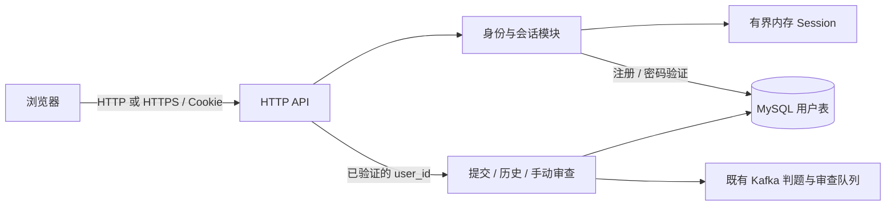

# 用户注册、登录与会话设计

版本：v7。本文定义注册、登录和内存 Session 的精简方案，用户已批准本计划，并要求前后端共同执行输入限制，见[审核记录](d01-review/11-user-authentication-review.md)。分阶段实施任务及实际检查结果见[实施记录](d02-execution/11-user-authentication-execution.md)；现行接口与使用范围见[后端设计](03-backend-design.md)、[数据库设计](02-database-design.md)和[前端设计](05-frontend-design.md)。

## 1. 目标与已确认范围

- 用户信息持久化到 MySQL，Session 保存在后端进程内存，不引入 Redis 或其他外置会话服务。
- 所有用户具有相同功能；保留现有 role、status 字段供以后使用，本轮不启用角色或状态差异。
- 提交记录、判题结果及 LLM 审查仅提交者本人可查看和操作。归属隔离是所有用户共同遵守的规则。
- 新版本全新部署，不要求向下兼容、旧库迁移或历史账号继承。
- 为预置测试用户提供明确的测试密码，在 seed-user 脚本中说明凭据并保存密码哈希。
- 用户名、显示名和密码限制在前后端一致执行；前端复用已有 Element Plus 表单校验能力，提交前提示字段错误并阻止无效请求。
- 未登录用户点击提交、历史等受保护功能时，显示登录要求，建议复用 Element Plus 对话框。
- 单用户会话数超限时淘汰该用户的旧会话，全局超限时淘汰全局旧会话，不因容量满返回错误。
- 用户级和全局会话管理采用哈希索引的期望／均摊 O(1)，使用两套 LRU 顺序索引；过期数据清理允许 O(N)，不通过扫描统计个人会话或查找个人最旧项。
- 服务端按 24 小时闲置超时滑动续期，浏览器使用有效期 24 小时的持久 Cookie 并同步续期；每用户默认 10 条会话、全局默认 10000 条。
- Cookie 的 Secure 属性可配置，默认关闭；部署方按浏览器访问的外部协议选择是否开启，支持反向代理终止 HTTPS。
- 暂不增加登录并发限制或登录失败次数限制；优先复用已有组件，新增测试和检查须事先告知用户。

首轮功能为用户名与密码注册、登录、查询当前身份和退出。注册后由用户手动登录。题目可公开浏览；提交、历史、结果、手动审查及健康接口和页面要求登录。登录提示不替用户发送提交或审查请求。邮箱验证、找回或修改密码、第三方登录和用户管理不纳入本轮。

## 2. 方案评估与架构

当前只有一个活动后端及 Scheduler，内存会话与该部署约束相符。数据库保存账号与业务数据，浏览器只携带不透明的随机 Cookie，后端从内存会话解析身份。



| 方面      | 收益                                       | 代价与适用边界                                             |
| --------- | ------------------------------------------ | ---------------------------------------------------------- |
| 部署      | 复用后端和 MySQL，无额外会话服务           | 后端退出或重启会使全部登录失效                             |
| 请求处理  | 会话校验只查内存，不需要逐请求查用户表     | 需要容量淘汰与过期判断                                     |
| 退出      | 删除当前会话即可阻止后续请求               | 不撤销退出前已经接纳的判题或审查                           |
| 多 Worker | Worker 不参与登录，可继续扩展执行节点      | 多 Worker 不等于多个 HTTP 后端；独立后端不能直接共享登录态 |
| 功能范围  | 所有账号共用一套功能，数据归属规则直接明确 | 没有管理员、禁用账号、密码找回等能力                       |

采用服务端不透明 Session，浏览器持有随机凭据，后端查内存得到用户身份。现有单活动后端和 Scheduler 的部署方式保持不变。

## 3. 用户数据与密码

### 3.1 users 与全新初始化

完整保留现有 users 表和结构版本 4。本轮不需要修改表结构或建立 sessions 表；新版本直接重新部署，不提供旧库迁移或兼容流程。

| 字段                | 用途                                                       |
| ------------------- | ---------------------------------------------------------- |
| id                  | 有符号 BIGINT 自增主键，提交归属继续引用此键               |
| username_normalized | 唯一登录名，保留现有 VARCHAR(255) 唯一索引                 |
| display_name        | 普通展示名称，无权限语义                                   |
| password_hash       | 带算法、参数和随机盐的 Argon2id PHC 字符串                 |
| role                | 保留现有列及约束；注册固定写入 student，本轮不据此区分功能 |
| status              | 保留现有列及约束；注册固定写入 active，本轮不实现停用功能  |
| created_at_ms       | 服务端生成的创建时间                                       |

注册接受 username、password 和可选 display_name，拒绝未定义字段。用户名去掉首尾 ASCII 空白后，要求 3–32 个 ASCII 字母、数字或下划线，并转成小写保存；注册和登录使用同一个规范化函数。显示名默认等于规范化用户名；显式值去掉首尾空白后为 1–64 个 Unicode 标量值，不允许控制字符，不要求唯一。应用限制不扩大数据库原有列预算。

密码长度为 8–128 个 Unicode 标量值、最多 512 UTF-8 字节；允许 Unicode，拒绝空格等 Unicode 空白字符，以 Rust char::is_whitespace 判定。包含空白时直接报输入错误，不裁剪、不静默截断或改写密码；不要求大小写、数字或符号组合。密码由服务端成熟库处理，不由浏览器哈希后代替密码。

长度按 Rust chars().count() 计数：a 和“我”各为一个标量值，a我为两个；组合字符或组合 emoji 可能显示为一个图形但包含多个标量值。前端采用相同计数规则，不能直接把 JavaScript 字符串 length 当作标量数。参见 [Rust char](https://doc.rust-lang.org/std/primitive.char.html)。

预置测试凭据默认采用用户名 test、显示名 Test User、开发密码 Acorn-Test-Only-123!。实施时生成对应 Argon2id 编码写入 [seed-user.sql](../examples/seed-user.sql)，注释说明测试密码；原 student／active 值保留。

后端不配置固定测试用户，启动不检查预置用户。只要结构版本正确，空用户表也可启动并开放注册。预置用户仍可由既有初始化流程创建；是否使用测试数据由部署方选择，正式程序不自动创建账号。手动初始化可省略 seed-user，既有部署脚本的初始化模式仍执行该开发预置。

### 3.2 密码计算与注册竞争

采用 Argon2id，初始基线 m=19456 KiB、t=2、p=1，参数与随机盐随 PHC 字符串保存。实现使用成熟 Argon2 库及操作系统安全随机源；已有依赖若不提供对应能力，再添加所需依赖。基线依据见 [OWASP Password Storage](https://cheatsheetseries.owasp.org/cheatsheets/Password_Storage_Cheat_Sheet.html)。

哈希及验证通过既有 Tokio 的 spawn_blocking 执行，避免占住异步执行线程；计算前释放数据库连接，不跨计算持有事务或 Session 锁。不为登录增加信号量、并发名额或失败计数器。

注册先校验输入、计算哈希，再插入用户。复用数据库唯一索引裁决同名注册；用户名冲突转换为 UsernameTaken，其他数据库错误沿用现有错误处理，不把正常重名误报为致命存储故障。

注册成功只返回公共用户信息，不创建 Session；前端转回登录表单，由用户手动登录。

登录读取哈希后释放连接，再验证密码。用户名不存在和密码不匹配统一返回 InvalidCredentials，数据库故障沿用现有服务错误处理。

## 4. Session 与 HTTP 请求边界

### 4.1 会话内容和生命周期

每次成功登录生成新的 32 字节安全随机 token，复用现有 base64 编码能力，以 base64url 放入 Cookie。内存以 token 为键，保存公共用户信息和最后活动时间；不把 token 写入数据库、日志、URL 或浏览器 Web Storage。

使用全局 LRU 和按用户索引的个人 LRU，共享一把短锁。全局索引保存会话正文，用户索引只保存 token 及其使用顺序：

```text
global: LRU<Token, Session>
by_user: HashMap<UserId, LRU<Token, ()>>
```

两类 LRU 均通过按键索引和双向链表支持直接定位、移动及删除；长度由容器维护。选用支持这些操作的组件，不通过遍历、队列搜索或排序维护顺序。LRU 负责容量淘汰；每次有效认证同时更新最后活动时间，按 24 小时闲置期限实现滑动续期。仅调整 LRU 顺序不会自动实现按时间过期或 Cookie 续期。

查找、访问更新、删除、个人及全局最旧项淘汰按常规哈希索引的期望／均摊 O(1) 定义，均操作固定数量的索引节点；接受普通 HashMap 的哈希及扩容成本，不要求单次操作最坏常数保证。过期项批量清理单独允许 O(N)，N 为缓存会话总数。参见 [Rust 集合复杂度](https://doc.rust-lang.org/std/collections/index.html#cost-of-collection-operations)。

| 项目       | 配置与语义                                                                         |
| ---------- | ---------------------------------------------------------------------------------- |
| 有效期     | 连续 24 小时没有有效认证请求后过期；有效请求更新最后活动时间，完成滑动续期         |
| 时间判断   | 在会话锁内读取单调时钟，计算闲置时长并更新活动时间                                 |
| 浏览器关闭 | 持久 Cookie 可跨浏览器重启保留；服务端会话仍需有效，见第 4.2 节                    |
| 总容量     | 默认最多 10000 条会话记录；启动配置决定上限，进程运行期间固定                      |
| 单用户容量 | 默认最多 10 条会话记录，允许多设备登录；启动配置决定上限                           |
| 清理       | 访问时删除当前过期项；新建会话时从全局 LRU 旧端连续清理过期项，允许 O(N)           |
| 容量耗尽   | 先淘汰该用户最久未使用的会话以满足个人上限，再淘汰全局最久未使用的会话以满足总上限 |
| 退出       | 删除当前 token 对应条目，发送同名、同 Path、同属性的过期 Cookie；其他设备保留登录  |
| 重启       | 不保存或恢复会话；浏览器旧 Cookie 被视为未登录                                     |

有效访问的顺序为：从全局索引查找条目而不调整顺序，判断是否过期；过期则删除该条目，否则更新最后活动时间，并在全局及所属用户的 LRU 中都移到新端。已过期的 token 不能因本次访问重新生效。

成功登录在锁外完成密码验证后，按以下顺序操作会话：

1. 从全局 LRU 最旧端连续删除过期项，遇到第一条未过期会话即停止。
2. 删除本浏览器携带的旧会话（若存在）。
3. 从用户索引直接取得会话数量；已达个人上限则删除该用户 LRU 的最旧项。
4. 此时若全局仍达上限，则删除全局 LRU 的最旧项。
5. 将新会话写入全局索引，并将 token 加入该用户索引，两者均位于最近使用端。

固定上限且每次插入一个会话时，个人与全局各最多淘汰一项。删除、退出、过期和容量淘汰共用同一入口，同步移除两套索引中的 token；用户最后一个会话删除后移除空的用户索引。容量淘汰显式走此入口，不能由某一个容器独自静默淘汰。

容量按实际缓存条目计数，包含尚未清理的过期项；这些条目认证时无效。所有会话使用相同闲置期限，活动时间与 LRU 顺序同步更新，因此过期项集中在全局最旧端。新建时清理 K 个过期项需 O(K)，最坏 O(N)，之后的个人及全局容量处理仍为期望／均摊 O(1)。本轮复用新建会话流程触发自动清理，无需另设定时任务；用户允许 O(N) 清理或定时扫描，不要求引入额外调度。总空间为 O(N)。

被淘汰的浏览器在下一次受保护请求得到 401，并显示登录要求；新登录请求本身不因会话容量满而失败。

登录成功替换本浏览器带来的旧会话，登录失败保留原会话。会话表的短锁不跨数据库、密码计算或网络等待。未访问的过期条目可以暂留内存，但不会通过认证，总容量仍受 LRU 约束。

活动按服务端收到的有效认证请求计算，结果或健康页面的自动轮询也算活动；这不代表鼠标、键盘活动。不新增前端心跳或用户操作跟踪。后端重启丢失全部 Session。

会话校验只决定请求接纳身份。已经接纳的提交、短事务和手动审查保留不可变 user_id，遵循既有独立于 HTTP 等待者的生命周期。退出、过期或浏览器取消都不取消这些操作，也不改变判题结果。

### 4.2 Cookie、同源与 CSRF

保持现有前端与 API 同源代理部署。http.public_origin 必填，必须为规范 HTTP(S) Origin，不含路径、末尾斜线、凭据、查询或片段；写请求按该字符串精确比较。布尔配置 http.cookie_secure 默认 false，省略时也按 false 处理：

```toml
[http]
public_origin = "http://127.0.0.1:8080"
cookie_secure = false

[auth]
max_sessions_per_user = 10
max_sessions = 10_000
```

[auth] 及其中容量字段可省略，使用上述默认值；两个容量均须为正。经 Vite 访问时 public_origin 使用实际浏览器 Origin，例如 http://localhost:5173，主机名和端口须完全一致。HTTP 命令行示例按所选配置发送 Origin。

使用有效期为 24 小时的持久 Cookie，Max-Age 为 86400 秒。默认配置下的示例如下：

```http
Set-Cookie: acorn_session=<token>; Path=/; HttpOnly; SameSite=Lax; Max-Age=86400
```

开启 http.cookie_secure 后，Cookie 名称使用 __Host-acorn_session，并添加 Secure；关闭时使用 acorn_session，不添加此前缀或 Secure。两种配置均保留 Path=/、HttpOnly、SameSite=Lax，不设置 Domain；设置、读取和清除 Cookie 使用同一配置。

配置依据是浏览器访问网站的外部协议：HTTP 部署保持 false，HTTPS 部署可显式设为 true。浏览器通过 HTTPS 访问反向代理、代理通过 HTTP 连接后端时，同样可以开启 Secure，后端无需直接提供 HTTPS；该选项由部署配置决定。public_origin 也填写浏览器访问的外部 Origin。

HttpOnly 禁止页面脚本直接读取 Cookie，Secure 要求浏览器通过 HTTPS 发送，SameSite=Lax 限制跨站请求携带 Cookie。参见 [OWASP Session Management](https://cheatsheetseries.owasp.org/cheatsheets/Session_Management_Cheat_Sheet.html)和 [MDN Cookie 属性与前缀](https://developer.mozilla.org/en-US/docs/Web/HTTP/Reference/Headers/Set-Cookie#cookie_prefixes)。

普通有效认证请求更新服务端活动时间，并在响应中对当前 token 重设 Max-Age=86400；续期沿用原 token，不重新验证密码或创建会话。登录响应设置新 token，退出响应以 Max-Age=0 清除 Cookie。Cookie 可跨浏览器重启保留，不增加“记住我”选项；服务端的超时、淘汰、退出和重启独立决定 Session 是否有效。参见 [MDN Set-Cookie](https://developer.mozilla.org/en-US/docs/Web/HTTP/Reference/Headers/Set-Cookie)。

注册、登录、退出、提交和手动审查继续使用 JSON POST；后端要求 Origin 与配置的 public_origin 精确匹配，缺失、null 或不匹配时拒绝。现有同源部署不开放跨域凭据 CORS；命令行调用显式发送 Origin 并使用 Cookie jar。来源校验用于防止其他网站借用浏览器 Cookie 发起写操作，见 [OWASP CSRF Prevention](https://cheatsheetseries.owasp.org/cheatsheets/Cross-Site_Request_Forgery_Prevention_Cheat_Sheet.html)。

复用现有日志入口，不记录密码、Cookie 或认证请求正文。认证及个人数据响应带 Cache-Control: no-store。

### 4.3 请求处理与复用

请求体大小直接复用现有 http.max_request_bytes 和 Axum DefaultBodyLimit，不增加独立 4 KiB 上限。用户名、显示名和密码按第 3.1 节校验；JSON 解析与错误返回复用现有 HTTP 组件。

本轮不增加登录并发限制、失败次数限制或注册频率限制。既有判题与审查容量规则保持不变。

## 5. API 与个人数据归属

### 5.1 认证接口

| 接口                       | 输入／结果                                                              |
| -------------------------- | ----------------------------------------------------------------------- |
| POST /api/v1/auth/register | username、password、可选 display_name；201 返回 user，不自动登录        |
| POST /api/v1/auth/login    | username、password；200 返回 user，同时设置新 Cookie                    |
| GET /api/v1/auth/me        | 200 返回 user；无有效会话时 user 为 null                                |
| POST /api/v1/auth/logout   | JSON 空对象；200 返回 user 为 null，并清除当前会话 Cookie；已退出也成功 |

公共用户指可返回浏览器的 id、username、display_name，不表示公开所有用户。登录、注册不接受指定 user_id、role 或 status；保留字段由服务端填写。退出返回 200 加 JSON，可直接复用现有 requestJson，无需为 204 空响应新增解析分支。

沿用现有 JSON 错误结构：密码不匹配为 401 InvalidCredentials，未登录为 401 AuthenticationRequired，用户名重复为 409 UsernameTaken，来源不符为 403 RequestOriginRejected，页面预期身份不符为 409 SessionChanged。401 响应同时携带 WWW-Authenticate: Session realm="acorn"；Session 为本应用的挑战名称，实际凭据仍由 Cookie 提供。状态码采用 HTTP 定义，业务错误名为项目自定义。

未登录访问受保护接口返回 401 AuthenticationRequired；查找不存在或属于他人的提交统一返回 404 SubmissionNotFound。身份校验在业务接纳和参数涉及的数据库查询之前完成，前端路由守卫不代替后端校验。

### 5.2 对现有业务的改动

| 业务             | 改动                                                                                                                 |
| ---------------- | -------------------------------------------------------------------------------------------------------------------- |
| 创建提交         | AuthenticatedUser 提供不可变 user_id，随创建请求进入 CreationService 和数据库；不能由请求体覆盖                      |
| 创建幂等         | 保持 UNIQUE(user_id, create_request_key)，所有查重及竞争重读显式使用认证用户；不同用户可以独立使用相同 UUID          |
| 提交历史         | SQL 按认证用户 user_id 过滤                                                                                          |
| 提交详情         | HTTP 专用读取在同一 SQL 使用 id 与 user_id，避免查到其他用户详情再由页面隐藏                                         |
| 手动审查         | 将 user_id 传入独立短操作；接纳事务的 SELECT FOR UPDATE 同时匹配 id 与 user_id，在读取已有审查和状态之前完成归属限制 |
| Kafka 与自动审查 | 继续以提交 ID 处理可信内部任务，不依赖浏览器 Session；重启恢复覆盖全部用户，不按当前登录者筛选                       |
| 健康查询         | 登录后可查，不要求 X-Acorn-User-Id；所有用户一致，不引入管理员检查                                                   |

HTTP 的用户限定查询与内部 Scheduler／审查查询明确区分命名和调用入口。Worker、Kafka 消息和模型输入无需携带 Session、密码或新的用户信息。

为防止多个标签页共用 Cookie 时旧页面混用新账号的数据，个人提交查询、创建提交、手动审查和有效会话退出要求 X-Acorn-User-Id 等于当前已验证会话的 user_id。它只表达页面预期身份，不赋予身份；不匹配返回 409 SessionChanged，未执行业务操作。auth/me 不要求预期身份，供首次加载和账号变化时确认当前身份。登录成功后前端更新身份再发业务请求。

## 6. 前端交互与本地数据

复用 Element Plus 对话框与表单提供统一登录／注册入口，导航显示当前用户和退出按钮。未登录用户点击提交、历史等受保护功能时弹出登录要求，取消后留在原页面；直接访问受保护链接时同样提示且不展示私有数据。后端仍执行登录检查。

登录与注册表单共同执行第 3.1 节的输入规则：用户名规范化、必填和允许字符，密码长度、UTF-8 字节数及禁止空白；注册表单还校验可选显示名。复用 Element Plus ElForm／ElFormItem 的 rules、字段错误提示和提交前 validate()；基本规则使用现成功能，Unicode 标量计数、字节数和与后端一致的空白判定通过表单的自定义 validator 补充。避免仅依赖输入框 maxlength 或默认字符串长度校验。表单校验失败时显示对应字段错误，不发送认证请求；后端仍独立校验相同规则。

应用启动调用 auth/me，使用现有请求组件处理身份加载和错误。认证失效或过期时复用同一登录提示，不新增独立跳转恢复机制。登录过程保留答题页当前编辑内容；登录成功后由用户再次点击提交，不自动发送代码。

认证失效时暂停结果及健康轮询，保存当前账号的草稿、收起其私有数据并引导登录；已保存的判题和审查继续运行。重新登录后先查询当前状态，不自动重放提交或审查 POST。

收到 SessionChanged 时同样停止旧页面操作并重新读取 auth/me，确认身份后重建对应页面；不得把旧账号的待提交内容直接发送为新账号的提交。

本地数据必须随账号隔离：

- 草稿和最后语言的存储键增加 user_id；退出时补存草稿并销毁编辑器，重新登录同一账号可恢复。
- 待确认提交快照也包含 owner_user_id，sessionStorage 按用户分键。仅同一账号可使用原键原内容手动重试，其他账号不展示或发送该快照。
- 当前无用户维度的旧本地存储格式不自动分配给新账号；读取入口更换版本，不做迁移或通用清理。
- 退出或身份变化取消旧请求、轮询和定时器，以身份代次忽略迟到响应，并清空私有页面内存数据。
- 旧标签页的个人请求若携带过时的预期用户，按第 5.2 节重新确认身份；不新增跨标签页广播系统。

按账号分键是应用层隔离，不加密浏览器草稿；共用浏览器配置文件或开发者工具仍能读取本地存储。页面保留现有本地草稿说明，Session token 不写入这些存储。

## 7. 实施拆分与文档同步

| 编号 | 工作                                                                       | 主要依赖 |
| ---- | -------------------------------------------------------------------------- | -------- |
| U01  | 复用 users 和结构版本 4、预置测试密码、用户查询与创建、Argon2id            | 无       |
| U02  | 内存会话淘汰及超时、Cookie 与 Secure 配置、认证接口与来源校验              | U01      |
| U03  | 当前身份接入创建／历史／详情／手动审查，移除测试用户配置，保留内部恢复职责 | U02      |
| U04  | 登录／注册对话框、身份状态、登录要求提示、草稿和待重试请求隔离             | U02、U03 |
| U05  | 全新部署、必要的定向验收与使用说明；新增测试或检查事先说明                 | U01–U04  |

新增后端模块以 auth 和 database/users 为主，Session 存储与认证边界集中实现，沿用既有 HTTP、SQLx 连接池和错误响应方式。前端在现有 API 客户端及 Vue composable 中管理身份，不引入全局状态框架或通用权限引擎。

实施时同步数据库、后端、前端、审查及健康接口的相关设计，更新初始化说明、开发账号及归属说明和中英文使用文档。沿用既有部署脚本，不添加迁移、热修复或升级框架。旧实施记录保留当时事实。

各目标的可执行步骤、依赖和完成条件见[开发清单](d02-execution/11-user-authentication-execution.md#3-开发清单)。沿用 U01–U05，并以 U01.1 等子编号追踪；完成改动及相应检查后在实施记录勾选，实际结果和遗留问题也记录于该文件。参数及交互选择见[实施前决策](d02-execution/11-user-authentication-execution.md#2-实施前决策)，决定依据见[审核记录](d01-review/11-user-authentication-review.md)。

## 8. 验收要求

优先复用现有测试和浏览器流程，只验证本轮新增功能：账号注册／登录／退出、约定的会话续期与淘汰、两用户数据隔离，以及未登录点击时的登录提示。登录及注册的前端表单与后端执行相同输入限制，前端对无效字段给出提示并阻止请求。新用户可以完成原有判题和审查流程。

新增测试用例或检查前，先告知用户覆盖内容及必要性，不预先要求完整测试矩阵。Rust 和前端代码实际改动时执行仓库已规定的格式、编译、Clippy 及相关检查；纯文档调整只检查改动文档的格式、链接和编号。
