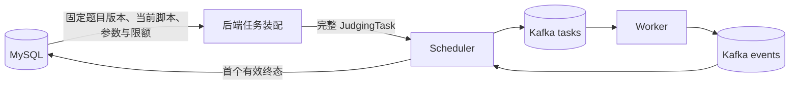

# Python 判题脚本设计

版本：v1。本文定义统一 Python 答案校验、数据库与任务增量、文件协议、沙箱复用、资源和错误归因，以及实施任务和验收要求。实施状态与实际检查见[实施记录](d02-execution/13-checker-scripts-execution.md)。

本篇定义脚本判题的完整合同。结构版本 5、任务字段与装配合同同步见[数据库](02-database-design.md)、[后端](03-backend-design.md)和 [Kafka](10-kafka-judging-design.md)设计；[Worker 设计](01-worker-design.md)区分任务接纳与现行执行流程。统一脚本执行及同提交沙箱复用按第 7 节分阶段接入，实际交付范围见实施记录。

## 1. 目标与范围

- 继续采用标准输入／标准输出答题，支持现有 C、Python 单文件提交。
- 所有答案校验统一为 Python 脚本，包括原 trim、浮点比较和题目专用校验。
- 预设与专用脚本共用 checker_scripts，同等引用和执行；用户提交不能指定或覆盖 checker。
- 后端装配完整任务，Scheduler 通过 Kafka 派发，Worker 执行；Worker 不访问数据库。
- 用户程序与 checker 串行执行，通过文件交接数据，各自的沙箱在同一提交内跨用例复用。
- 题目与脚本直接在数据库维护，不新增发布工具、上传 API 或管理页面。
- 按全新部署实施，更新完整初始化 SQL 和结构版本，不提供旧库转换或旧消息兼容流程。

HTTP 认证、个人提交隔离、幂等创建、Kafka 首个有效终态、首败短路与 LLM 审查规约保持不变。LLM 仍读取原始提交源码、语言、固定版本公开题面和机器 verdict，不取得 checker 源码、隐藏用例、参考答案或私有参数，见[LLM 输入合同](08-llm-code-review-design.md#61-输入)。

## 2. 数据模型与源码副本

### 2.1 脚本与题目版本

数据库结构版本为 5，沿用[MySQL 字段表示](02-database-design.md#2-字段表示)、字符集和短事务合同。

checker_scripts：

| 字段   | 表示与用途                                              |
| ------ | ------------------------------------------------------- |
| id     | 有符号 BIGINT AUTO_INCREMENT PRIMARY KEY，脚本记录身份  |
| name   | 非空 LONGTEXT，维护者可读名称，不作为执行分支或文件路径 |
| source | 非空 LONGBLOB，UTF-8 Python 源码；内容可修改            |

problem_versions 删除 comparison_mode，增加：

| 字段                 | 表示与用途                                             |
| -------------------- | ------------------------------------------------------ |
| checker_script_id    | 非空 BIGINT 外键，引用 checker_scripts(id)             |
| checker_config_json  | 非空 LONGTEXT JSON 对象，默认 {}；保存该版本的脚本参数 |
| checker_cpu_time_ms  | 可空 BIGINT，非空时为正值，覆盖 checker CPU 限额       |
| checker_wall_time_ms | 可空 BIGINT，非空时为正值，覆盖 checker 墙钟限额       |
| checker_memory_kib   | 可空 BIGINT，非空时为正值，覆盖 checker 内存限额       |

脚本外键采用 ON DELETE RESTRICT、ON UPDATE RESTRICT，不对 checker_script_id 建立 UNIQUE。外键所需索引按现行 InnoDB 合同建立，不重复增加相同前缀索引。

脚本参数的键、类型、默认值和语义由各脚本定义。后端与 Worker 校验 JSON 对象及字节预算，不实现通用参数 Schema 或比较模式枚举。trim 使用 {}，浮点参数见第 6.2 节。参数不承载 Worker 资源限额、命令、宿主路径或挂载选项。

维护题目版本、语言限额、用例和发布指针时继续遵守现有数据事务合同。脚本 source 可直接 UPDATE，包括已经被引用的记录；不要求为源码修改新增脚本 ID 或题目版本。

### 2.2 装配时取得源码

后端装配任务时读取脚本源码、题目参数和有效 checker 限额，随完整任务交接。每个任务的所有用例使用任务内同一份源码与参数副本。

数据库随后修改脚本，不改变已装配到 Scheduler 内存或 Kafka 消息中的内容。修改共享记录会影响所有引用它、此后才装配的任务。queued 在重启或重交接中确实需要重新装配时，读取当时的源码；Kafka 重放同一消息仍使用消息中的副本。

接受装配期间的变更窗口，不增加版本锁、内容摘要、二次读取或源码历史表。脚本 ID 表示记录身份，固定题目版本不保证不同提交取得相同的 checker 源码。

### 2.3 用例数据

现有 test_cases 与 TestCase 的逐例结构保持不变：

| 字段            | 含义                                  |
| --------------- | ------------------------------------- |
| input           | 用户程序的题目输入，允许为空          |
| expected_output | 参考输出或 checker 辅助数据，允许为空 |

参考数据可以是完整输出、最优值等辅助信息，也可以由专用脚本忽略。output.bin 来自本次用户程序的 stdout，不写入题库 cases。用例顺序、连续序号、数量及单项字节上限沿用现有合同。

脚本、参数与 checker 限额属于 Job 级数据，不在每个 case 重复发送。

## 3. 任务装配与消息

### 3.1 后端职责

新提交在创建操作中装配完整 JudgingTask，Scheduler 不为同一新任务再次读取题库。queued 重交接和启动装入按提交固定版本装配；dispatching、running 只恢复等待状态，继续接收 Kafka 事件。



读取与必要写入使用既有短数据库操作，连接和事务不跨 Kafka 等待或脚本执行。普通题目 HTTP 查询不返回脚本源码、私有参数或 checker 限额；公开误差要求写入题面。

### 3.2 Proto 增量

按[现有生成流程](../crates/protocol/README.md)扩展 SubmitJobRequest，保留现有字段号：

```proto
message SubmitJobRequest {
  string job_id = 1;
  string language_id = 2;
  bytes source = 3;
  repeated TestCase cases = 4;
  RunLimits run_limits = 5;
  bytes checker_source = 6;
  string checker_config_json = 7;
  CheckerLimits checker_limits = 8;
}

message CheckerLimits {
  optional uint64 cpu_time_ms = 1;
  optional uint64 wall_time_ms = 2;
  optional uint64 memory_kib = 3;
}
```

checker_limits 消息必须存在；其内部字段缺失表示该项未设限，存在时必须为正值并能转换为沙箱所用数值。空的 CheckerLimits 表示三个项目均未设限。用户程序的 RunLimits 继续要求正值并遵守现有 max_run 上限，不将其 0 值改为无限额。

缺少 checker 源码、参数不为 JSON 对象、缺少 checker_limits 或超出任务预算，属于 InvalidJob。合法脚本的语法错误和运行异常按第 4.3 节归为 CheckerFailed。

TestCase、GetJobReply、JudgeResult、FailedCase 和资源字段的结构保持不变，gRPC 仍只提供只读状态。后端结果类型和校验器接纳 CheckerFailed，并沿用现有机器失败保存流程。

checker 执行沿用 CHECKING 阶段，不增加新的 phase。取得本例 AC／WA 后才推进 completed_cases；checker 自身故障保留先前已裁决数量。

### 3.3 字节预算

后端和 Worker 使用相同的新增任务预算默认值：

| 项目                      | 配置字段与默认值                                                                |
| ------------------------- | ------------------------------------------------------------------------------- |
| checker 源码              | request.checker_source_max_bytes = 65536                                        |
| checker 参数的 UTF-8 文本 | request.checker_config_max_bytes = 16384                                        |
| 原始任务合计              | 在既有 payload_max_bytes 中计入用户源码、各例输入与参考数据、checker 源码和参数 |

每项执行对应的非空、UTF-8、JSON 形状和字节预算校验。源码的 Python 语义由解释器处理，不在接纳时执行脚本。

Protobuf 编码后的完整任务继续受 Kafka max_task_record_bytes 与两端收发预算约束。保留现有消息预算校验与可配置门限，初始化部署时对齐后端、Worker 和 broker 配置。

## 4. 脚本协议

### 4.1 输入

使用 Worker 配置的 Python 解释器和固定参数：

```text
python3 -I -B -S checker.py input.bin answer.bin output.bin config.json
```

| 入口                 | 内容                                     |
| -------------------- | ---------------------------------------- |
| checker.py           | 任务携带的脚本源码副本                   |
| argv[1]：input.bin   | 当前用例原始题目输入                     |
| argv[2]：answer.bin  | 当前用例参考输出或辅助数据，允许为空     |
| argv[3]：output.bin  | 用户程序正常结束后取得的 stdout 原始字节 |
| argv[4]：config.json | 题目版本参数，UTF-8 JSON 对象            |
| stdin                | 空输入                                   |

用户提交仍按标准输入／标准输出编写。Worker 将当前题目输入提供给用户 stdin，持续收集有界 stdout/stderr，将 stdout 保存为本次执行的受控文件。用户程序进程树结束后，向 checker 环境提供 output.bin，不要求提交源码主动打开这些固定文件名。

文件交接继续执行现有用户输出上限：超限立即停止并判 OLE，不以截断后的输出继续校验。输出文件属于 Worker 管理的 Job 上下文，不从用户指定的宿主路径读取。

### 4.2 输出与诊断

脚本成功完成判断时，AC 和 WA 均以实际退出码 0 结束；stdout 只包含一个 UTF-8 JSON 对象：

```json
{ "verdict": "AC" }
```

唯一字段为 verdict，值必须是 AC 或 WA。拒绝缺失、重复或未知字段、非对象、空输出、多个 JSON 值和混入调试文字；允许 JSON 首尾空白。

| 项目        | Worker 配置与处理                                                                              |
| ----------- | ---------------------------------------------------------------------------------------------- |
| 结果 stdout | checker.result_max_bytes = 4096；超限停止并形成 CheckerFailed，不解析截断前缀                  |
| 诊断 stderr | checker.diagnostic_max_bytes = 65536；超过保存上限继续排空并标记截断，不因诊断较长改变校验结论 |

Worker 等待 checker 退出、进程树停止并完成输出收集后，才接受 JSON 判断。提前输出 AC 后异常退出、超限或被停止，不能形成 AC。

checker stdout/stderr 原文不进入 Kafka 终态、HTTP DTO 或 LLM 输入。Worker 在内部失败日志中记录运行事实和最多 4096 UTF-8 字节（4 KiB）的 stderr 摘要，供维护者排查。stderr 仅通过日志摘要保留，全文不持久化；运行期间收集的数据随 Job 收尾释放。JobFailure.diagnostic 仅包含用例序号与稳定故障原因，例如“Checker failed for case 3: exit code 1.”，继续遵守既有 512 UTF-8 字节上限。

### 4.3 结果归因

| 执行事实                                                     | 处理                                                      |
| ------------------------------------------------------------ | --------------------------------------------------------- |
| 用户编译错误或编译限额触发                                   | 原 CE，不运行用户用例或 checker                           |
| 用户运行已确认 MLE、OLE、TLE、RE                             | 原结论，不运行 checker                                    |
| checker 无超限、无信号退出，实际退出码 0，合法 JSON 为 AC    | 本例 AC，继续下一例                                       |
| checker 无超限、无信号退出，实际退出码 0，合法 JSON 为 WA    | 本例 WA，首败短路                                         |
| checker 语法错误、异常、非零退出、独立限额触发或结果协议错误 | JobFailure / CheckerFailed                                |
| 初始化、文件准备、启动、停止或收集等基础设施错误             | 沿用 PreparationFailed、SandboxError 等相应故障           |
| Job 总期限、Worker 停机或停止未确认                          | 沿用 JobDeadlineExceeded、WorkerShutdown、StopUnconfirmed |

Worker 从 Isolate 元数据取得脚本实际退出码。用户输出格式或数值非法是脚本的正常 WA 分支；脚本配置、参考数据错误与未捕获异常属于 checker 故障，不能伪装成 WA。

WA 仍返回当前用户程序的输出、退出事实和资源字段；checker 消耗不合并到用户统计。checker 故障保存为 failed，不计作本例得到 AC／WA 裁决；先前已裁决用例数保持不变。

## 5. 沙箱与资源

### 5.1 同一提交内复用

每个 Job 保留用户运行环境和 checker 环境，各自初始化一次并跨用例复用。两个环境具有隔离的文件可见范围、Isolate box ID 和控制组；即使串行执行，也不让参考答案、checker 源码或私有配置进入用户环境。

沿用 sandbox.box_id 承担编译和用户运行，新增 sandbox.checker_box_id 指定 checker 环境。两者必须不同，且与同机其他 Worker 的 ID 均不冲突。C 编译按原独立阶段初始化、执行、导出及清理，之后才初始化持久至本 Job 结束的用户运行环境。checker 环境在第一次需要校验时初始化。

每例依次完成用户执行、停止确认、输出保存、checker 执行与停止确认。每次启动新的进程，Python 解释器进程不跨用例复用。

固定程序、输入、参考与配置文件从任务私有副本重新放置；输出、JSON 结果和诊断文件执行前清空。复用环境中的同名条目可能由用户留下，重新放置必须使用受控常规文件复制，不跟随残留链接；无法准备时显式形成执行故障。用户自行创建的其他文件可在同一提交内保留，继续受该环境的文件大小、磁盘与 inode 配额约束。

用户程序副本的修改不影响 Worker 私有源码或编译产物，也不影响下一例重新放置的固定程序。不同 Job 重新初始化环境，不跨提交沿用工作文件。

### 5.2 checker 限额

后端对 CPU、墙钟和内存逐项计算有效值：

1. 题目版本提供显式 checker 覆盖值时使用该值。
2. 否则取同版本 Python 语言的相应限额。
3. 没有 Python 语言限额时，该项不设限。

这只是默认值来源，不要求验证开销小于求解开销。checker 的有限值必须为正且能由沙箱表示；用户程序 max_run 门限仍只约束用户运行，不自动给 checker 未设限项添加预算。

checker 不使用用户程序执行后的剩余额度，解释器启动计入 checker 自己的运行。未设限仅取消对应 checker CPU、墙钟或内存限制；输出预算和沙箱隔离、进程数、FD、磁盘等既有配置仍生效。

沿用 execution.job_wall_time_ms 和接纳时建立的一份绝对期限，覆盖编译、初始化、所有用户运行、checker 校验及收尾。未设 checker 独立墙钟限额也不能超出 Job 总期限；总期限到达形成 JobDeadlineExceeded，不归为用户 TLE 或 CheckerFailed。用例切换和 checker 启动都不延长期限。

### 5.3 复用的计量语义与释放

接受控制组文件缓存和历史内存峰值跨用例保留。CPU 时间按本次 Isolate --run 的起始累计值扣除；内存使用实际返回的 cg-mem，可能含同一用户运行环境此前用例留下的峰值，不对逐例峰值求和。checker 环境的缓存与内存不计入用户环境。

FailedCase.resources 的结构和单位不变；CPU、墙钟仍是本次用户运行，peak_memory_bytes 表示当前用户运行环境观测到的历史峰值，不承诺仅由失败用例产生。HTTP 与结果页面同步说明该语义，不能继续标为失败用例独占内存消耗。依据见 [Isolate 手册](https://www.ucw.cz/isolate/isolate.1.html)及[控制组实现](https://github.com/ioi/isolate/blob/master/cg.c)。

正常或错误终止共用 Job 收尾：活动进程树确认停止后清理两个环境和私有文件，再释放执行位置。已停止环境清理失败只记录警告；停止未确认时保留仍可能使用的环境与执行占用，发布相应故障并继续沿用 BLOCKED、状态 RPC、结果交接和部署端处置合同。新增 checker 不改变这些边界。

### 5.4 配置职责

后端和 Worker 同步新增 checker 源码及参数的请求预算；Worker 新增 checker_box_id 和结果、诊断保存预算。各字段默认值由第 3.3、4.2 节定义，示例配置为：

```toml
[request]
checker_source_max_bytes = 65_536
checker_config_max_bytes = 16_384

[checker]
result_max_bytes = 4_096
diagnostic_max_bytes = 65_536

[sandbox]
box_id = 0
checker_box_id = 1
```

以上仅列本次增量。各 Worker 的 box ID 由部署配置分配；多个 Worker 可使用 0／1、2／3 等互不冲突的组合。其他运行、停止、清理、Kafka 和结果预算继续使用现有配置，实施时同步配置校验、示例和部署说明。

## 6. 预设脚本与示例题

### 6.1 trim

忽略整个输出末尾的 HT、LF、VT、FF、CR、SPACE，内部字节保持原样，与现有规则一致。脚本不需要参数，使用 {}。

```python
import json
import sys
from pathlib import Path

trailing = b"\t\n\v\f\r "
actual = Path(sys.argv[3]).read_bytes()
expected = Path(sys.argv[2]).read_bytes()

verdict = "AC" if actual.rstrip(trailing) == expected.rstrip(trailing) else "WA"
print(json.dumps({"verdict": verdict}))
```

脚本正常结束自然返回 0。初始两数求和题继续使用原 104 个用例，改为引用该脚本。

### 6.2 浮点比较

使用 bytes.split() 按连续 ASCII 空白划分数值项，要求用户与参考输出项数相同。每项通过 Python float 解析，支持其小数和科学记数法形式，只接受有限数值。用户输出项数不符、解析失败、NaN 或无穷大时为 WA；参考数据不能解析或不是有限数值时为 CheckerFailed。

配置支持 abs_tol 和 rel_tol，缺省均为 1e-6。参数必须是有限的非负数值，布尔值不作为数值；rel_tol 必须小于 1，未知参数或非法值视为配置错误。逐项使用 math.isclose：

```text
abs(actual - expected)
    <= max(abs_tol, rel_tol * max(abs(actual), abs(expected)))
```

所有项满足才为 AC；行数和小数位数不单独限制。公开题面说明这套容差规则。算法依据见 [bytes.split](https://docs.python.org/3/library/stdtypes.html#bytes.split)和 [math.isclose](https://docs.python.org/3/library/math.html#math.isclose)。

新增“计算两个整数的商”示例题：每例输入整数 a、b，-1000000 <= a <= 1000000，1 <= b <= 1000000，输出 a / b。允许 C、Python，初始化时写入与两数求和示例题相同的语言预算，配置两项容差为 1e-6，参考文件保存一个数值。用例包含零、负值、循环小数、大小不同的数量级，展示不同合法数值格式均可通过。

### 6.3 题目专用脚本

专用脚本使用相同数据表、文件参数、JSON 结果和沙箱，不增加 custom 模式枚举。最小开发夹具输入整数 n >= 3，要求输出两个正整数 x、y，满足 x + y = n；脚本读取 input.bin 与 output.bin 判断，answer.bin 为空。用两份不同合法输出和一份非法输出验收多解及 WA 分支。

题库数据和脚本通过直接数据库操作维护。仓库中的 .py 是编写材料，数据库中装配时取得的源码决定任务行为；Worker 不按 name 查找本机文件，也不回退到内置比较器。

## 7. 实施任务

| 编号 | 工作                                                          | 依赖与完成条件                                                                 |
| ---- | ------------------------------------------------------------- | ------------------------------------------------------------------------------ |
| PS01 | MySQL 结构版本 5、脚本表、版本引用／参数／限额覆盖与存储类型  | 全新初始化可用，comparison_mode 移除；保留现有题目、提交和审查约束             |
| PS02 | Proto 与生成代码、完整任务装配、可选限额解析及两端预算        | 依赖 PS01；新建、queued 重交接和启动装入均携带同一合同的数据                   |
| PS03 | Isolate 环境生命周期、两个 box ID、文件输入输出及可选执行限额 | 依赖 PS02；同 Job 复用、跨 Job 初始化、进程停止与公共清理完整衔接              |
| PS04 | checker 阶段、JSON 解析、故障归因与结果展示说明               | 依赖 PS02、PS03；用户错误与 checker 故障区分，内存统计语义准确，LLM 输入不扩展 |
| PS05 | trim／浮点预设、示例题与完整初始化和使用说明                  | 依赖 PS01、PS04；现有两数求和、浮点题和专用多解样例按新协议运行                |
| PS06 | 定向检查、真实联调与交付记录                                  | 依赖 PS01–PS05；第 8 节必要验收通过，失败与未测范围如实保留                    |

PS01–PS05 实施时同步受影响的设计、调用方、配置、SQL／协议说明、数据库夹具和部署初始化入口。修改 Proto 后使用现有 Cargo／Prost 生成流程，不手改生成代码；不提供新旧两套判题路径。

## 8. 验收要求

| 编号 | 必要覆盖                                                                                                                        |
| ---- | ------------------------------------------------------------------------------------------------------------------------------- |
| CV01 | trim 保留末尾 ASCII 空白语义，内部空白差异仍为 WA；两数求和 C／Python 真实判题通过                                              |
| CV02 | 浮点题接受不同合法小数格式，容差内／外判断准确；项数、非法数和非有限值分别按合同处理                                            |
| CV03 | 专用脚本接受至少两份不同合法答案，非法用户输出为 WA，参考数据或参数错误为 CheckerFailed                                         |
| CV04 | 退出码 0 与唯一合法 JSON 共同成立才接受结果；空输出、协议错误、结果超限及输出 AC 后异常均不伪装成功；诊断不直接返回答题者       |
| CV05 | 装配后的源码不随数据库修改变化，重新装配读取当前源码；同一脚本可被多题版本引用，参数仍按题目版本取得                            |
| CV06 | Python 默认限额、题目覆盖与无默认来源时不设限生效；Job 总期限始终覆盖 checker，用户运行限额不被放宽                             |
| CV07 | 同 Job 复用两类隔离环境、每例重新启动进程与清空固定输出，跨 Job 重新初始化；用户和 checker 的资源及文件不混用，接受历史内存峰值 |
| CV08 | 新任务预算与 Kafka 编码预算一致，完成一次真实 Kafka → Worker／Isolate → MySQL 流程；历史、结果及 LLM 既有输入合同保持可用       |

优先扩展现有协议、数据库、Worker、workflow 与前端检查，覆盖本次明确变更，不扩展为完整故障矩阵。新增具体用例或检查前按仓库要求说明覆盖与必要性。

Rust 代码实施时执行既有格式、受影响模块编译、相关测试，以及 cargo clippy --workspace --all-targets --locked -- -D warnings。前端实际改动时使用既有 pnpm 检查与必要浏览器定向检查。纯文档定稿仅检查格式、编号和本地链接；实际结果写入实施记录。
